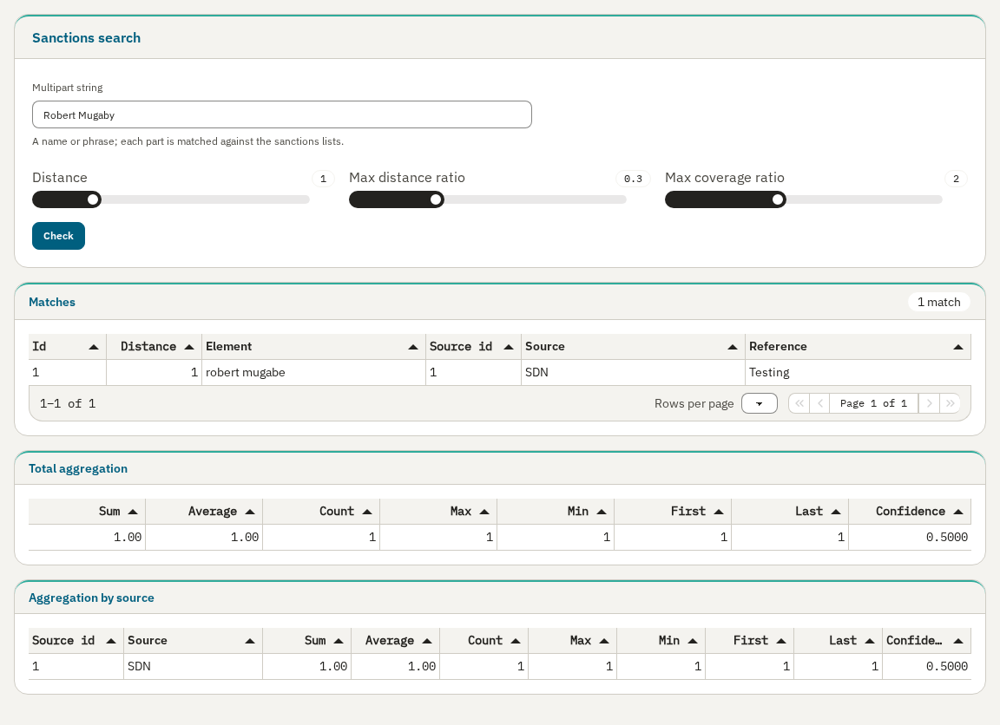

# Sanction Searching

Sanction searching answers the question: does this name appear on a sanctions list, allowing for the name having been misspelled, reordered or written a little differently. A name is typed, the lists held by the engine are compared with it, and every listed name that is close enough is returned together with a number stating how close it is.

The Sanctions page in Jube exists for the purposes of performing manual sanction name matching against the entries loaded by the engine.

The Sanctions page uses the matching functionality available to the engine and is therefore exactly the same functionality available in model invocation in real time, as described in [Sanction Model Invocation](../SanctionModelInvocation/index.html).

Subject to the EnableSanction Environment Variable being set to the string "True", which is the default, the thread will be started to support the aforementioned. The thread should be started on all servers that require online recall of sanctions, either directly or via model invocation:

```text
EnableSanction=True
```

| Value          | Description                                              | Example |
|----------------|----------------------------------------------------------|---------|
| EnableSanction | A flag indicating if sanctions is enabled in the engine. | True    |

In the default installation of Jube there is only a single Sanction record, by name "Robert Mugabe", although Jube supports the remote updating of sanctions from a variety of sources on the internet, as described in [Sanctions Loader](../SanctionsLoader/index.html).

## Where it lives

Manual Sanction invocation is available from the top level of the menu, at Sanctions. The page presents a form headed Sanctions search, with the results beneath it once a search has been made.

The search made is held in the address of the browser, such that a search can be bookmarked or shared, taking the form `/sanctions?q=Robert+Mugabe&d=1`. The distance (`d`), the max distance ratio (`r`) and the max coverage ratio (`c`) are held in the address only where they differ from their defaults.

SHOT id=sanctions-searching-results
     route=/sanctions?q=Robert+Mugaby&d=1
     steps=wait-for:Total aggregation
     frame=page
     state=the Sanctions page with the Multipart string Robert Mugaby and a Distance of 1 having been checked, the Matches grid showing the robert mugabe entry at a distance of 1 with its source and reference, and the Total aggregation and Aggregation by source grids beneath
     conveys=a search returns the matching entries with their distance, alongside every aggregation in total and by source
     alt=The Sanctions page showing the search form with a multipart string and three sliders, a Matches grid with one entry at distance 1, and two aggregation grids listing sum, average, count, max, min, first, last and confidence



## Multipart strings and distance

Sanctions matching in Jube uses a concept of a multipart string, which is to say that a string (most likely a name) may be comprised of several elements (for example a first name and a last name), separated by a space character (and only a space character).

A multipart string in Jube makes no distinction in the order in which strings are presented, such that first then last name would be the same as last then first name for the purposes of matching.

The concept of distance is the implementation of the Levenshtein Distance algorithm, being the number of characters that would need to be changed to achieve an absolutely perfect match.

Consider the following table, which evaluates the multipart string "Robert Mugabe":

| Multipart String | Distance                                                    |
|------------------|-------------------------------------------------------------|
| Robert Mugabe    | 0 characters need be changed to achieve perfect match.      |
| Robert Mugaby    | 1 character need be changed to achieve a perfect match.     |
| Robert Fugaby    | 2 characters need to be changed to achieve a perfect match. |

A distance is henceforth read as follows: 0 is an exact match, 1 or 2 is a near match of the kind a typing error or an alternative spelling produces, and the larger the number the weaker the resemblance. Lower is closer.

## How a match is decided

Three terms are needed before the sliders of the form can be understood. A token is one part of a multipart string, once cleaned as described under Splitting and cleaning, such that Robert Mugabe is two tokens. The distance ratio limits how many changes a single token may bear in proportion to its length. The coverage ratio is the number of tokens in the searched string divided by the number of tokens in the listed entry, and guards against a short name being matched to a much longer one, or the reverse.

For each listed entry the comparison proceeds as follows:

* The coverage ratio is calculated. The entry is passed over where the ratio is below 0.5, which is fixed, or above the Max coverage ratio. Searching for Mugabe alone against the entry robert mugabe gives 1 token against 2, a ratio of 0.5, which is allowed; against an entry of three tokens it gives 0.33, and the entry is passed over.
* Each token of the searched string, the longest first, is paired with the closest token of the entry not yet paired. The number of pairs sought is the smaller of the two token counts.
* Each pair must be within a number of changes that is the lesser of the Distance and the length of the shorter token of the pair multiplied by the Max distance ratio (rounded down, yet never less than 1). At the default ratio of 0.3 a token of up to six characters may bear 1 change, a token of seven to nine characters 2 changes, and a token of ten characters or more 3, whatever larger Distance has been asked for.
* Where every pair is within its bound, the entry is a match, and the distance reported for the entry is the worst distance among its pairs, not their sum.

It follows that the three examples of the table above do not all return a result at the defaults. Robert Mugabe matches at a distance of 0 and Robert Mugaby at a distance of 1. Robert Fugaby, however, asks for 2 changes of the six character token mugabe, which at a Max distance ratio of 0.3 may bear only 1, and nothing is returned even with Distance at 2; upon moving Max distance ratio to 0.4, the same search returns robert mugabe at a distance of 2. The ratio exists for exactly this purpose, as two changes in a short name make it, more often than not, a different name.

## Fields

The Sanctions search form takes the parameters described in the following table, the latter three being sliders:

| Value              | Description                                                                                                                                                                                                                                                                                           | Example       |
|--------------------|-------------------------------------------------------------------------------------------------------------------------------------------------------------------------------------------------------------------------------------------------------------------------------------------------------|---------------|
| Multipart string   | The multipart string to be checked against sanctions, where strings are separated by a space character (and nothing else).                                                                                                                                                                            | Robert Mugabe |
| Distance           | The maximum distance to be checked for and returned by the Levenshtein distance algorithm. Results will not be returned where this threshold, being the number of characters required to be changed for a match, has been exceeded. The slider runs from 0 to 5, and is 2 by default.                | 1             |
| Max distance ratio | Scales down the allowed distance in proportion to the shorter token being compared, such that short tokens cannot match too loosely. The slider runs from 0 to 1, and is 0.3 by default, being the default of the SanctionsLevenshteinMaxDistanceRatio Environment Variable.                          | 0.3           |
| Max coverage ratio | Rejects a candidate whose token count differs too greatly from the token count of the searched string. The slider runs from 0 to 5, and is 2 by default, being the default of the SanctionsLevenshteinMaxCoverageRatio Environment Variable.                                                         | 2             |

The Distance and Max coverage ratio sliders move in steps of 1 and the Max distance ratio slider in steps of 0.1, with the value presently chosen written beside each. Beneath the Multipart string the form states: A name or phrase; each part is matched against the sanctions lists.

The search is made upon clicking Check, or pressing Enter in the Multipart string, neither of which is available until a multipart string of something other than spaces has been entered. Moving a slider does not of itself repeat the search. While the search is under way the button reads Checking and cannot be pressed again. Until a search has been made the page states, beneath the form: Enter a name or phrase to search for.

To broaden the allowable distance, it is a simple matter of moving the Distance slider to the new threshold, although keeping in mind that this will greatly increase false positives.

## Results

The results are presented in a manner friendly to the end user, in three grids:

| Grid                  | Description                                                                                                                                              |
|-----------------------|----------------------------------------------------------------------------------------------------------------------------------------------------------|
| Matches               | The raw matches, 20 to a page, with the columns Id, Distance, Element (the listed name as matched), Source id, Source and Reference, and a count of the matches. |
| Total aggregation     | A single row, being the grand total across every source, with the columns Sum, Average, Count, Max, Min, First, Last and Confidence.                    |
| Aggregation by source | A row for each source having matched, with Source id and Source ahead of the same aggregation columns.                                                   |

Every aggregation mode is returned together on every search, rather than a single mode having to be selected beforehand, and what each one means is described in [Aggregation Type and Confidence](../SanctionModelInvocation/index.html#aggregation-type-and-confidence).

The count beside the heading of Matches reads No matches, 1 match or the number of matches. Sum and Average are shown to two decimal places, Confidence to four, and the remaining aggregations as whole numbers. The aggregations are read in two directions: Sum, Average, Max, Min, First and Last are distances, for which lower is closer, whereas Confidence runs from 0 to 1 and higher is the stronger match. An exact match on a single entry is henceforth a Min of 0 and a Confidence of 1.

Where the search ran and nothing matched, the page states: The search ran and nothing matched. Widen the distance or the ratios to match more loosely. A refused search is shown as an error instead, never as an empty result. The three grids are still drawn, each reading No sanctions entries matched.

A search that was refused in validation is shown as an error headed The search was refused: with the reasons returned by the server beneath it, a search by a user lacking the permission is answered You do not have permission to search sanctions., and any other failure as The search could not be completed.

Names are isolated from the surrounding text in the Matches grid, such that an entry in a script reading from right to left is displayed correctly inside a page reading from left to right, and vice versa.

## Validation

The values are validated in the server, and a failure is a 400 with the standard validation body, being the same structure the user interface shows for any form. A search is rejected where:

* The multipart string is empty, is longer than 500 characters once trimmed, or contains a NUL character.
* Distance, where given, is not a whole number from 0 to 50.
* Max Distance Ratio, where given, is not a number from 0 to 1.
* Max Coverage Ratio, where given, is not a number from 0 to 100.

Not a number, infinity and negative values are refused. Through the API, an absent Distance is taken as 0 and an absent ratio takes its server wide default, whereas the page always sends all four values. It can be seen that the API accepts a wider range of Distance and Max Coverage Ratio than the sliders of the page offer.

## Example

The Sanction functionality is exposed in the Invoke API, the user interface being a fascia of it, and the Check button compiles and sends the following GET statement to the Jube Engine on the server side:

```http
GET https://localhost:5001/api/Invoke/Sanction?multiPartString=Robert+Mugabe&distance=2&maxDistanceRatio=0.3&maxCoverageRatio=2
```

Returning the following response payload, being a grand total and an aggregation breakdown by source alongside the raw matches, rather than a bare array of matches as in earlier versions:

```json
{
  "aggregations": {
    "total": {
      "sum": 0, "average": 0, "count": 1, "max": 0, "min": 0,
      "first": 0, "last": 0, "confidence": 1.0
    },
    "bySource": [
      {
        "sourceId": 1, "sourceName": "SDN",
        "sum": 0, "average": 0, "count": 1, "max": 0, "min": 0,
        "first": 0, "last": 0, "confidence": 1.0
      }
    ]
  },
  "entries": [
    {
      "id": 1,
      "value": "robert mugabe",
      "sanctionEntrySourceId": 1,
      "source": "SDN",
      "reference": "Testing",
      "distance": 0
    }
  ]
}
```

In this example, across all Sanctions lists, it can be seen that one record has been returned as matching, with the distance to an absolute match being 0 characters requiring change.

To demonstrate distance, the multipart string is changed to "Robert Mugaby" (a deliberate misspelling by one character in the surname Mugabe) and the search repeated. It can be seen that a match is still achieved, this time with a distance of 1, which indicates that one character needs to be changed in order to achieve an exact match:

```json
"entries": [
  {
    "id": 1,
    "value": "robert mugabe",
    "sanctionEntrySourceId": 1,
    "source": "SDN",
    "reference": "Testing",
    "distance": 1
  }
]
```

The endpoint answers 404 when the `EnablePublicInvokeController` Environment Variable is False, and 503 until the engine has finished starting.

## The matching process

There is some additional processing beyond the use of the Levenshtein Distance algorithm that is worth noting. The Sanctions functionality is an implementation of the Levenshtein Distance algorithm, which compares strings (for example Richard against Gichard) and returns an integer value specifying the number of characters that have to be changed in order for the two strings to be absolutely matched (1 in this example). The purpose of fuzzy matching in the realm of Sanctions checking is to detect the scenario where names are subtly changed by error, by deliberate action or for cultural reasons (Mohammed, for example, has several possible spellings in practice).

The Sanctions process takes the Multipart String that has been passed in the query string in the first instance (for example Robert Mugabe). The multipart string takes each name component separated by a space, where the order of the name components does not matter, which is to say that Mugabe Robert is identical to Robert Mugabe for the purposes of the processing of sanctions matches. The distance query string parameter is important to limit the return to only records that have a certain match quality, where only a small number of characters need to be changed in order for a match to be achieved. All Sanctions lists are held in the memory of the engine to assure fast response times. Although the Levenshtein Distance algorithm exists outside the scope of this document, as it is a pure implementation, it is explained in more detail as follows:

[https://en.wikipedia.org/wiki/Levenshtein_distance](https://en.wikipedia.org/wiki/Levenshtein_distance)

### Splitting and cleaning

The first step in the sanctions processing is to break the Multipart string passed into component parts as an array. For example, the string Robert Mugabe would be broken into two strings, Robert and Mugabe, for the purposes of matching. During the breaking of the multipart string, each string will be cleaned, replacing characters based on the following dictionary (currently hard coded):

| Value            | Description                                                                                                                                              |
|------------------|----------------------------------------------------------------------------------------------------------------------------------------------------------|
| ,                | Removed.                                                                                                                                                 |
| - and .          | Replaced with a space, such that hyphenated or abbreviated name components are still split into separate tokens.                                         |
| ' (apostrophe)   | Removed outright (for example O'Brien becomes OBrien) rather than treated as a token boundary.                                                           |
| " " (i.e. space) | Removed, keeping in mind that it should have been split on this value in any event, it serves to remove the curious instance of double space in a string. |

Accented characters are also normalised (diacritics stripped) and everything is lower-cased before comparison, such that "Müller" and "Muller" tokenise identically.

After splitting and cleaning, any token that is a single character, or that matches an entry in the server wide Stop Token list, is dropped from both the searched string and every sanction entry before matching. Stop tokens are common honorific and religious or cultural titles (for example, titles equivalent to "Sheikh" or "Imam" that are common in some naming conventions), so that a name written with such a title compares correctly against a list entry that omits it, and vice versa, without the extra token itself counting against the match. Stop tokens are seeded via a database migration rather than being administrable from this page, as described in [Sanctions Loader](../SanctionsLoader/index.html#stop-tokens).

### Stepping through the entries

The routine now has a list of strings that need to be matched against the sanctions loaded to memory, keeping in mind that the components of the multipart string (Robert and Mugabe) will need to be matched with each component of the sanction entry (for example Robert AND Gabriel AND Mugabe). The reason multipart strings are broken into components for both the request (what the user has provided to be tested) and the file entries is to assure a rigorous matching analysis, without the user being required to perform several searches with subtle changes to the multipart string.

For each Sanctions entry available in the memory of the engine, the process will step through each entry one by one. The process will be repeated in a step wise fashion depending upon the maximum distance that has been specified in the request. For example, if the user has passed a value that the maximum distance to be considered is five, then there will be five iterations of sanctions checking, with any matches being recorded alongside the distance threshold that yielded a match. For each Sanction Entry, for each distance step, each component of the multipart string passed by the user will be tested against each component element of the Sanction Entry. The component entries are broken out of the multipart string during the load to save processing time, and are referenced distinctly, only once, in this process (for example Richard David Richard would be tested as Richard David). When processing values for the multipart string, either passed by the end user or available in memory from the sanctions loader, it is done so on a distinct basis.

For each component of the multipart string passed by the user, it is tested against each component part of the sanctions entry using the Levenshtein distance algorithm, which returns an integer detailing the number of characters that need to be changed in order for the comparison to be a perfect match. If the distance is within the value specified in the query string parameter from the user, the multipart string element is recorded as having matched in a buffer. The process is repeated until each multipart string element passed by the user is tested against each multipart string element from the sanctions loader (and thus in the memory of the engine).

The list is tokenised and folded once, when an entry is loaded or replaced, and kept with the entry in memory, so a search only folds the searched string.

### Unicode handling

Before comparison both the searched string and every entry are folded in the same manner: compatibility forms are normalised (full-width Latin letters, ligatures, Arabic presentation forms), combining marks are removed (accents, Arabic short vowels), zero-width and bidirectional control characters are removed, other white space becomes a space, and the text is lower-cased. Latin, Cyrillic, Greek, Arabic, Georgian and Devanagari are compared letter for letter in their own script.

Lookalike letters are folded identically when the list is loaded and when a search or model lookup is made. Within a word, if every letter is either Latin or a Cyrillic or Greek letter that looks like a Latin one (for example Cyrillic a, e, o, p, c, x, y or Greek alpha, omicron, nu), the lookalikes are replaced by their Latin letters, such that a Cyrillic or Greek lookalike spelling of a listed Latin name is found at the same distance as the Latin spelling. A word containing any letter that has no Latin lookalike (for example Cyrillic g, d, l or Greek final sigma), and every Arabic, Urdu, Georgian and Devanagari word, is left exactly as written. Digits that resemble letters (0 and O, 1 and l) are not folded.

Transliteration between scripts (Arabic or Cyrillic to Latin) is a separate feature and is not performed by the search, henceforth a Cyrillic or Arabic spelling will not match a Latin list entry. Transliteration of Cyrillic and Greek is available to a sanction check in model invocation, as described in [Sanction Model Invocation](../SanctionModelInvocation/index.html#match-algorithm-and-transliteration).

## Limits

Searches are limited for each user, to 300 in each 60 seconds by default, as set by the `SanctionSearchMaxPerUserPerWindow` and `SanctionSearchWindowSeconds` Environment Variables and counted in each server process, and a search answers 429 when the limit is exceeded.

At most `SanctionSearchMaxEntries` (1000 by default) matching entries are returned, the closest first. The aggregations are always computed over every match, so the count can exceed the number of rows listed.

## Permissions and security

Searching requires permission 29, View Sanction, in addition to being signed in. It is this permission that presents the Sanctions menu item, and a caller without it receives 403 from the Invoke API, as well as the message on the page that they do not have permission to search sanctions.

Sanction lists are reference data shared by every tenant, so a result is not scoped to a tenant.
