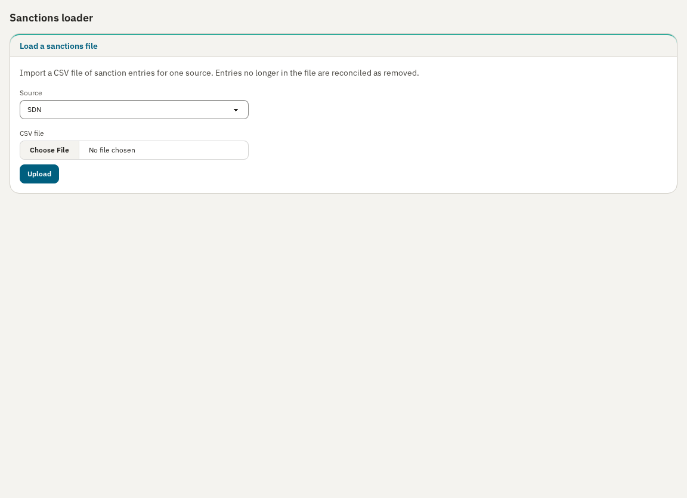

# Sanctions Loader

Sanctions are published by various bodies and provide a list of names for which business is prohibited. The functionality offered by Jube allows the loading of Sanctions lists into the engine for matching using fuzzy logic (Levenshtein Distance) to create matches. Jube also allows this matching to be embedded into the Entity Analysis Model recall in real time. Sanctions data is stored in the engine, in memory, so as to assure that the recall is extremely fast.

Sanctions requires the EnableSanction Environment Variable being set to True, which is the default:

```text
EnableSanction=True
```

On the enabling of sanctions, a thread will be started. This thread should be started on all servers that require online recall of sanctions, either directly or via model invocation.

## Where it lives

There are two means by which a sanctions file reaches the engine. The automatic loader polls the locations specified for each source, and is configured by Environment Variables and in the database, there being no page to edit a source. A file can also be uploaded by hand, by navigating through the menu to Administration, then Sanctions loader, which is available to the landlord only and is described in Manual upload below.

## Sources

There are many different types of sanctions file available, published by the EU, US, UN and so on. The specification of sanctions files is stored in the SanctionEntrySource database table, with the name, delimiter and several mappings detailed later in the loading process:

```sql
select * from "SanctionEntrySource"
```

By default there are four file definitions in place, alongside their locations on the internet:

* US Office Of Foreign Assets Control (OFAC) Specially Designated National (SDN).
* Bank of England (BOE) Sanctions.
* European Union (EU) Sanctions.
* US Office Of Foreign Assets Control (OFAC) Specially Designated National (SDN) alternative names.

The seeded Bank of England (BOE) definition reads the UK Sanctions List: the file starts with a report date line and a header line (Skip 2), the name is spread across the Name 6 and Name 1 to Name 5 columns (MultiPartStringIndex 4 to 9) and the reference is the Unique ID column (ReferenceIndex 1). The seeded alternative names definition reads the comma delimited OFAC alt.csv, taking the alias from column 3 and the SDN entity number from column 0 as the reference. Both definitions were corrected by a migration that only rewrites a definition still carrying the original seeded values, so a definition changed by hand is left alone. For the corrected BOE definition the migration also soft deletes the entries built from the old column mapping, and the next load inserts them again from the correct columns.

## Fields

New entries to the SanctionEntrySource table are accepted as the following definition:

| Value                     | Description                                                                                                                                                                                                                                 | Example                                         |
|---------------------------|---------------------------------------------------------------------------------------------------------------------------------------------------------------------------------------------------------------------------------------------|-------------------------------------------------|
| Name                      | The reference for the sanctions source.                                                                                                                                                                                                     | SDN                                             |
| Severity                  | An integer number to express notional severity.                                                                                                                                                                                             | 1                                               |
| Directory Location        | In the absence of internet or HTTP polling, the local file system directory to poll for the same file. All files in the directory will be consumed. Intended for use only on the basis that security disallows access to the HTTP resource. | /Sanctions/SDN                                  |
| Delimiter                 | The delimiter separating the fields in the file.                                                                                                                                                                                            | ,                                               |
| Multipart String Index    | The zero based field location for the multipart string. In the event of many elements needing to be concatenated, the locations are separated with a comma, whereby the concatenation will be separated by a space.                         | 1                                               |
| Reference Index           | The zero based field location for the reference of the entry.                                                                                                                                                                               | 0                                               |
| Enable Directory Location | A bit value to instruct polling of a Directory Location for new files.                                                                                                                                                                      | 0                                               |
| Enable HTTP Location      | A bit value to instruct polling of a HTTP location for the latest file.                                                                                                                                                                     | 1                                               |
| HTTP Location             | The location to poll for current sanctions files.                                                                                                                                                                                           | https://www.treasury.gov/ofac/downloads/sdn.csv |
| Skip                      | The first rows to skip on account of having header data.                                                                                                                                                                                    | 0                                               |
| AliasIndex                | Optional. The zero based column holding other names of the same entity. Each alias is loaded as its own entry with the same reference as the entity, so a match on any name identifies the entity.                                          | 3                                               |
| AliasSeparator            | Optional. The text that separates the aliases inside the AliasIndex column. A semicolon when AliasIndex is set and this is empty.                                                                                                           | ;                                               |
| FilterIndex               | Optional. The zero based column on which to filter rows, for example the entity type.                                                                                                                                                       | 1                                               |
| FilterValues              | Optional. Comma separated values of the FilterIndex column that are loaded, compared without regard to case. Any other row is not loaded, and an entry loaded earlier for such a row is removed at the next load. Empty loads every row.    | Person,Organization                             |

Sources are configured only in the database, so the download address is controlled by the operator and never by a tenant. Sanction entries and sources carry no tenant: they are reference data owned by the landlord and shared by every tenant, and only a landlord user can list sources or upload a file. There is no manual entry of sanctions at the level of the tenant.

## The automatic loader

To enable the loading process, the following Environment Variables need to be set:

| Value                          | Description                                                                                                                                                                                                                                                                                                                                                                                             | Example |
|--------------------------------|---------------------------------------------------------------------------------------------------------------------------------------------------------------------------------------------------------------------------------------------------------------------------------------------------------------------------------------------------------------------------------------------------------|---------|
| EnableSanctionLoader           | A flag indicating if sanctions should be loaded via this instance of the engine and inserted into the SanctionEntry database table, noting that this table will be synchronised to memory. It is False by default.                                                                                                                                                                                      | True    |
| SanctionLoaderWait             | Interval in milliseconds between polling and synchronising new sanctions files, being 3600000 (one hour) by default. A key concept is regular polling of the official locations with a view to perpetual validation and merging of the new records with the database.                                                                                                                                  | 60000   |
| EnableSanctionLoaderChangePoll | True (the default) enables the check described under SanctionLoaderChangePoll. False restores a single wait of SanctionLoaderWait. It is independent of EnableSanctionLoader, which only gates the loading of the HTTP and directory sources.                                                                                                                                                          | True    |
| SanctionLoaderChangePoll       | Interval in milliseconds (60000, one minute, by default) at which the engine checks the import audit for a new import, such as an upload from the user interface, and refreshes the sanctions cache straight away, such that a new list is searchable within seconds rather than after SanctionLoaderWait. A missing, non numeric, zero or negative value is read as 60000. Nothing is downloaded by this check. | 60000   |

```text
EnableSanctionLoader=True
SanctionLoaderWait=60000
```

By default the sanctions loader process is disabled, so as not to make connections to the internet without explicit instruction by the end user. Via Migration, there is only a single example sanction, for Robert Mugabe, loaded by default for the purposes of documentation and training.

In enabling the Environment Variables for the loader, the files will be loaded and their contents inserted into the SanctionEntry database table:

```sql
select *
from "SanctionEntry"
```

The SanctionEntry database table is the initial target for the synchronisation on loading of the instance. On perpetual processing of sanctions files the entries will be merged. An entry is validated by creating an MD5 hash of the source, the multipart string value and the reference, taken together, then checking its existence in the SanctionEntry database table, and thereafter, if new, adding it to both the SanctionEntry database table and the in memory copy of it. It follows that a changed name or reference for what is otherwise the same entry produces a different hash, and is treated as a new entry rather than an update to the old one.

## Import and rejection audit trail

Every run of the loader, for every SanctionEntrySource in turn, records a SanctionEntryImport row describing what happened: the total rows read, and how many were Inserted, Revived, Unchanged, Removed and Rejected, along with whether the run was Successful and, if not, the error message. Individual bad rows are recorded to SanctionEntryRejection with the row number, the raw data and a rejection ReasonId, rather than only failing the run as a whole:

| ReasonId | Meaning                                                                                                                      |
|----------|------------------------------------------------------------------------------------------------------------------------------|
| 1        | InsufficientFields, where the row did not contain enough delimited fields to be parsed.                                      |
| 2        | NoReferenceIndexConfigured, where the SanctionEntrySource has no Reference Index configured, so no reference could be extracted. |
| 3        | ParseError, where an unexpected error occurred while parsing the row.                                                        |

Only the ReasonId is stored, and not the underlying exception message, as rows sharing the same mode of failure would otherwise duplicate near identical free text with no real diagnostic gain over the ReasonId itself.

The four outcomes recorded for each entry are:

| Outcome   | Meaning                                                                                                                                                                                                                                                                                                                                                             |
|-----------|---------------------------------------------------------------------------------------------------------------------------------------------------------------------------------------------------------------------------------------------------------------------------------------------------------------------------------------------------------------------|
| Inserted  | The hash of the entry was not previously seen for this source, being a brand new row.                                                                                                                                                                                                                                                                               |
| Unchanged | The hash of the entry matches an existing, active row, and no write is made.                                                                                                                                                                                                                                                                                        |
| Revived   | The hash of the entry matches an existing row that had previously been soft deleted (see below). The row is restored in place rather than inserted again, so its Id is preserved.                                                                                                                                                                                  |
| Removed   | An existing active entry for this source was not present in the file of this run at all, and is soft deleted (SanctionEntry.Deleted, DeletedDate and DeletedUser being set) rather than physically removed. If a file produces zero rows at all, removal is skipped entirely for that run, such that a broken or empty download cannot delete the entries of a source en masse. |

Because Removed entries are soft deleted rather than physically deleted, an entry that disappears from a published list and later reappears (Revived) keeps its original Id and any history associated with it, rather than starting over as a new row.

## Manual upload

In addition to the automatic polling loader above, the file of a source can be uploaded by hand from Administration, then Sanctions loader. This is useful where a source only publishes on an ad hoc basis, or where outbound internet access from the Jube servers is restricted and files are instead obtained and vetted out of band before being loaded.

The page presents a single panel, headed Load a sanctions file, with the following:

| Value    | Description                                                                                                       | Example |
|----------|-------------------------------------------------------------------------------------------------------------------|---------|
| Source   | The source for which the file is to be loaded, selected from the sources in the SanctionEntrySource table.        | SDN     |
| CSV file | The file to load. Only a file with the `.csv` extension can be chosen, and an empty file is refused in the page. | sdn.csv |

Beneath the heading the panel states: Import a CSV file of sanction entries for one source. Entries no longer in the file are reconciled as removed. The Source is set at first to the first of the sources, and the file cannot be sent until a source is selected. The file is sent upon clicking Upload, which reads Uploading… for as long as the file is in transit. The page itself refuses to send, with the reason beside the file, where no file has been chosen (Choose a file first.), where the file has another extension (Only .csv files can be uploaded.) and where the file is empty (The chosen file is empty.).

Upon the upload completing, the page confirms the name of the file as Loaded (the name of the file)., otherwise the reason for the failure returned by the server is presented, or The file could not be loaded. where no reason was given. A confirmation is replaced by the failure of a later upload, and the reverse. A user who is not the landlord, on opening the address directly, is presented with the message Only the landlord can load sanctions files. in place of the Source and the file.

By way of example, a file of two lines, `1001,Ivan Petrov` and `1002,Maria Gonzales`, uploaded for a source whose Delimiter is a comma, Reference Index is 0, Multipart String Index is 1 and Skip is 0, records an import of two rows Inserted. Within the minute, a search for Ivan Petrof in the [Sanctions](../SanctionSearching/index.html) page returns ivan petrov at a distance of 1 with a Reference of 1001. Uploading the same file again records two rows Unchanged, and uploading a file holding only the first line records one Unchanged and one Removed, whereupon maria gonzales ceases to be found.

SHOT id=sanctions-loader-manual-upload
     route=/administration/sanctions-loader
     steps=none
     frame=page
     state=the Sanctions loader page signed in as the landlord, showing the Load a sanctions file panel with the Source selector listing the seeded sources and the CSV file chooser
     conveys=a file is loaded by hand for one source at a time, from a single small panel
     alt=The Sanctions loader page with a panel headed Load a sanctions file, holding a Source selector and a CSV file chooser



Manual upload shares the same import path as the automatic loader described above, which is to say the same hash based reconciliation of Inserted, Unchanged, Revived and Removed, and the same SanctionEntryImport and SanctionEntryRejection audit rows being written. It follows that a file uploaded by hand behaves identically to one picked up automatically, except that CreatedUser on the resulting audit trail records the name of the signed in user rather than the background loader.

The search reads the in memory copy of the engine, so a successful upload is searchable once that copy has been refreshed. Between full loader cycles (every SanctionLoaderWait, hourly by default) the engine checks the successful imports in SanctionEntryImport every SanctionLoaderChangePoll (one minute by default). When a new successful import is seen, it reloads the stop tokens and the entries and brings the memory copy into line with the database in both directions: new entries are added, and entries that have been removed or soft deleted (for example because the new file no longer contains them) leave memory too. A failed import, or a source that answered an error, does not change the copy.

## Stop Tokens

Before matching, common honorific and religious or cultural titles, being tokens such as those equivalent to "Sheikh" or "Imam" that are common in some naming conventions, are stripped from both the searched string and every sanction entry, so that including or omitting such a title does not itself affect whether names match. The list of stop tokens lives in the SanctionStopToken database table, seeded with an illustrative starting set via migration, and is loaded into memory at the start of every loader cycle alongside sanction entries and files. The memory copy follows the table in both directions: a token that is added or whose category changes takes effect, and a token that is deleted from the table stops being applied, on the next cycle, without a restart.

## Download policy and safety limits

The automatic loader downloads each HTTP Location through the same outbound host policy used by web hooks and case hooks, as described in [Outbound Host Policy](../../Administration/OutboundHostPolicy/index.html): only http and https, no user information in the URL, and every address the host name resolves to is checked at connection time, so a source that resolves to a loopback, private, link-local or cloud metadata address is refused unless the operator has allowed it with `JUBE_HOOK_ALLOWED_HOSTS` or `JUBE_HOOK_ALLOWED_CIDRS`. Redirects are followed by the loader itself, at most five, and each hop is checked against the same policy, which keeps the real OFAC address (it redirects) working while preventing a redirect into the internal network. TLS certificates are validated and the environment proxy is not used, hence a site that must egress through a proxy cannot make use of the HTTP Location, and should instead use the Directory Location or the manual upload.

| Limit                | Value                                                                                                          | Behaviour when exceeded                                                                                        |
|----------------------|----------------------------------------------------------------------------------------------------------------|----------------------------------------------------------------------------------------------------------------|
| Download size        | 128 MiB                                                                                                        | The download is abandoned, the import is recorded as unsuccessful and nothing is delisted.                     |
| Download time        | 5 minutes in total                                                                                             | As above.                                                                                                      |
| Rows in one file     | 5,000,000                                                                                                      | Reading stops, the import is recorded as unsuccessful and nothing is delisted.                                 |
| Manual upload size   | 64 MiB                                                                                                         | The upload is refused with a validation error and no import row is written.                                    |
| Delisting in one run | A run that would remove more than half of the active entries of a source (sources with at least 100 active entries) | Removal is skipped and a warning logged, although additions still apply. A truncated or wrong file is the likely cause. |

An import whose file could not be read to the end (a dropped connection, an unreadable file) is recorded with Successful 0 and never removes entries, and a manual upload that ends in this manner is shown as an error rather than as loaded. The list files are CSV and are read by a delimited text parser: no XML or archive is ever opened, henceforth XML external entities, entity expansion, zip-slip and decompression bombs do not apply. A download is held in memory in full, within the 128 MiB limit, which a very large export can exceed.

## Loading a list with aliases and a mix of entity types

Many lists put each entity on one row with its other names together in one column. An OpenSanctions export in the simple CSV format, for example, has the columns `id, schema, name, aliases, birth_date, countries, addresses, identifiers, sanctions, phones, emails, dataset, first_seen, last_seen, last_change`, with the aliases separated by semicolons and the `schema` column saying whether the row is a Person, an Organization, a Vessel and so on. Such a list is described by one row in SanctionEntrySource:

| Value                | Setting               |
|----------------------|-----------------------|
| Delimiter            | `,`                   |
| MultiPartStringIndex | `2` (name)            |
| ReferenceIndex       | `0` (id)              |
| Skip                 | `1` (header)          |
| AliasIndex           | `3` (aliases)         |
| AliasSeparator       | `;`                   |
| FilterIndex          | `1` (schema)          |
| FilterValues         | `Person,Organization` |

Politically exposed persons are carried in such lists as ordinary Person rows, and are screened exactly as any other entry is. Which list is loaded, and what the deployer is licensed to load, decides whether PEPs are screened at all, keeping in mind that the licence of any list is for the deployer to check: the OpenSanctions data, for example, is not free for commercial use, and this page neither grants nor implies a licence.

It should be noted that an alias reducing to a single token, because the remainder are initials of one letter (such as "I. Petrov"), matches any name containing that surname at a distance of zero.

## Permissions and security

Listing the sources and uploading a file are available to the landlord only, and no permission grants them. The menu entry is hidden from every other user, and the server refuses the request of anyone who is not a landlord, whatever permissions that user holds. An upload from a cookie session also needs the antiforgery token.
