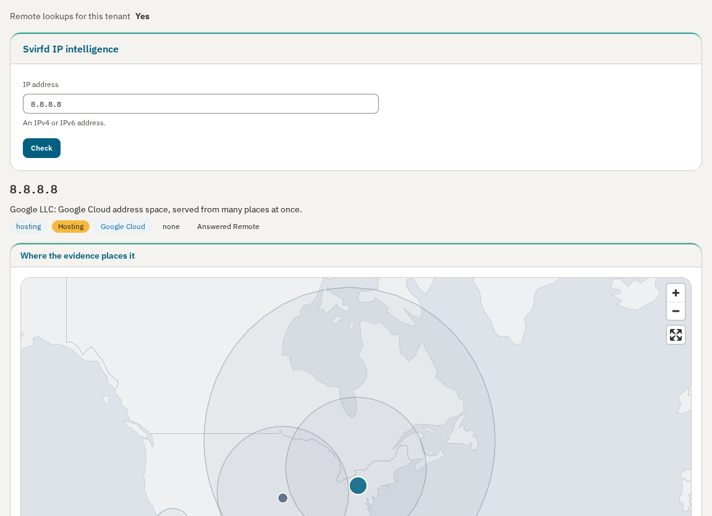

# Svirfd

The Svirfd page looks up any IPv4 or IPv6 address and presents the full IP intelligence record from [svirfd.com](https://svirfd.com), which is to say who announces the address, where it is and how sure the record is of that, the evidence behind the city, the VPN, Tor and relay lists, the cloud and connection type, what traceroutes have observed and a narrative in plain English.

The page exists for the purposes of looking up an address on an ad hoc basis, by hand. Looking addresses up automatically during the invocation of a model, such that the record is available to rules, is a matter of model configuration and is described in [Svirfd on a model](../Models/Svirfd/index.html).

## Where it lives

Navigate through the menu to Svirfd, being an item of the main menu. The page presents a panel titled Svirfd IP intelligence, having a box labelled IP address and a Check button, beneath which the record is presented upon an address having been checked. Until then the page reads Enter an IP address to see its record.

The address checked is kept in the address of the browser, taking the form `/svirfd?ip=8.8.8.8`, and it follows that a result can be shared as a link, the lookup being made again upon the link being opened.

## Terms

The question the page answers is plain enough: given the address a transaction came from, who is behind that address, where is it, and how far is that to be believed. The record answers in the vocabulary of internet routing, the terms of which are as follows:

| Term                 | Meaning                                                                                                                                                                                       |
|----------------------|-----------------------------------------------------------------------------------------------------------------------------------------------------------------------------------------------|
| AS, or AS number     | An Autonomous System, being one network operator (an internet provider, a cloud, a company) as known to the internet at large. The AS number is its identifier, for example AS15169 for Google. |
| Prefix               | A block of adjoining addresses announced together, written as an address and a length, for example 8.8.8.0/24. The Announced prefix is the block within which the address falls.               |
| Origin, and upstream | The origin is the AS announcing the prefix, and the upstream is the AS through which it reaches the rest of the internet.                                                                      |
| Registry             | One of the five regional bodies that allocate addresses to operators. What the registry records is who holds a range, which is not of necessity where it is used.                              |
| RPKI                 | A cryptographic statement by the holder of a prefix of which AS may announce it. Valid means the announcement agrees with it, invalid that it does not, which is a mark of a hijacked or misconfigured route. |
| Round trip time      | The time, in milliseconds, for a message to reach the address and return. As nothing travels faster than light, a short round trip from a known place bounds how far away the address can be.  |
| Probe, and vantage   | A measuring point at a known place from which a round trip time was taken.                                                                                                                     |
| Anycast              | One address answered from many places at once, as the public DNS resolvers are, such that it has no single location.                                                                           |
| Bogon                | An address that ought not to appear on the public internet at all, being private, reserved or unallocated.                                                                                     |

The worked example is 8.8.8.8, the public DNS resolver of Google, which is safe to look up and returns a full record: typing 8.8.8.8 and clicking Check presents a record whose Network section names Google as the Operator with AS number 15169, whose Routing section gives 8.8.8.0/24 as the Announced prefix, and whose Observed section shows Anycast as Yes, which is the reason its City is to be read with caution.

## The record

The record is headed by the address and a single line summary, alongside badges for the network type, any VPN, Tor, relay or similar claim, the cloud provider, the confidence in the city, and the mode in which the lookup was answered. Thereafter the record is arranged as follows:

| Part                            | Description                                                                                                                                                 |
|---------------------------------|-------------------------------------------------------------------------------------------------------------------------------------------------------------|
| Where the evidence places it    | A map drawing the located point, the round-trip bound of every probe as a ring, the hubs of the operator, and the data centres considered.                  |
| Round trip time against distance | A chart, drawn in the server, of the round trip times measured against the distance of each vantage point.                                                 |
| In plain English                | The narrative of the record that does not belong to one of the sections below.                                                                              |
| Identity                        | The Reverse DNS name, the Organisation and the Operator domain.                                                                                             |
| Network                         | The operator, its AS number, handle, country, route and type, the carrier, and whether the connection is mobile, hosting, satellite or a shared address.    |
| Routing                         | The Announced prefix, the Origin AS, the upstream, the RPKI state, whether there are Multiple origins, and when the route was first and last seen.          |
| Registry                        | The regional registry, the status, the Holder country, the range and the date of allocation.                                                                |
| Location                        | The Country, City, Time zone, City confidence, City source, Latitude, Longitude, Accuracy radius (km) and Hub.                                              |
| Privacy                         | VPN, Tor, Relay, Hosting and Proxy, the Service named, and the Lists checked.                                                                               |
| Cloud                           | The Provider, Region, Service and Range, where the address is in a published cloud provider range.                                                          |
| Observed                        | What traceroutes have observed: the Prefix, Router addresses, Probes, Anycast and whether the observation Contradicts registry.                             |
| Density                         | How much of the surrounding range was sampled and answered, the fastest and median round trip, and whether that is consistent with the city.                |
| Caveats                         | Whether the address is a Bogon or Special purpose, the dates as of which the routing and registry data stand, when the index was loaded, and the Request id. |
| Evidence for the city           | Each item of evidence, alongside its source.                                                                                                                |

Each section carries the paragraphs of the narrative that relate to it, and a badge stating the provenance of its data where that is known.

SHOT id=svirfd-search-result
     route=/svirfd?ip=8.8.8.8
     steps=wait-for:Where the evidence places it
     frame=page
     state=the Svirfd page with 8.8.8.8 checked, showing the search panel, the heading of the record with its badges, the map with the located point, probe rings and legend, and the first of the sections of facts with their narrative
     conveys=one address returns a whole record: a map of the evidence, sections of facts and a narrative, with how it was answered
     alt=The Svirfd page showing the record for 8.8.8.8, with a world map marking the located point and the probes that bound it, above panels for identity, network, routing, registry and location

The legend of the map names what is drawn: the Located point, the Operator hub, the Default point, the Measured estimate, each Probe (the ring being its round-trip bound), Operator routers seen, each Data centre considered, each Ping vantage and, where the record is shown beside an archived one, the Archived location. The map is read by its rings: the address can lie only where the rings overlap, hence a small overlap about the Located point is strong evidence for the city, and a Located point with no ring near it rests upon the registry or the operator alone. The City confidence and the City source say the same in words, and the Accuracy radius (km) states the distance within which the address is believed to lie. Beneath the heading the record states the mode in which it was answered, as Answered followed by the mode.

For the purposes of fraud and AML, the parts most often acted upon are Privacy (a VPN, Tor, Relay or Proxy of Yes says the true origin is concealed), Hosting and Cloud (an address in a data centre is seldom a person at home), Country set against the country the customer claims, and Contradicts registry in Observed, which says the address is not where its registration suggests.

The following should be kept in mind when reading a record:

* A value that is not known is shown as Not claimed and never as false. A VPN shown as Not claimed means that no list that was checked names the address, and the Lists checked are shown such that the extent of that statement can be judged.
* Where the address is not in any published cloud provider range, the Cloud section states as much rather than being left empty.
* Numbers and dates are always written left to right, and other values take their direction from their content, such that addresses, AS numbers, prefixes and ranges read left to right inside the right to left locales (Arabic and Urdu).
* Every result carries the svirfd.com credit, links to the Data sources and the Data licence, and the Acknowledgements.

## Where the lookup is answered

An address typed here is looked up fresh, which is to say that the cache of answers kept for the engine is passed over. Where the installation is in Remote mode the address is sent to svirfd.com, whereas in Local and Directory modes the lookup is a read of the index held in the process and nothing leaves the installation. Private and loopback addresses, and other addresses that are not publicly routable, are never sent, and no record is returned for them in Remote mode. The circumstances in which an address is sent outside of the installation are set out in full under [What leaves the installation](../Models/Svirfd/index.html).

The platform operator may switch remote lookups off for a tenant. The page states whether Remote lookups for this tenant are permitted, and where they are not, and the installation is in Remote mode, Check is not available.

The state of the Svirfd client is shown above the search panel whenever it is other than ready, refreshed every 30 seconds:

| State            | Notice                                                                                                        |
|------------------|---------------------------------------------------------------------------------------------------------------|
| Starting         | Svirfd is starting. Lookups answer once the index is ready.                                                   |
| FellBackToRemote | Answering from the public API. The local index could not be loaded, so Local is retried, with the time of the retry. |
| Stale            | The local index has not heard from the feed for a number of hours. It is still answering.                     |
| Failed           | Svirfd could not start, with the error.                                                                       |

## Validation

Check is not available until the text entered has the form of an IPv4 or IPv6 address, and That is not an IP address is written beneath the box until it has. The address is validated again in the server, and a lookup is refused or unanswered as follows:

| Response | Reason                                                                                                   |
|----------|----------------------------------------------------------------------------------------------------------|
| 400      | The text is not an IP address.                                                                           |
| 403      | The user does not hold the permission.                                                                   |
| 404      | No record is available for the address, Svirfd is turned off, or remote lookups are off for the tenant.  |
| 429      | The service is rate limiting lookups, as it does on the open tier.                                       |
| 503      | The index is still loading.                                                                              |

The page reports each in words of its own, beneath the search panel, the record of any earlier lookup being withdrawn:

| Response      | Message                                                    |
|---------------|------------------------------------------------------------|
| 403           | You do not have permission to look up addresses.           |
| 404           | No record is available for that address right now.         |
| 429           | The service is rate limiting lookups. Try again shortly.   |
| 503           | The index is still loading. Try again shortly.             |
| Anything else | The lookup failed.                                         |

Beneath the box the page states An IPv4 or IPv6 address., the box suggests e.g. 8.8.8.8 or 2001:4860:4860::8888, and Check reads Checking for as long as the lookup is under way. Where remote lookups have been switched off for the tenant the page states: Remote Svirfd lookups are switched off for your tenant by the platform operator. Local and directory lookups still work.

## The record elsewhere

The same record is presented in the [Case Key Journal](../CaseManagement/WorkingCaseKeyJournal/index.html) when an IP identifier of a transaction is opened. In that place the record as it was archived with the transaction is compared with the record as it stands now, under the heading Changed since archived, listing each member that has changed alongside its archived and present values.

## Permissions and security

The Svirfd menu item, the lookup and the status of the client require permission 72, View Svirfd. A user without it is told You do not have permission to use Svirfd, and receives 403 from the API.

The page depends upon the EnableSvirfd Environment Variable, which is True by default. Where it is False the Svirfd menu item is not presented, and the page, should it be reached by its address, states that Svirfd is turned off on this installation and no lookup can be made. The Svirfd settings are described in [Environment Variables](../../Concepts/EnvironmentVariables/index.html).

IP addresses are personal data under most data protection regimes, hence the granting of permission 72 should be considered in that light, keeping in mind that in Remote mode each address checked is disclosed to svirfd.com.

> Data: svirfd.com, built from RIR delegated statistics, RouteViews, RIPE NCC RIS, open traceroutes, Wikidata (CC0) and operator-published lists. Credit svirfd.com where this data is shown.
