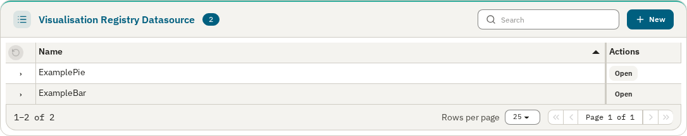
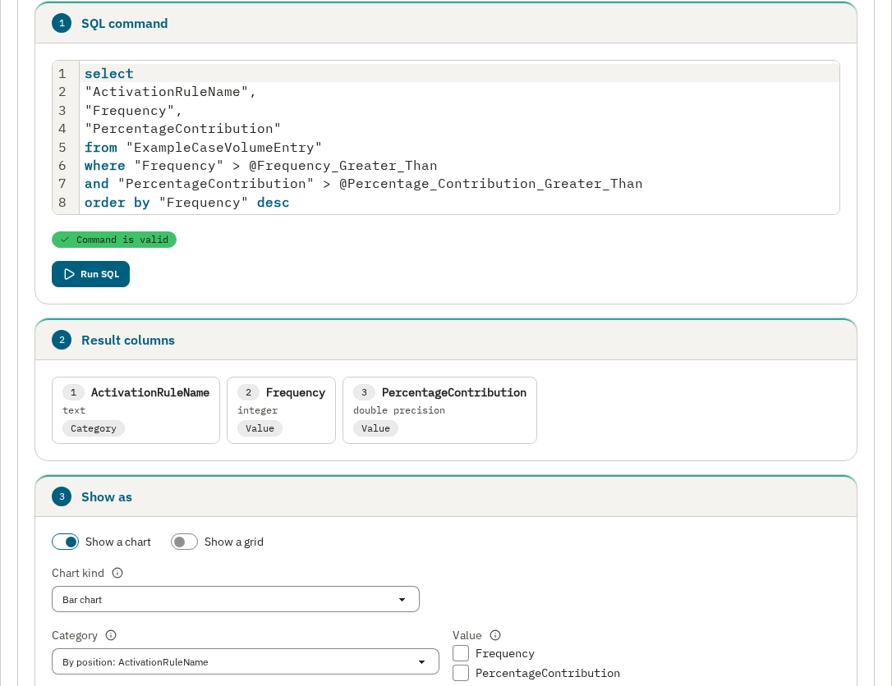
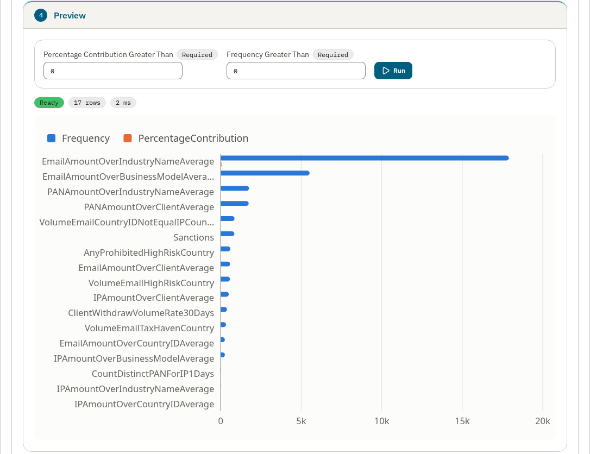

# Embed SQL and Generate Grid in Datasource

Datasources are the tiles inside a Visualisation. At their core each is an SQL statement executed against the reporting database and presented as a grid, a chart, a map or a template, or any combination of a grid with one of the others.

All of it is drawn in the server. The browser asks for a Datasource and receives one response holding everything the tile needs, which is to say the chart already drawn as an SVG document, the rows when the grid is switched on, the state of the tile and the stylesheet the chart uses. It follows that nothing is drawn by scripts in the browser, and there is no chart configuration to write.

## Where it lives

Navigate through the menu to Administration, then Visualisation setup, open the Visualisation Registry, then the Datasources hub card. Creating, changing and deleting a Datasource follows the common manner described in [Child Objects](../../../Navigation/ChildObjects/index.html), with the exception that Visualisation entities are not subject to approval, hence a change takes effect upon being saved.

What is particular to a Datasource is that the SQL, the chart and the grid are not edited as separate fields, and are instead edited together in a single builder, in the Query group of the form, as described below. A Datasource belongs to the Visualisation Registry under which it was created, and it cannot be moved to another Visualisation Registry by an update.

SHOT id=visualisations-datasources-list
     route=/administration/visualisations
     steps=open-row:ExampleVisualisation, open-hub:Datasources
     frame=section:Visualisation Registry Datasource
     state=the Datasources list of the ExampleVisualisation entry of the Visualisation Registry, showing its two Datasources, ExamplePie and ExampleBar, each on a row with its Active state and an Open action
     conveys=the Datasources of a Visualisation, one for each tile, are kept as a list beneath its Visualisation Registry entry
     alt=The Datasources list of the ExampleVisualisation entry showing two Datasources, ExamplePie and ExampleBar, each on a row with its Active state



## The SQL

As introduced in [Visualisation Parameters](../Parameters/index.html), the following SQL is to be executed:

```sql
select * from "ExampleCaseVolumeEntry"
where "ActivationRuleName" LIKE @Name
```

The parameterisation is performed on the basis of the Visualisation Registry Parameters created, and matched on the basis of the name. A parameter such as `@Name` is only accepted when the Visualisation Registry has a Parameter of exactly that name (letters are case sensitive, and spaces in a Parameter name become underscores in SQL). A parameter that has not been defined is refused as the SQL is written, stating that the parameter is not available here.

The SQL must be a single `SELECT` statement. Statements that write, several statements, functions that sleep or read the server, the system catalogues and the identity and credential tables are refused, and the statement runs in a read only transaction limited to 30 seconds, being the default of the ReportStatementTimeoutSeconds Environment Variable (see [Software Validations](../../../Concepts/SoftwareValidations/index.html)). The command is limited to 65,536 characters.

A tile reads at most 5,000 rows. When the result is larger the tile states that it was truncated, so it is advisable to aggregate or filter in SQL rather than draw thousands of points.

Every column needs its own name, hence each should be given an alias, for example `AS "Total"`. Two columns with the same name are refused.

The tables that may be queried, and the rows of those tables that are returned, are restricted to the tenant and to the permissions of the user, as described in [Visualisations Security Policy](../SecurityPolicy/index.html).

## The Datasource builder

The builder is laid out as four numbered steps down a single page:

| Step              | Description                                                                                                                                                                                                 |
|-------------------|-------------------------------------------------------------------------------------------------------------------------------------------------------------------------------------------------------------|
| 1. SQL command    | An editor for the statement, with the highlighting of PostgreSQL syntax, beneath which is the status of the command and Run SQL.                                                                             |
| 2. Result columns | Each column the SQL returns, in order, with its position, name, data type and the chart role it fills, or Not drawn where it fills none.                                                                    |
| 3. Show as        | The switches Show a chart and Show a grid and, where a chart is switched on, the Chart kind and the columns filling each role, as described in [Generate Chart in Visualisation Datasource](../GenerateChartInDatasource/index.html). |
| 4. Preview        | The tile exactly as the Visualisation will present it, headed by its state (Ready, No rows or Error), the number of rows, the time taken in milliseconds and, where it applies, Truncated.                   |

SHOT id=visualisations-datasource-builder
     route=/administration/visualisations
     steps=open-row:ExampleVisualisation, open-hub:Datasources, open-row:ExampleBar, scroll-to:SQL command
     frame=record
     state=the seeded ExampleBar Datasource opened, showing the four steps of the builder: the SQL command with the status Command is valid, the Result columns each with a role, Show as with Show a chart and Show a grid switched on and a bar chart selected, and the Preview drawing the chart with the grid beneath
     conveys=the SQL, the chart and the grid of a Datasource are edited together in one builder, with the tile previewed as it is written
     alt=The Datasource builder with a SQL editor marked as valid, a strip of the result columns and their chart roles, switches for a chart and a grid with the chart kind chosen, and a preview of the resulting tile



### Checking the SQL

The command is checked as it is typed, a moment after typing stops, and the status beneath the editor is one of the following:

| Status                     | Description                                                                             |
|----------------------------|-----------------------------------------------------------------------------------------|
| Write a SELECT to begin    | Nothing has been entered.                                                               |
| Checking the command       | The command is being checked in the server.                                             |
| Command is valid           | The command passed every check, and its columns are known.                              |
| Command has errors         | The command was refused, and the reason is written alongside.                           |
| Could not reach the server | The check could not be made.                                                            |

The checking takes place in two parts. Firstly the command is checked by Jube against the tables, columns, functions and parameters available, which is able to give a plain reason, alongside the line and column, for the more common mistakes: a table that does not exist or may not be queried, a column that does not exist (with a suggestion where a similar name does, noting that names with capital letters must be in double quotes), an aggregate used where it is not allowed, or values of types that cannot be compared. Where there are several problems each is listed.

Secondly the command is planned by the reporting database without being executed. Should the database refuse the command, only a generic message is given, `The SQL command was rejected by the reporting database.`, together with the line and column of the problem, which is also underlined in the editor. The error text of the database, its SQLSTATE code and the statement itself are never returned to the browser, and the full error is written to the server log only. SQL that the safety check refuses (not a single SELECT, or a blocked function or table) is reported as `The SQL command must be a single SELECT statement that uses no blocked statement, function or table.`

Once the command is valid, Run SQL executes it and presents the rows returned as a grid beneath the editor, irrespective of the chart or grid chosen, for the purposes of inspecting the data while the Datasource is being written. Where the Visualisation Registry has Required Parameters, they must first be completed in the Preview step, and until they are Run SQL answers Fill in the required parameters below first. A command that fails upon being run is reported as The SQL could not be run., and a command returning nothing reads No rows to show.

Until the command is valid the Result columns step reads The columns appear here once the command is valid., and where neither a chart nor a grid has been switched on the Show as step reads Switch on a chart, a grid or both.

### Preview

The preview does not appear until the command is valid and a chart or a grid is switched on, until which point it reads The preview appears once the command is valid and a chart or grid is switched on. When the Visualisation Registry has Parameters, a form above the tile offers them, filled with their defaults, so the tile can be tried with other values by clicking Run.

Neither the checking of the command nor the preview is recorded in the logging of executions, which is reserved for recall.

SHOT id=visualisations-datasource-preview-step
     route=/administration/visualisations
     steps=open-row:ExampleVisualisation, open-hub:Datasources, open-row:ExampleBar, scroll-to:Preview
     frame=record
     state=the ExampleBar Datasource scrolled to the Preview step of the builder, with the form offering Percentage Contribution Greater Than and Frequency Greater Than at their defaults beside Run, the status reading Ready with the number of rows and the time taken, and the tile drawn as a bar chart of Frequency and PercentageContribution for each activation rule name
     conveys=the Preview step runs the command with the Parameters of the Visualisation and draws the tile as it will be recalled
     alt=The Preview step of the Datasource builder for the ExampleBar Datasource, showing two parameter boxes and Run above a status of Ready and a bar chart of two series by activation rule name



## Fields

The form is arranged in the groups Identity, Query, Layout and Audit, the latter being collapsed. The Query group holds the builder.

| Value        | Description                                                                                                                                                              | Example    |
|--------------|--------------------------------------------------------------------------------------------------------------------------------------------------------------------------|------------|
| Name         | The title of the tile. Unique within the Visualisation Registry.                                                                                                         | ExampleBar |
| Active       | Whether the Datasource takes part in the Visualisation. Active is on for a new Datasource.                                                                               | True       |
| Locked       | A locked Datasource cannot be edited or deleted.                                                                                                                         | False      |
| SQL command  | The SQL to be executed, with Parameters added with the @ symbol.                                                                                                         |            |
| Show a chart | Draw the result as a chart, map or template. The Chart kind is then chosen and, where needed, which columns fill each role.                                              | True       |
| Show a grid  | Include a grid containing the full dataset returned by the SQL (up to 5,000 rows). Show a grid is on for a new Datasource.                                               | True       |
| Priority     | The order of presentation of the Datasource tile, lowest first.                                                                                                          | 1          |
| Row span     | Given rows are unbounded, with the height of the rows specified in the Visualisation Registry, the number of rows that the tile should overlay.                          | 1          |
| Column span  | Given the number of columns specified in the Visualisation Registry, the number of those columns that should be taken up by this Datasource tile.                        | 3          |

On recall a tile always spans at least one row and one column, and never more columns than the Visualisation Registry has.

## Validation

A Datasource must show a chart, a grid or both, and its SQL must be valid. For as long as that is not the case the form states Complete the display before saving: the SQL must be valid and a chart or grid chosen, and saving is held back.

A Datasource is furthermore validated in the server, and is rejected where:

* The Name is empty, is longer than 256 characters, or is already in use by another Datasource of the Visualisation Registry, without regard to case.
* The SQL command is empty or is longer than 65,536 characters.
* Priority, Row span or Column span is less than 0.
* Neither a chart nor a grid is switched on.
* A template is longer than 65,536 characters, is empty where the Chart kind is Template, or is not valid.
* A column is assigned to more than one chart role, or a role is assigned twice.

Upon saving, the SQL is tested again against the reporting database, the columns, with their data types, are recorded, and the chart column assignments are checked against the columns the SQL really returns.

## The grid

With only the grid switched on the tile shows the response of the SQL as a grid filling the tile. Numbers are right aligned, dates are shown in the language of the page, flags are shown as Yes or No and columns holding arrays are shown as comma separated lists. The grid shows 10 rows to a page, and can be sorted by clicking the heading of a column.

TODO(verify): the page formerly stated that the grid of a tile can also be filtered and exported. The Vue tile (Jube.App/Vue/src/datasource/DatasourceCardView.vue) passes neither a filter nor an export control to the grid. Owner to decide whether filtering and export are to be restored to tiles.

When a chart is switched on as well, the chart takes the top of the tile and the grid appears beneath it. The reason to have both in the same tile is to reuse the SQL and present a chart's raw data alongside the chart. When the grid is switched off none of the rows are sent to the browser.

Given the use of parameter queries and the validation of SQL on save, the prospect of errors during execution is minimised (although execution performance is available, with each Datasource execution being logged, as described in [Logging in Visualisation Datasource](../Logging/index.html)).

## Permissions and security

Creating, changing and deleting a Datasource, checking and previewing its SQL in the builder, and allocating roles to it, requires permission 33, Read Write Visualisation Datasource. A user without it receives 403, and an unauthenticated request receives 401.

Reading the active Datasources of a Visualisation Registry for the purposes of recall requires permission 33, permission 28, View Visualisation Directory, or permission 1, Read Write Case, and only the Datasources allocated to the role of the user are returned. The SQL of a Datasource is returned only to a user holding permission 33, and it is otherwise withheld, such that a user recalling a Visualisation is never given the SQL behind a tile.
