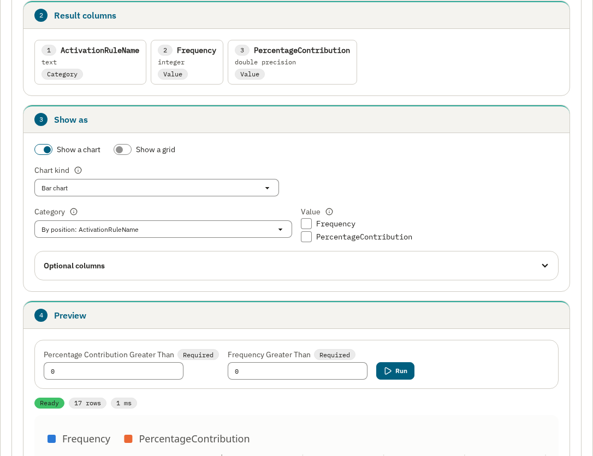
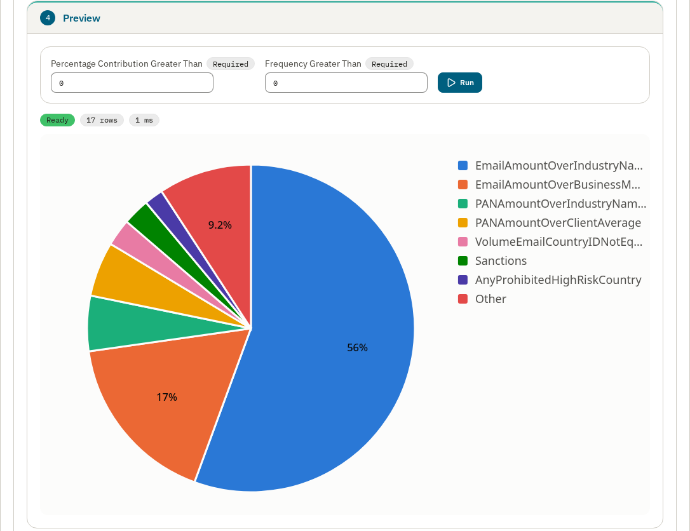
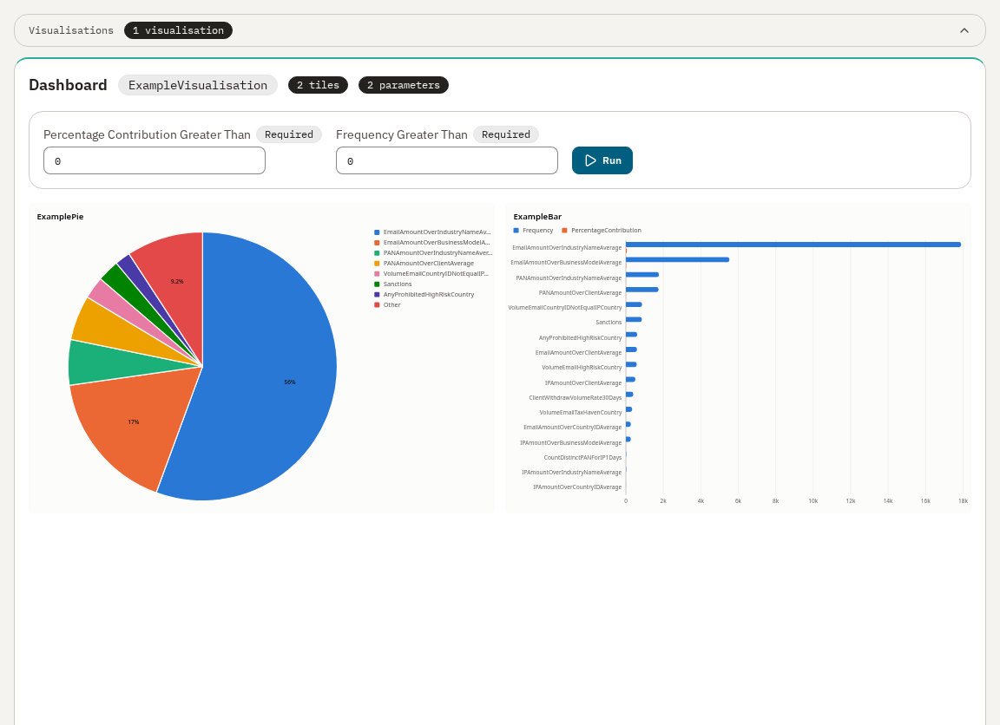

# Generate Chart in Visualisation Datasource

In all instances of Visualisation Datasource recall, SQL is executed and returned as a dataset that can be switched to present as a grid. In the creation of dashboard type visualisations it is likely some form of chart will be shown too.

There is no chart configuration to write. A chart is instead described by its kind and by the columns the SQL returns, which are drawn by position. The chart is drawn in the server as an SVG document, using the same charting library as the rest of Jube, with no charting script being executed in the browser, and it follows the light and dark theme of the page.

## Where it lives

A chart is chosen in the Show as step of the Datasource builder, described in [Embed SQL and Generate Grid in Datasource](../EmbedSQLGenerateGridInDatasource/index.html). Upon Show a chart being switched on, the Chart kind is selected from a list, beneath which the columns filling each role of that kind of chart are presented.

## Columns are taken by position

Each kind of chart has roles, and the columns returned by the SQL fill them in order. For a bar chart the first column is the category and the following numeric columns are the values, one series per column. Take the following SQL:

```sql
select "ActivationRuleName", "Frequency"
from "ExampleCaseVolumeEntry"
where "ActivationRuleName" LIKE @Name
```

Upon Bar chart being selected as the Chart kind, the first column labels the bars and the second sets their length, with nothing more to specify.

The list of chart kinds is split into two groups, being Draws from these columns, for the kinds that can be drawn from the columns as they stand, and Needs columns assigned, for the remainder. For a kind that cannot yet be drawn the builder states why, for example that it needs a second numeric column.

The Result columns step of the builder shows which role each column is filling, so what will be drawn is always visible.

SHOT id=visualisations-chart-show-as
     route=/administration/visualisations
     steps=open-row:ExampleVisualisation, open-hub:Datasources, open-row:ExampleBar, scroll-to:Result columns
     frame=record
     state=the Result columns and Show as steps of the builder for the ExampleBar Datasource, with Show a chart switched on, Bar chart selected as the Chart kind, the Category and Value roles each showing the column taken by position, and Optional columns collapsed
     conveys=a chart is a kind and an assignment of columns to roles, filled by position unless chosen otherwise
     alt=The Show as step of the Datasource builder with a bar chart selected and the result columns shown against the category and value roles they fill



## Choosing columns for roles

When the SQL returns extra columns, for the grid for instance, or the roles need to be filled in a different order, the column for each role is chosen explicitly. A role that takes one column offers a list headed by the choice By position, alongside the columns that position would give. A role that takes many, such as the values of a column chart, offers the columns to tick. Roles that are optional are gathered under Optional columns. A column fills at most one role, so assigning it to a role takes it from another.

Columns that are not assigned to a role are marked Not drawn, and are still available in the grid.

Roles that take numbers accept integers, decimals and flags, and roles that take times accept dates and times, the builder offering only the columns that fit.

## Splitting rows into series

When the SQL returns long form data, with one row for each category and series pair, one column is given the Series role. Its distinct values become the series, drawn from one value column:

```sql
select "Month", "Channel", sum("Amount") as "Total"
from "ExampleTransactions"
group by "Month", "Channel"
```

Each pair must appear once. When the result has more than one row for the same pair the chart is refused with a message asking for the query to be aggregated in SQL, as the chart will not silently add or drop rows. It follows also that when rows are split into series by a column, exactly one value column is drawn.

## Chart kinds

Every kind that can draw from columns is available:

| Kind                                             | Roles filled by the columns, in order                                            |
|--------------------------------------------------|----------------------------------------------------------------------------------|
| Column, Bar, Line, Area, Radar                   | Category, then one or more numeric Values (one series each), or a Series column  |
| Stacked and percent stacked Column, Bar and Area | As above, stacked, or as shares of the total                                     |
| Pie, Donut, Funnel, Waterfall                    | Category, then one numeric Value                                                 |
| Scatter or bubble                                | X, then one or more Y, an optional Size that makes bubbles, an optional Series   |
| Histogram                                        | One or more numeric columns, binned to show the distribution                     |
| Heatmap                                          | Row category, Column category, then a numeric Value                              |
| Combination                                      | Category, Values drawn as columns, Lines, and optional Lines on a secondary axis |
| Box plot                                         | Category, Minimum, First quartile, Median, Third quartile, Maximum               |
| Candlestick                                      | Category (often a date), Open, High, Low, Close                                  |
| Polar                                            | X as the angle in degrees, then Y as the radius, optional Series                 |
| Gauge                                            | A Value from the first row, with optional Target, Minimum and Maximum            |
| Bullet                                           | Optional Category, Value, optional Target                                        |
| Sparkline                                        | Value, with an optional Category for order                                       |
| Treemap                                          | Category, Value, optional Parent group                                           |
| Gantt                                            | Task, Start time, End time, optional Series                                      |
| Map                                              | See [Generate Map in Visualisation Datasource](../GenerateMapInDatasource/index.html) |
| Template                                         | Markup written by the user, see [Generate a Template in Visualisation Datasource](../GenerateHTMLInDatasource/index.html) |

SHOT id=visualisations-chart-pie-preview
     route=/administration/visualisations
     steps=open-row:ExampleVisualisation, open-hub:Datasources, open-row:ExamplePie, scroll-to:Preview
     frame=record
     state=the ExamplePie Datasource scrolled to the Preview step of the builder, with the form offering the two Parameters of the Visualisation above the tile, the status of the run, and the tile drawn as a pie chart with a slice and a legend entry for each category
     conveys=the same builder draws any chart kind, and the Preview step shows the tile exactly as recall will draw it
     alt=The Preview step of the Datasource builder for the ExamplePie Datasource, showing the parameter form above a pie chart with a legend naming each slice



## Limits

Charts have limits on how much they will draw, for example the number of categories or points. When a result is too large the tile states as much and by how much, giving the amount against the limit, and the remedy is to aggregate or filter in SQL. A query returning no rows is reported as having nothing to draw.

## Recall

Navigate to the Visualisation through the Visualisation directory and run it, as described in [Visualisation Recall](../Recall/index.html). Each tile is requested separately, so a tile that fails shows its own reason while the others are drawn. The chart takes the tile, and when Show a grid is also on, the grid appears beneath it.

SHOT id=visualisations-chart-recall-tiles
     route=/visualisation
     steps=open-row:ExampleVisualisation, click:Run
     frame=page
     state=the canvas of the seeded ExampleVisualisation after Run, with the ExampleBar tile drawn as a bar chart of Frequency by ActivationRuleName and the ExamplePie tile drawn as a pie chart, in the light theme
     conveys=charts are drawn in the server and arrive ready to display, several to a canvas
     alt=Two tiles of a Visualisation side by side, a bar chart of frequency by activation rule name and a pie chart of the percentage contribution of each rule



The text of the chart kinds, their roles and any message about a chart follows the language of the user interface.

## Permissions and security

Choosing and previewing a chart is part of authoring a Datasource, and requires permission 33, Read Write Visualisation Datasource. Recall is governed as described in [Visualisations Security Policy](../SecurityPolicy/index.html).

The chart is drawn in the server and delivered as an SVG document, and the browser removes any script, event handler and external link from that document again before showing it, such that a value returned by the SQL cannot be executed as script.
