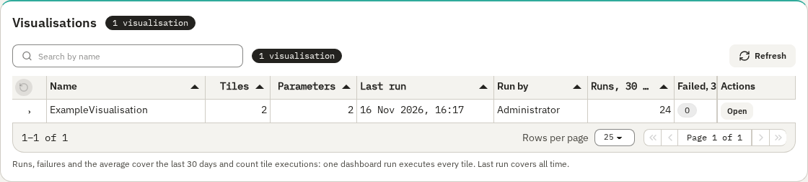

# Logging in Visualisation Datasource

On each recall of a Visualisation Datasource there is extensive logging in the database for the purpose of capturing user inputs, the time taken to process the SQL and any errors returned by the database.

Given SQL is validated on the creation of a Visualisation Datasource and all parameters are passed as named variables, the likelihood of errors at recall is reduced.

## Where it lives

There is no page in the user interface for the inspection of the log in full, and the tables are instead queried directly in the database. A summary of the log is however presented in the Visualisation directory, where the last run, the user having run it, and the runs, failures and average response time of the last 30 days are shown against each Visualisation, as described in [Visualisation Recall](../Recall/index.html).

SHOT id=visualisations-logging-directory-summary
     route=/visualisation
     steps=none
     frame=section:Visualisations
     state=the Visualisation directory listing ExampleVisualisation on a single row, with 2 tiles and 2 parameters and the columns drawn from the log, the Last run, Run by reading Administrator, 22 runs and 0 failed in the last 30 days, and the explanation of those figures beneath the list
     conveys=the only view of the log in the user interface is the summary carried against each Visualisation in the directory
     alt=The Visualisation directory listing ExampleVisualisation with its last run, Administrator as the user who ran it, 22 runs and 0 failed over the last 30 days, and a line beneath explaining the figures



## What is logged

An entry is written for each tile each time it is drawn upon recall, in the Visualisation page and in the dashboard of a case alike, whether the execution succeeded or the SQL was refused. It follows that one run of a Visualisation having six tiles writes six entries. An execution of a Datasource by Ask Jooby is logged in the same manner.

The following are not logged:

* The checking of SQL, Run SQL and the preview in the Datasource builder.
* A request for a Datasource that the user is not permitted to see.
* A request refused because a parameter value does not parse as its data type.

## Executions

To inspect the Datasource recall:

```sql
select * from "VisualisationRegistryDatasourceExecutionLog"
```

Returning the following columns:

| Column                            | Description                                                                 |
|-----------------------------------|-----------------------------------------------------------------------------|
| Id                                | The identifier of the execution.                                            |
| VisualisationRegistryDatasourceId | The Datasource executed.                                                    |
| CreatedDate                       | The date and time of the execution, in UTC.                                 |
| CreatedUser                       | The user having recalled the Datasource.                                    |
| ResponseTime                      | The time taken to execute the SQL, in milliseconds. 0 for a failure.        |
| Records                           | The number of rows returned. 0 for a failure.                               |
| Error                             | Empty for a success, otherwise the message that was given to the user.      |

There exists the possibility to join onto the VisualisationRegistryDatasource to obtain the SQL:

```sql
select d."Command",l."ResponseTime" from "VisualisationRegistryDatasourceExecutionLog" l
inner join "VisualisationRegistryDatasource"d on d."Id" = l."VisualisationRegistryDatasourceId"
```

Returning the SQL of the Datasource alongside the response time of each execution.

The table should be inspected for excessive response times and errors. In the case of long response times, it is advisable to manually test the explain plan of the SQL composed and seek optimisation.

Keep in mind that the Error column holds the same plain message that the user was shown, never the error text of the database nor a stack trace, since the table can itself be read by a Datasource; the detail of a failure is written to the server log alone, against the Datasource Id and the user.

## Parameters

The parameters that have been passed in each execution, and so the parameterisation of the execution, are available:

```sql
select * from "VisualisationRegistryDatasourceExecutionLogParameter"
```

Returning the following columns:

| Column                                        | Description                                         |
|-----------------------------------------------|-----------------------------------------------------|
| Id                                            | The identifier of the entry.                        |
| VisualisationRegistryDatasourceExecutionLogId | The execution to which the value belongs.           |
| VisualisationRegistryParameterId              | The Parameter for which the value was supplied.     |
| Value                                         | The value supplied, as text.                        |

Only the values supplied in the request are recorded, for Parameters known to the Visualisation Registry. A Parameter left to its default is not recorded.

To obtain the name of the parameter a join:

```sql
select p."Name",l."Value" from "VisualisationRegistryDatasourceExecutionLogParameter" l
inner join "VisualisationRegistryParameter" p on p."Id" = l."VisualisationRegistryParameterId"
```

Returning the name of each Parameter alongside the value supplied for it.

## Permissions and security

Keep in mind that the SQL cannot be injected as it is validated then stored alongside the Datasource and the parameters are passed on a secure basis. Notwithstanding the secure development of the SQL invocation, the parameters log should be monitored for potentially malicious statements.

The log is not exposed through the user interface beyond the summary in the directory, hence reading it in full requires access to the database.
