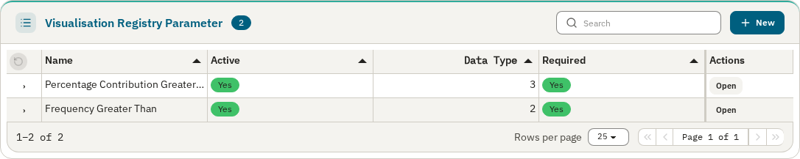
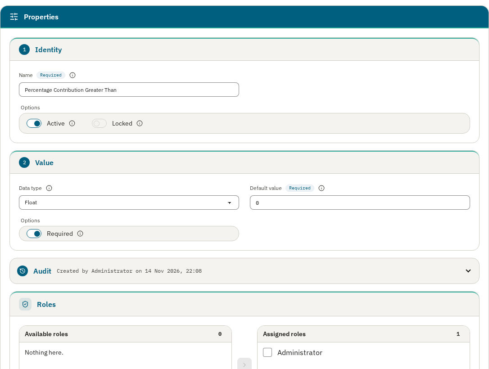

# Visualisation Parameters

The concept of visualisations in Jube is that SQL is executed against the database and presented in either grid or chart form. The SQL itself can be parameterised on a named parameter basis.

There can be many Datasources available to a Visualisation, however, they are expected to share a common collection of Parameters.

Parameters are collected via manual form entry upon recall of the Visualisation. Where the Visualisation is embedded in a case there is no form, and the Parameters instead take their default values, with the case itself being identified by the built-in parameter `@Id` as described below.

## Where it lives

Navigate through the menu to Administration, then Visualisation setup, open the Visualisation Registry, then the Parameters hub card. Creating, changing and deleting a Parameter follows the common manner described in [Child Objects](../../../Navigation/ChildObjects/index.html), with the exception that Visualisation entities are not subject to approval, hence a change takes effect upon being saved.

A Parameter belongs to the Visualisation Registry under which it was created, and it cannot be moved to another Visualisation Registry by an update.

SHOT id=visualisations-parameters-list
     route=/administration/visualisations
     steps=open-row:ExampleVisualisation, open-hub:Parameters
     frame=section:Visualisation Registry Parameter
     state=the Parameters list of the ExampleVisualisation entry of the Visualisation Registry, showing its two Parameters, Percentage Contribution Greater Than and Frequency Greater Than, each on a row with its Active state, its Data Type, whether it is Required, and an Open action
     conveys=the Parameters of a Visualisation are kept as a list beneath its Visualisation Registry entry
     alt=The Parameters list of the ExampleVisualisation entry showing two Parameters, Percentage Contribution Greater Than and Frequency Greater Than, each on a row with its Active state, Data Type and Required state



## Parameters in SQL

For the purpose of this example, an example table will be used as follows, with the following basic SQL returning every row of the table, having the columns Id, ActivationRuleName, Frequency and PercentageContribution:

```sql
select * from "ExampleCaseVolumeEntry"
```

In this example, the table will be filtered based on a LIKE statement on name:

```sql
select * from "ExampleCaseVolumeEntry"
where "ActivationRuleName" LIKE '%Email%'
```

Which returns a filtered view of the table, being only the rows where the ActivationRuleName contains Email, such as EmailAmountOverIndustryNameAverage and VolumeEmailHighRiskCountry.

The SQL will however be parameterised via a named @ parameter (this is SQL syntax rather than the Jube style of tokenisation):

```sql
select * from "ExampleCaseVolumeEntry"
where "ActivationRuleName" LIKE @Name
```

Tokenisation as supported in the rest of the application is not supported here for reasons of SQL injection prevention, each parameter has formal equivalence as a scoped parameter in the call to the database.

The name of the parameter in SQL is the Name of the Parameter, where letters are case sensitive, and where any space in the Name is replaced by an underscore. It follows that a Parameter named Frequency Greater Than is referred to in SQL as `@Frequency_Greater_Than`.

## Fields

The form is arranged in the groups Identity, Value and Audit, the latter being collapsed:

| Value         | Description                                                                                                                                                                                                                                                  | Example |
|---------------|--------------------------------------------------------------------------------------------------------------------------------------------------------------------------------------------------------------------------------------------------------------|---------|
| Name          | The name of the Parameter, shown as the label of its control upon recall, and used as the named SQL parameter when running the report.                                                                                                                      | Name    |
| Active        | Whether the Parameter is collected upon recall. Active is off for a new Parameter and must be switched on.                                                                                                                                                   | True    |
| Locked        | Whether the Parameter is protected from change.                                                                                                                                                                                                              | False   |
| Data type     | The data type governing the control that will be displayed when collecting the Parameter, and the type as which its value is passed to the database: String, Integer, Float, Date or Boolean.                                                               | String  |
| Default value | The default value to be provided to the control and to the scoped parameter on report recall (noting that Case embedding does not include controls to capture Parameters). In the case of Date, this is an offset as a number of days before the present.    | %Test%  |
| Required      | A flag indicating if the Parameter is mandatory, in which case it cannot be left blank upon recall.                                                                                                                                                          | True    |

The Default value is entered through a control that follows the Data type selected. The controls presented upon recall for each Data type are set out in [Visualisation Recall](../Recall/index.html).

SHOT id=visualisations-parameters-record
     route=/administration/visualisations
     steps=open-row:ExampleVisualisation, open-hub:Parameters, open-first-row
     frame=record
     state=the Percentage Contribution Greater Than Parameter of the ExampleVisualisation opened at its Properties form, showing the Identity group with its name and the Active and Locked switches, the Value group with a Data type of Float, a Default value of 0 and Required switched on, and the Roles panel beneath with Administrator assigned
     conveys=a Parameter is a short record, a name by which the SQL refers to it and the type, default and requirement of its value
     alt=The Properties form of the Percentage Contribution Greater Than Parameter showing its Identity group with the name, its Value group with a Data type of Float, a Default value of 0 and Required switched on, and the Roles panel beneath



## Validation

A Parameter is validated in the server, and is rejected where:

* The Name is empty.
* The Name is longer than 256 characters.
* The Name is already in use by another Parameter of the Visualisation Registry, without regard to case.
* The Data type is not one of the five available.
* The Default value is empty.
* The Default value is longer than 256 characters.
* The Default value does not parse as the Data type: a whole number for Integer, a number for Float, a whole number of days for Date, and 1 or 0 for Boolean.

Upon recall, a value that does not parse as the Data type of its Parameter is refused in the same manner, the tile stating for example that the value for the Parameter must be a whole number. A parameter id that is not known, or that belongs to another Visualisation Registry, is refused with 400, as is the same Parameter supplied more than once.

## The built-in parameter for a case

Where the Visualisation Registry has Shown in set to Case, every Datasource is given one further parameter, `@Id`, being the id of the case in which the Visualisation is embedded. Nothing else about the case is supplied, and the SQL traces what it needs from the id, through the tables available to Datasources:

```sql
select a."Json" -> 'payload' ->> 'Amount' as "Amount", a."CreatedDate"
from "Case" c
join "Archive" a on a."Json" -> 'payload' ->> c."CaseKey" = c."CaseKeyValue"
where c."Id" = @Id
```

The following should be kept in mind:

* The id is checked before it is passed to the database. The case must belong to the tenant of the user, otherwise `@Id` is passed as null and the Datasource returns nothing.
* The built-in `@Id` takes the place of any Parameter created with the Name Id.
* A Visualisation Registry shown in the Directory is not given `@Id`.
* While a Datasource is being written in the builder, `@Id` is passed as 0, such that the SQL can be validated in the absence of a case.

Formerly, each Parameter was matched by name to a value in the case payload. This is no longer the case, and a Visualisation relying upon that matching must be rewritten to trace its values from `@Id`.

## Example

Keeping in mind the SQL above and the eventual parameterisation of this query, a Parameter is created with the following values:

| Value         | Entry   |
|---------------|---------|
| Name          | Name    |
| Active        | True    |
| Data type     | String  |
| Default value | %Email% |
| Required      | True    |

Having allocated the Parameter to a role in its Roles section, navigate to the Visualisation page via the main menu and open the Visualisation Registry, whereupon the Parameter is presented as a text box labelled Name, holding %Email% and marked Required, alongside Run.

Clicking Run will collate the Parameters and make them available for Datasource parameterisation, yet for the purpose of this example there exist no Datasources to execute SQL, and the page states This visualisation has no active datasources.

## Permissions and security

Creating, changing and deleting a Parameter, and allocating roles to it, requires permission 32, Read Write Visualisation Parameter Administration. A user without it receives 403, and an unauthenticated request receives 401.

Reading the active Parameters of a Visualisation Registry for the purposes of recall requires permission 32, permission 28, View Visualisation Directory, or permission 1, Read Write Case. Only the Parameters allocated to the role of the user are returned, and a Parameter that is not allocated is not presented, its Default value being used in its place, as described in [Visualisations Security Policy](../SecurityPolicy/index.html).

As each value is passed to the database as a scoped parameter, a value entered upon recall can never alter the SQL of a Datasource.
