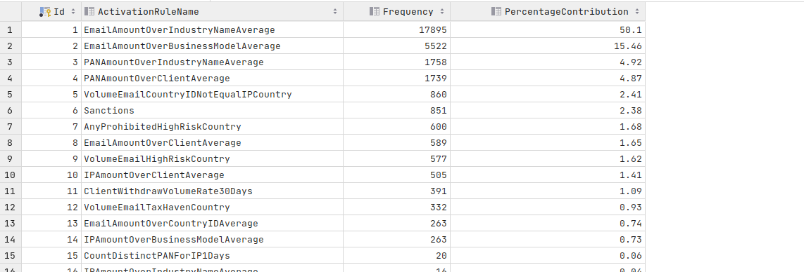
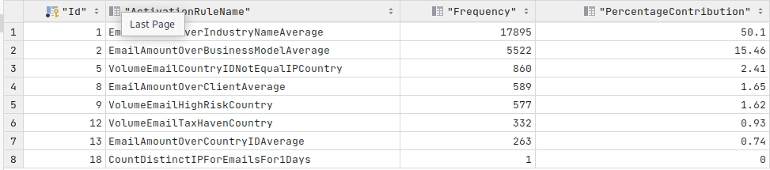
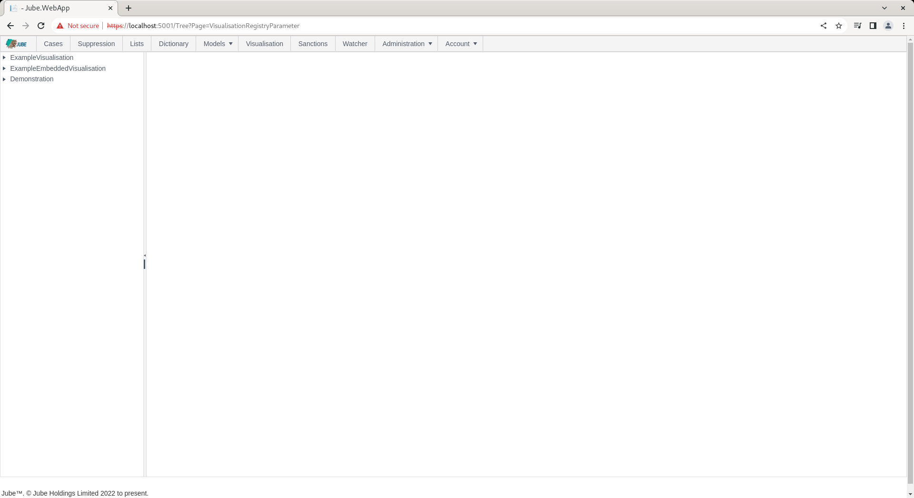
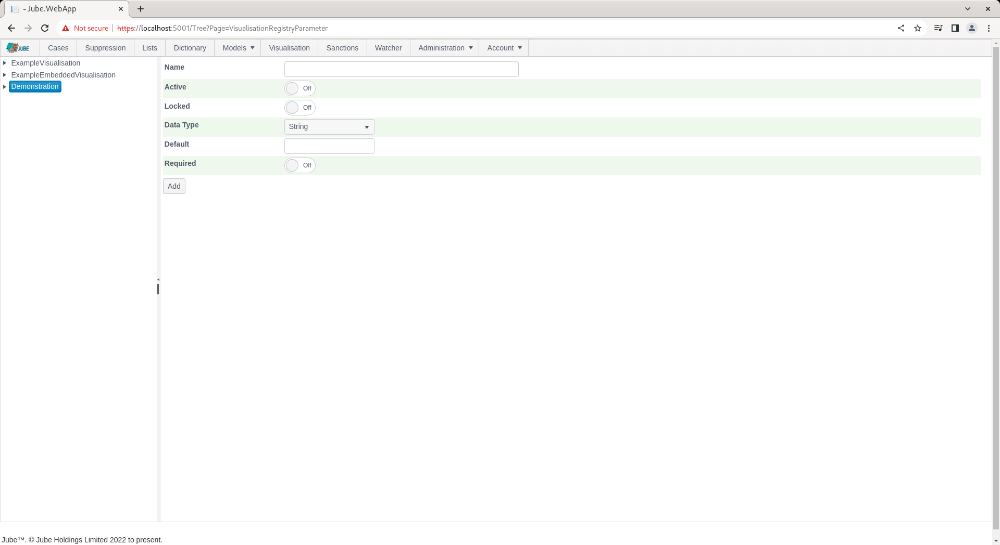
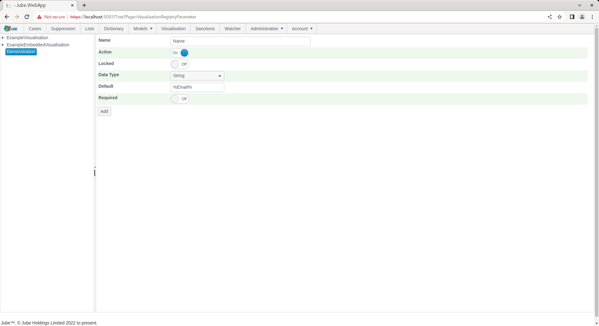
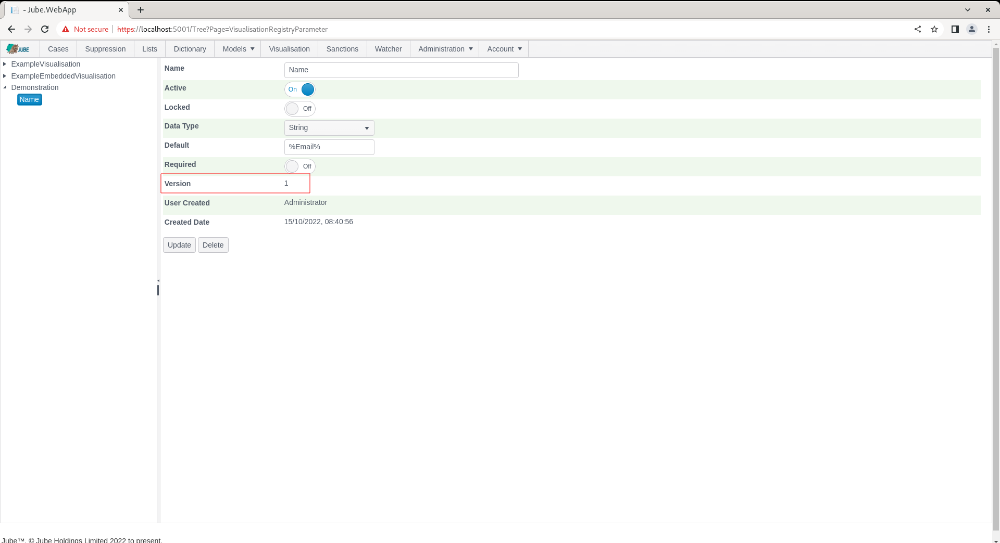
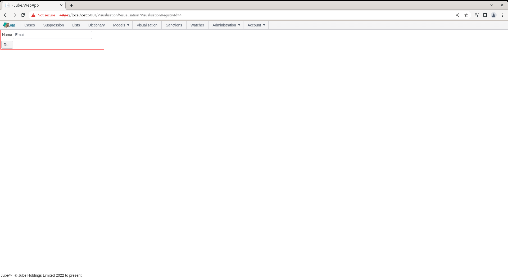
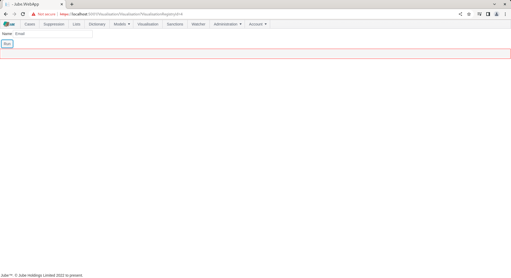

# Visualisation Parameters

The concept of visualisations in Jube is that SQL is executed against the database and presented in either grid or chart
form. The SQL itself can be parameterized on a tokens basis.

There can be many datasource's available to a Visualisation, however, they are expected to share a common collection of
parameters.

Parameters can either be collected via manual form entry or matched to the Case payload in the event that the
Visualisation is embedded (where the parameters are matched to the values in the case payload based on their name).

For the purpose of this example, an example table will be used as follows, with the following basic SQL returning:

```sql
select * from "ExampleCaseVolumeEntry"
```

<!-- TODO(screenshot): file=visualisation-example-table-data.png route=/administration/visualisations state="Replace the Razor-era image ExampleTableData.png with the Vue Administration > Visualisations page showing the same state" -->


In this example, the table will be filtered based on a LIKE statement on name:

```sql
select * from "ExampleCaseVolumeEntry"
where "ActivationRuleName" LIKE '%Email%'
```

Which returns a filtered view of the table:

<!-- TODO(screenshot): file=visualisation-filtered-view-of-the-table.png route=/administration/visualisations state="Replace the Razor-era image FilteredViewOfTheTable.png with the Vue Administration > Visualisations page showing the same state" -->


The SQL will however be parameterized via a named @ parameters (this is SQL syntax rather than the Jube style of
tokenization):

```sql
select * from "ExampleCaseVolumeEntry"
where "ActivationRuleName" LIKE @Name
```

Tokenization as supported in the rest of the application is not supported here for reasons of SQL injection prevention,
each parameter has formal equivalence as a scoped parameter in the call to the database.

To create a parameter, start by navigating to Administration >> Visualisation >> Visualisation Parameters:

<!-- TODO(screenshot): file=visualisation-visualisation-registry-parameters-top-of-tree.png route=/administration/visualisations state="Replace the Razor-era image VisualisationRegistryParametersTopOfTree.png with the Vue Administration > Visualisations page showing the same state" -->


Click on the node entry for the recently created Visualisation Registry, in this case Demonstration, to expose options
for the creation of a parameter:

<!-- TODO(screenshot): file=visualisation-empty-visualisation-parameter.png route=/administration/visualisations state="Replace the Razor-era image EmptyVisualisationParameter.png with the Vue Administration > Visualisations page showing the same state" -->


Visualisation Registry Parameters have the following properties:

| Value     | Description                                                                                                                                                                                                                                                                                                                                                                                         | Example |
|-----------|-----------------------------------------------------------------------------------------------------------------------------------------------------------------------------------------------------------------------------------------------------------------------------------------------------------------------------------------------------------------------------------------------------|---------|
| Name      | The name of the parameter, matched against the Case payload field of the same name when the Visualisation is embedded, and used as the named SQL parameter when running the report. Must be unique within the Visualisation Registry (case-insensitive) and no more than 256 characters.                                                                                                            | Name    |
| Data Type | The data type governing the control that will be displayed when collecting parameters.                                                                                                                                                                                                                                                                                                              | True    |
| Default   | The default value to be provided to the control and the scoped parameter matching on report recall (noting that Case embedding does not include controls to capture parameters).  In the case of date,  this will be an offset of the number of days. Required, and no more than 256 characters. Must parse as the selected Data Type (e.g. a whole number for Integer or the day offset for Date). | %Test%  |
| Required  | A flag indicating if the parameter is mandatory.                                                                                                                                                                                                                                                                                                                                                    | True    |

Keeping in mind the SQL above and the eventual parameterization of this query, create a parameter as follows:

<!-- TODO(screenshot): file=visualisation-template-values-for-parameter.png route=/administration/visualisations state="Replace the Razor-era image TemplateValuesForParameter.png with the Vue Administration > Visualisations page showing the same state" -->


Scroll down and click update to create a version of the Visualisation Registry Parameter:

<!-- TODO(screenshot): file=visualisation-version-of-parameter.png route=/administration/visualisations state="Replace the Razor-era image VersionOfParameter.png with the Vue Administration > Visualisations page showing the same state" -->


Navigate to the Visualisation page via the main menu and click through the Demonstration link to recall this
Visualisation Registry, which should expose the parameters:

<!-- TODO(screenshot): file=visualisation-available-visualisation-parameter.png route=/administration/visualisations state="Replace the Razor-era image AvailableVisualisationParameter.png with the Vue Administration > Visualisations page showing the same state" -->


Clicking run will collate the parameters and make them available for datasource parameterization, yet for the purpose of
this example, there does exists no datasource's to execute SQL:

<!-- TODO(screenshot): file=visualisation-area-where-datasources-will-be-presented.png route=/administration/visualisations state="Replace the Razor-era image AreaWhereDatasourcesWillBePresented.png with the Vue Administration > Visualisations page showing the same state" -->


<!-- TODO(docs): Document that a parameter cannot be moved to another registry by an update, and that unknown or foreign parameter ids supplied to a card are refused (400). -->
<!-- TODO(docs): Verify the data type list (1 text, 2 whole number, 3 number, 4 date and time with default expressed as days back, 5 flag) against VisualisationRegistryParameter.DataTypeId and ExecuteVisualisationRegistryDatasourceCardQuery.ValueOf. -->
<!-- TODO(docs): Document that spaces in a parameter name become underscores when the SQL uses it (for example @Frequency_Greater_Than). -->
