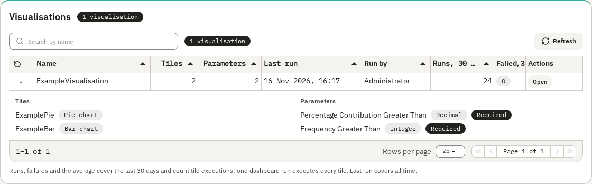
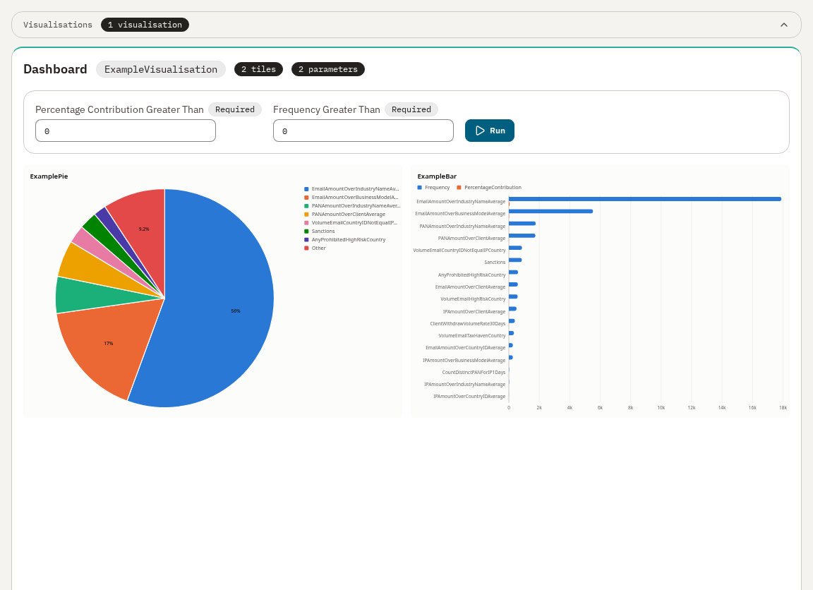

# Visualisation Recall

Jube provides a rudimentary reporting tool that exists to execute SQL against the database and present the result as a grid, chart, map or template. The philosophy is to make the creation of reports quick given a rudimentary understanding of SQL, with the presentation drawn by Jube rather than assembled by hand.

A Visualisation is a canvas of tiles, each of which is a Datasource. The [Visualisation Registry](../Registry/index.html) sets the number of columns, the width of each column and the height of each row, and every Datasource states how many columns and rows its tile spans and in which order the tiles come. On a narrow screen the tiles are stacked one above the other.

## Where it lives

Navigate through the menu to Visualisation, which presents the directory of Visualisations, then click Open on the Visualisation of interest. The page is arranged as a story in the same manner as the rest of the user interface, which is to say that the directory collapses to a single summary line upon a Visualisation being opened, and that line can be clicked to return to the directory.

A Visualisation is opened at its own address, taking the form `/visualisation/{guid}`, which can be bookmarked or shared.

## The directory

The directory lists the Visualisation Registry entries having Shown in set to Directory. Only active Visualisations are listed, and only those allocated to the role of the signed in user, as described in [Visualisations Security Policy](../SecurityPolicy/index.html). Where none are available the directory reads No visualisations are listed in the directory.

The directory has a box to search by name, a count of the Visualisations listed, and Refresh. Visualisations are shown 25 to a page, with the following columns:

| Column          | Description                                                                                      |
|-----------------|--------------------------------------------------------------------------------------------------|
| Name            | The name of the Visualisation Registry.                                                          |
| Tiles           | The number of Datasources.                                                                       |
| Parameters      | The number of Parameters.                                                                        |
| Last run        | The date and time of the most recent execution of any tile, or Never run.                        |
| Run by          | The user having made that most recent execution.                                                 |
| Runs, 30 days   | The number of tile executions in the last 30 days.                                               |
| Failed, 30 days | The number of those executions that failed.                                                      |
| Average         | The average response time of those executions, in milliseconds.                                  |
| Actions         | Open, to recall the Visualisation.                                                               |

Keep in mind that the runs, failures and average count the executions of tiles, such that one run of a dashboard having six tiles is counted as six, whereas Last run covers all time. The figures are taken from the logging described in [Logging in Visualisation Datasource](../Logging/index.html).

Beneath the directory the page states the same in its own words: Runs, failures and the average cover the last 30 days and count tile executions: one dashboard run executes every tile. Last run covers all time. The count beside the search reads no visualisations, 1 visualisation or the number of visualisations, and a search that matches nothing reads No visualisations match. A figure that is not available is shown as n/a.

A row can be expanded, without opening the Visualisation, to list its Tiles alongside the kind of chart each is drawn as, and its Parameters alongside their data type and whether they are Required.

SHOT id=visualisations-recall-directory-expanded
     route=/visualisation
     steps=expand-first-row
     frame=section:Visualisations
     state=the Visualisation directory with the row of ExampleVisualisation expanded, listing its Tiles, ExamplePie as a Pie chart and ExampleBar as a Bar chart, and its Parameters, Percentage Contribution Greater Than as a Decimal and Frequency Greater Than as an Integer, both Required, with the explanation of the run figures beneath the list
     conveys=a row of the directory can be expanded to see what a Visualisation holds before it is opened
     alt=The Visualisation directory with the ExampleVisualisation row expanded to list its two tiles, a Pie chart and a Bar chart, and its two Required parameters with their data types

## Parameters

When the Visualisation Registry has active [Parameters](../Parameters/index.html), they are shown as a form above the tiles, filled with their default values:

| Data type | Input                  | Note                                                                      |
|-----------|------------------------|---------------------------------------------------------------------------|
| String    | A text box             |                                                                           |
| Integer   | A number box           | Whole numbers only.                                                       |
| Float     | A number box           |                                                                           |
| Date      | A date and time picker | The default is a number of days, which becomes that many days before now. |
| Boolean   | A switch               | The default is 1 for on and 0 for off.                                    |

A Parameter marked as Required must not be left blank, and Enter a value. is written beneath it where it is. Clicking Run draws the tiles, and until then the page reads Set the parameters and run to draw the visualisation. A Visualisation with no Parameters runs as soon as it opens.

Upon Run being clicked the values entered are also written to the address, by name, as in `?Name=West`. It follows that a Parameter can be given in the address to start with a value other than its default, and that a Visualisation opened from such an address runs straight away with those values, which makes a link to a particular view of the data a simple matter of copying the address.

SHOT id=visualisations-recall-dashboard
     route=/visualisation
     steps=open-row:ExampleVisualisation, click:Run
     frame=page
     state=the seeded ExampleVisualisation opened and run with its default parameters, showing the collapsed directory step, the parameters form with Run, and a canvas of tiles including the ExampleBar chart with its grid beneath and the ExamplePie chart beside it
     conveys=a Visualisation is a canvas of tiles drawn from shared parameters, each tile being a chart, a grid or both
     alt=A Visualisation opened from the directory, with a parameters form above a canvas of tiles, one tile showing a bar chart with a grid of its rows beneath

## Tiles

There are as many tiles as there are active Datasources allocated to the role of the user, which allows for the creation of dashboards. Charts, maps and templates fill their tile, and where a Datasource also shows a grid, the grid appears beneath.

Each tile is requested separately with the values entered, so the tiles are drawn as each completes. A tile that fails, for example because a value is not a whole number or the SQL is refused, states why in its own place, alongside Retry, while the others are drawn. A tile whose result was cut off at the limit of 5,000 rows is marked Truncated.

A tile that fails without a reason of its own reads This tile could not be drawn., and a tile whose Datasource has been removed or withdrawn since the Visualisation was opened reads This datasource is no longer available. A Visualisation having no active Datasources allocated to the role of the user reads This visualisation has no active datasources.

Where the Visualisation itself cannot be presented, the page states one of the following in place of the tiles:

| Message                                                          | Reason                                                                                                        |
|------------------------------------------------------------------|---------------------------------------------------------------------------------------------------------------|
| That visualisation could not be found, or it is not active.      | The address names a Visualisation that does not exist, is not active, or is not allocated to the role of the user. |
| You are not permitted to see this visualisation.                 | The user holds neither of the permissions set out under Permissions and security.                             |
| The visualisation could not be loaded. Try again.                | Any other failure.                                                                                            |

By way of example, on a clean installation the directory lists ExampleVisualisation. Upon Open, the directory collapses to a single line reading All visualisations, the parameters form is presented with its defaults, and upon Run the tiles are drawn one after another, the ExampleBar tile as a bar chart with the grid of its rows beneath. Returning to the directory and pressing Refresh, Last run for ExampleVisualisation shows the present time, Run by the signed in user, and Runs, 30 days has risen by the number of tiles drawn.

Every execution is logged, with its parameter values and how long it took.

## Case Visualisation

A Visualisation may be allocated to a Case Workflow, to produce a visual consolidation of a case, which is oftentimes referred to as a dashboard. The Visualisation Registry must have Shown in set to Case, and it is then selected in the Visualisation group of the [Case Workflow](../../CaseManagement/CreatingCaseWorkflows/index.html).

The case page presents such a Visualisation as the section titled Dashboard. There is no parameters form in the case page: the tiles are drawn at once, the Parameters take their default values, and every Datasource is additionally given the parameter `@Id`, being the id of the case, as described in [Visualisation Parameters](../Parameters/index.html).

## Permissions and security

The Visualisation menu item requires permission 28, View Visualisation Directory. Recalling a Visualisation, its Parameters and its tiles requires either permission 28 or permission 1, Read Write Case, the latter for the purposes of the dashboard in the case page.

Permission alone is not sufficient, as the Visualisation, each of its Parameters and each of its Datasources must also be allocated to the role of the user. A Visualisation that is not allocated, or is not active, is not returned, and its existence is not disclosed.
