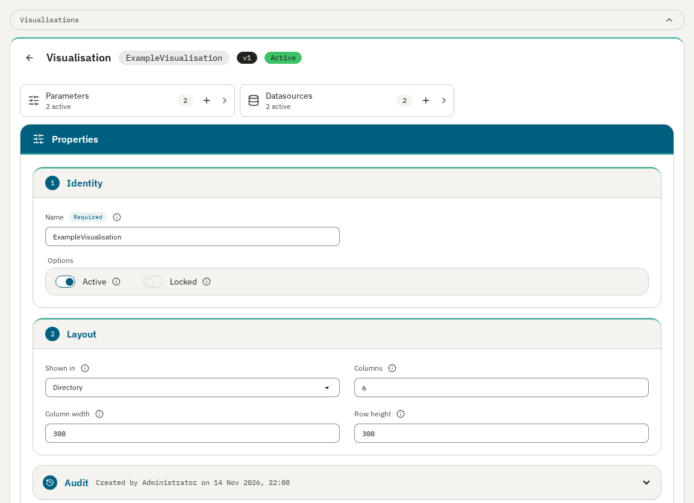

# Visualisation Registry

Think of a Visualisation Registry as a report. The Visualisation Registry can have many Datasources which share a common set of Parameters. The Visualisation Registry is the wrapper and specifies the size of the canvas upon which the Datasources are arranged. The registry entry also controls where the Visualisation is shown, which is to say whether it is available for navigation through the Visualisation directory or is embedded in a case.

## Where it lives

Navigate through the menu to Administration, then Visualisation setup, which presents the table of Visualisations. Clicking Open on a Visualisation presents a hub card for its Parameters and a hub card for its Datasources, with the Properties form of the Visualisation Registry beneath. Creating, changing and deleting a Visualisation Registry follows the common manner described in [Child Objects](../../../Navigation/ChildObjects/index.html), with the Visualisation Registry in the place of the Model as the parent, and [Visualisation Parameters](../Parameters/index.html) and [Datasources](../EmbedSQLGenerateGridInDatasource/index.html) as its children.

Visualisation entities are not subject to approval, and it follows that a change takes effect upon being saved. A copy of the record as it stood beforehand is nevertheless written to the version table on each update, for the purposes of audit.

SHOT id=visualisations-registry-hub-cards
     route=/administration/visualisations
     steps=open-row:ExampleVisualisation
     frame=page
     state=the seeded ExampleVisualisation opened in Visualisation setup, showing the collapsed Visualisations step, the Parameters and Datasources hub cards with their counts, and the Identity and Layout groups of the Properties form
     conveys=a Visualisation Registry is the parent of its Parameters and Datasources, and holds the layout of the canvas
     alt=A Visualisation Registry opened in Visualisation setup, with hub cards for Parameters and Datasources above a form giving its name, where it is shown, and the columns, column width and row height of its canvas

## Fields

The Properties form is arranged in the groups Identity, Layout and Audit, the latter being collapsed:

| Value        | Description                                                                                                                                                                                                             | Example   |
|--------------|-------------------------------------------------------------------------------------------------------------------------------------------------------------------------------------------------------------------------|-----------|
| Name         | The display name of the Visualisation Registry, as listed in Visualisation setup and, where it is shown in the Directory, in the Visualisation directory.                                                               | Sales     |
| Active       | Whether the Visualisation Registry is available for recall. Active is off for a new Visualisation Registry and must be switched on.                                                                                     | True      |
| Locked       | Whether the Visualisation Registry is protected from change.                                                                                                                                                            | False     |
| Shown in     | Directory, in which case the Visualisation is listed in the Visualisation page for the roles it is allocated to, or Case, in which case it is embedded as the dashboard of a case and receives the id of the case as the SQL parameter `@Id`. | Directory |
| Columns      | The number of columns that the Visualisation Registry will be divided into for the purpose of arranging the Datasources, or tiles.                                                                                      | 6         |
| Column width | Given the columns having been specified, the size in pixels of each column.                                                                                                                                             | 300       |
| Row height   | Rows are otherwise unbounded, however, like columns, have their size in pixels specified.                                                                                                                               | 300       |

Shown in is Directory for a new Visualisation Registry. A Visualisation Registry shown in a Case is not listed in the directory, and one shown in the Directory is not given `@Id`, such that a Datasource referring to `@Id` fails there rather than running with an empty value. Allocating a Visualisation Registry to a Case Workflow is described in [Visualisation Recall](../Recall/index.html).

On recall a column is never drawn narrower than 120 pixels nor a row shorter than 80 pixels, whatever is entered, and on a narrow screen the columns are set aside and the tiles are stacked.

## Validation

A Visualisation Registry is validated in the server, and is rejected where:

* The Name is empty.
* The Name is longer than 256 characters.
* The Name is already in use by another Visualisation Registry of the tenant, without regard to case.
* Columns is not greater than 0.
* Column width is not greater than 0.
* Row height is not greater than 0.

## Availability for recall

Upon a new Visualisation Registry having been created, it is not yet available for recall. For it to be listed in the Visualisation directory, reached by clicking Visualisation in the main menu, the following must all be true:

* Shown in is set to Directory.
* Active is switched on.
* The Visualisation Registry is allocated to the role of the user in the Roles section of the record, as described in [Visualisations Security Policy](../SecurityPolicy/index.html).

Opening such an entry from the directory will present a page stating This visualisation has no active datasources, in the absence of Parameters and Datasources having been created for the Visualisation Registry.

## Permissions and security

The Visualisation setup menu item is presented to a user holding any of permission 31, Read Write Visualisation Administration, permission 32, Read Write Visualisation Parameter Administration, or permission 33, Read Write Visualisation Datasource. Listing the Visualisation Registry entries is permitted to those same permissions and to permission 18, Read Write Case Workflow, the latter such that a Visualisation can be selected for a Case Workflow.

Creating, changing and deleting a Visualisation Registry, and allocating roles to it, requires permission 31. A user without it receives 403, and an unauthenticated request receives 401. A user holding none of permissions 31, 32 and 33 who opens the address of Visualisation setup directly is told You do not have permission to set up visualisations.

The directory itself is not subject to a permission in the server. It is instead governed by role allocation, returning only the active Visualisation Registry entries allocated to the role of the user, notwithstanding that the Visualisation menu item is presented only to a user holding permission 28, View Visualisation Directory. Reading a single Visualisation Registry for recall requires permission 31, 28 or permission 1, Read Write Case.

A Visualisation Registry is scoped to the tenant of the user, and a Visualisation Registry of another tenant behaves as one that does not exist.
