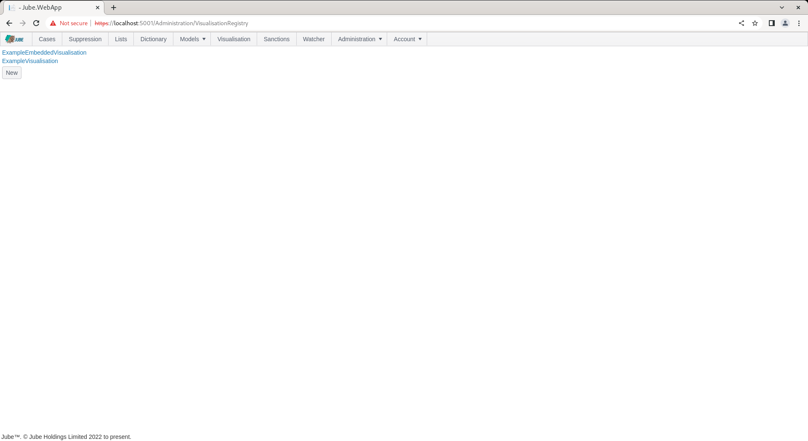
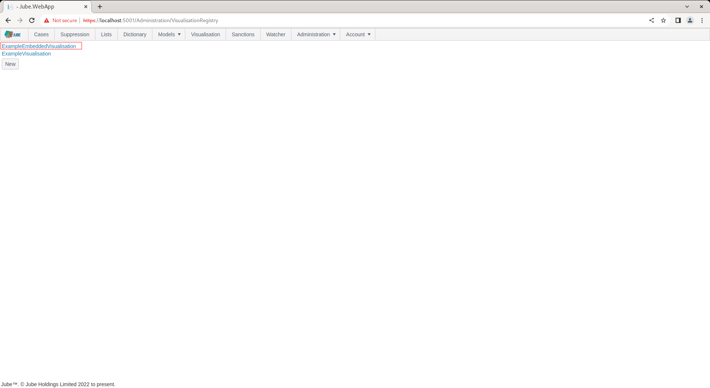
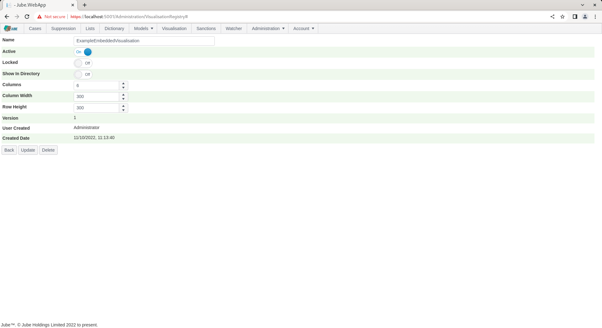
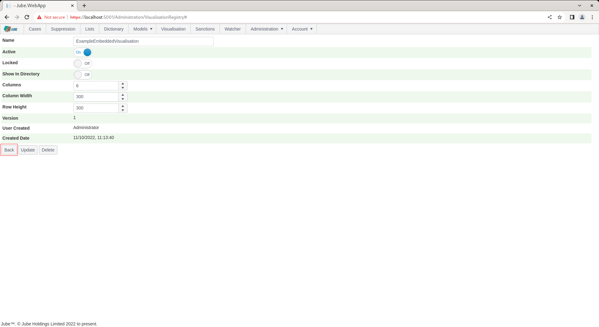
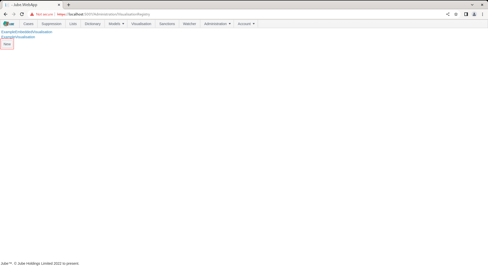
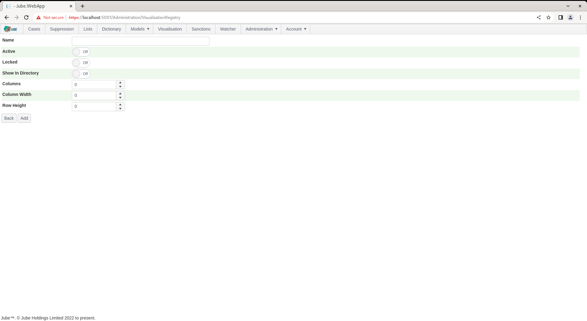
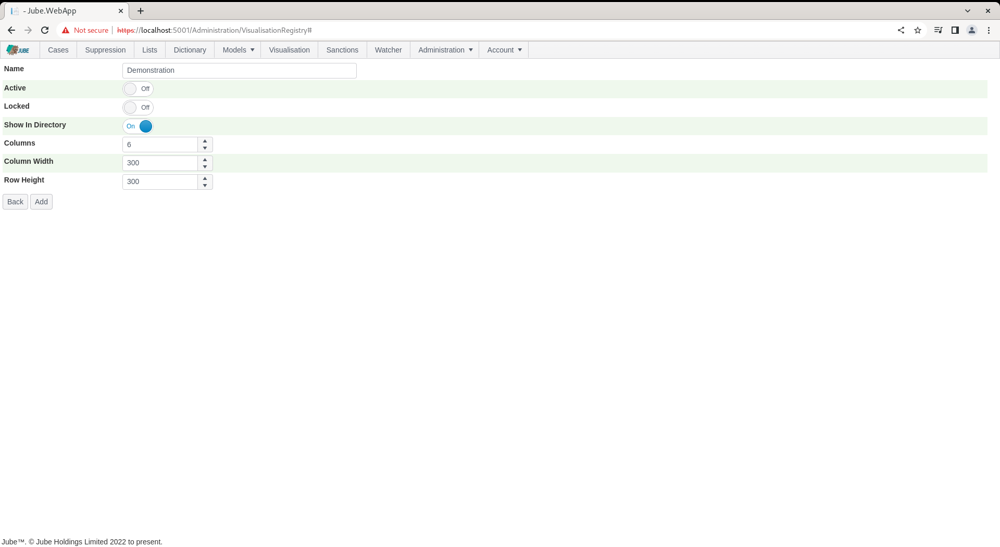
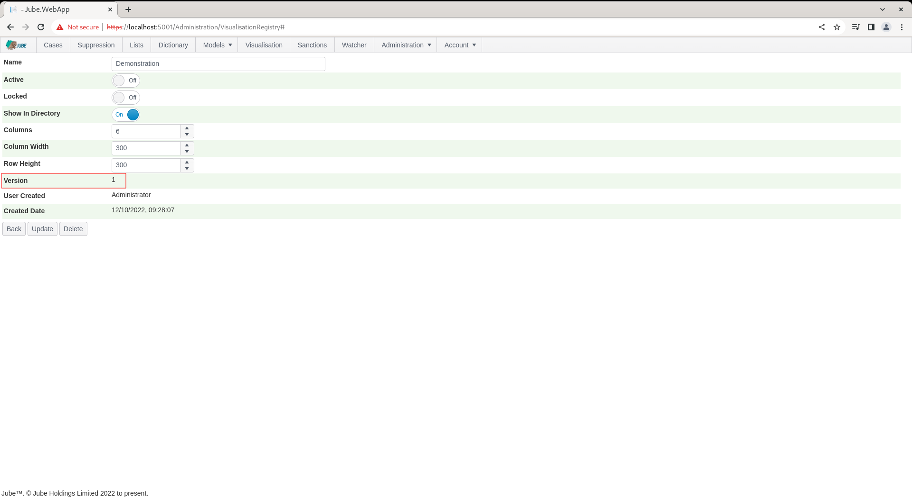
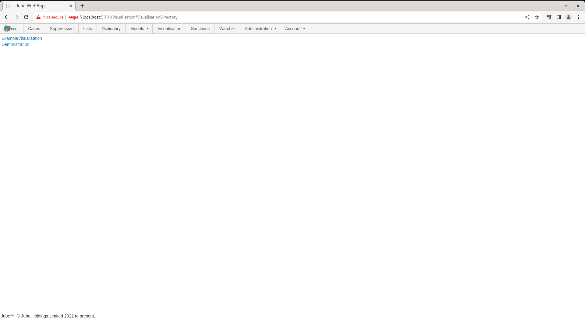
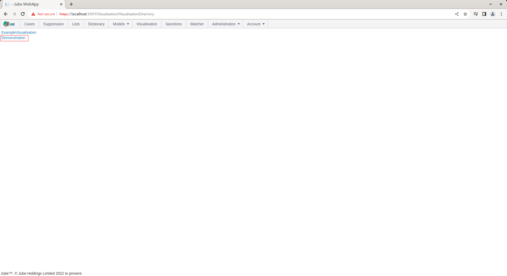

# Visualisation Registry

Think of a Visualisation Registry as a report. The Visualisation Registry can have many Datasource's which share a
common set of parameters. The Visualisation Registry is the wrapper and specifies the the size of the canvass for the
datasource's to be arranged. The registry entry also controls the availability of navigation to the Visualisation
through the Visualisation Directory.

To create a Visualisation Registry, navigate Administration >> Visualisation >> Visualisation Registry:

<!-- TODO(screenshot): file=visualisation-top-of-tree-visualisation.png route=/administration/visualisations state="Replace the Razor-era image TopOfTreeVisualisation.png with the Vue Administration > Visualisations page showing the same state" -->

To select an existing Visualisation Registry locate the link corresponding to the name:

<!-- TODO(screenshot): file=visualisation-link-to-exsiting.png route=/administration/visualisations state="Replace the Razor-era image LinkToExsiting.png with the Vue Administration > Visualisations page showing the same state" -->

Clicking on the link will expand the Visualisation Registry:

<!-- TODO(screenshot): file=visualisation-expanded-visualisation-registry.png route=/administration/visualisations state="Replace the Razor-era image ExpandedVisualisationRegistry.png with the Vue Administration > Visualisations page showing the same state" -->

To return to the list, click the Back button:

<!-- TODO(screenshot): file=visualisation-return-to-list.png route=/administration/visualisations state="Replace the Razor-era image ReturnToList.png with the Vue Administration > Visualisations page showing the same state" -->

To create a new Visualisation Registry click the New button:

<!-- TODO(screenshot): file=visualisation-new-button-for-visualisation-registry.png route=/administration/visualisations state="Replace the Razor-era image NewButtonForVisualisationRegistry.png with the Vue Administration > Visualisations page showing the same state" -->

On clicking the New button a page will be presented with empty fields for the creation of the Visualisation Registry:

<!-- TODO(screenshot): file=visualisation-empty-visualisation-registry.png route=/administration/visualisations state="Replace the Razor-era image EmptyVisualisationRegistry.png with the Vue Administration > Visualisations page showing the same state" -->

The Visualisation Registry takes the following parameters:

| Value        | Description                                                                                                                                                                              | Example   |
|--------------|------------------------------------------------------------------------------------------------------------------------------------------------------------------------------------------|-----------|
| Name         | The display name of the Visualisation Registry. Required, unique per tenant (case-insensitive), 256 characters maximum.                                                                  | Sales     |
| Shown In     | A drop down: Directory (listed in the Visualisation page, for the roles it is granted to) or Case (embedded as the dashboard of a Case, receiving the Case id as the SQL parameter @Id). | Directory |
| Columns      | The number of columns that the Visualization Registry will be divided into for the purpose of arranging the Datasource's, or tiles. Must be greater than 0.                              | 6         |
| Column Width | Given the columns having been specified,  the size in pixels of each column. Must be greater than 0.                                                                                     | 300       |
| Row Height   | Rows are otherwise unbounded,  however,  like columns,  have their size in pixels specified. Must be greater than 0.                                                                     | 300       |

Complete the page as follows and above:

<!-- TODO(screenshot): file=visualisation-example-registry.png route=/administration/visualisations state="Replace the Razor-era image ExampleRegistry.png with the Vue Administration > Visualisations page showing the same state" -->

Click Add to create a version of the Visualisation Registry:

<!-- TODO(screenshot): file=visualisation-version-of-visualisation-registry.png route=/administration/visualisations state="Replace the Razor-era image VersionOfVisualisationRegistry.png with the Vue Administration > Visualisations page showing the same state" -->

Upon a new Visualisation Registry having been created, and noting that Shown In having been set to Directory, it
will be available for recall. Clicking Visualisation from the main menu:

<!-- TODO(screenshot): file=visualisation-new-entry-in-visualisation-directory.png route=/administration/visualisations state="Replace the Razor-era image NewEntryInVisualisationDirectory.png with the Vue Administration > Visualisations page showing the same state" -->

It can be noted that a new entry has been created:

<!-- TODO(screenshot): file=visualisation-new-entry-for-recall.png route=/administration/visualisations state="Replace the Razor-era image NewEntryForRecall.png with the Vue Administration > Visualisations page showing the same state" -->

Clicking on the new entry will expose a blank page however in the absence of parameters nor datasource's having been
created for teh Visualisation Registry.

<!-- TODO(docs): Confirm the directory is role-grant gated only (no permission needed to list; the card needs permission 28 or 1) and that Administration > Visualisations needs 31, 32 or 33 (VisualisationRegistryService listPermissions 18, 31, 32, 33). -->
<!-- TODO(docs): Describe the new registry context kind (directory registry versus case-context registry): VisualisationRegistry.ContextKindId, only registries with a null or 1 context appear in the directory. -->
<!-- TODO(docs): Document that a datasource cannot be moved to another registry by an update; the registry id is pinned to the stored row. -->
<!-- TODO(docs): Replace every Razor-era description of the Kendo tree with the Vue story page, and verify the Summary tile figures (30 day window, executions, failures, average response, last user). -->
