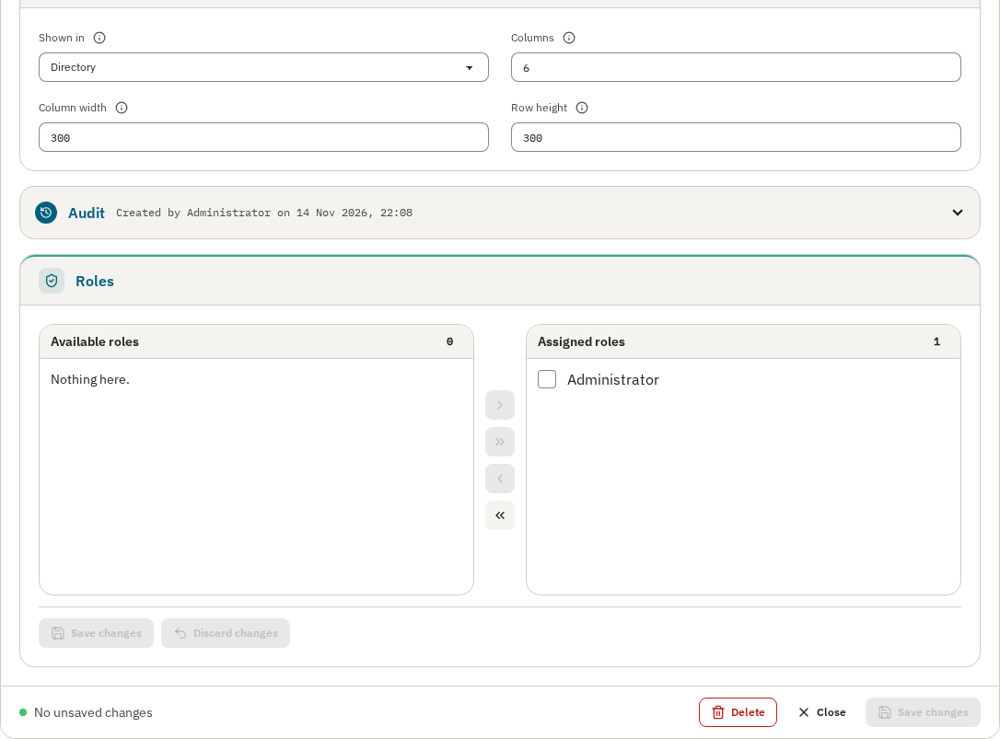

# Visualisations Security Policy

Before embarking on this section of documentation it is incumbent to explain that the functionality aims to provide for a similar use case as Case isolation, and in the interests of being concise, the explanation of database duplication is not repeated. It is suggested to review the core concepts under [Case Management Security Policy](../../CaseManagement/SecurityPolicy/index.html) beforehand.

Every Visualisation entity supports the allocation of roles and therefore isolation of data where that entity is apportioned.

The role allocations are joined upon recall in the Visualisation page, and its embedding in the Case page, having the effect of that data not being in existence unless it is possible to join back to the user, through the role, through the allocation and to that Visualisation entity.

## Where it lives

Navigate through the menu to Administration, then Visualisation setup, and open a Visualisation Registry. The Roles section is presented with the record, beneath its form, and is common to the following Visualisation entities, each of which is allocated in its own record:

* Visualisation.
* Visualisation Parameter.
* Visualisation Datasource.

The role allocations have different implications for the isolation of each Visualisation entity, as is explained in the section below.

The Roles section presents two lists, Available roles and Assigned roles. Roles are moved between the two with Assign selected, Assign all, Unassign selected and Unassign all, and nothing is changed until Save changes is clicked, whereupon Roles saved is returned. For the examples created in migrations, Administrator is allocated (this happens in migrations for the Administrator role in the Landlord Tenant only, and otherwise allocations need to be manually created).

It follows that a newly created Visualisation, Parameter or Datasource is allocated to no role, and is not available for recall by anyone, its author included, until it has been allocated.

SHOT id=visualisations-security-roles-section
     route=/administration/visualisations
     steps=open-row:ExampleVisualisation, scroll-to:Roles
     frame=record
     state=the seeded ExampleVisualisation opened in Visualisation setup and scrolled to the Roles section, with Administrator in Assigned roles and the remaining roles in Available roles
     conveys=each Visualisation entity carries its own allocation of roles, maintained as two lists beneath its form
     alt=The Roles section of a Visualisation Registry showing a list of available roles and a list of assigned roles, with controls to move roles between them



## Visualisation Recall Page Isolation

The Visualisation Recall page is responsible for the invocation and full recall of Datasources, and the rendering of responses from the database as grids or charts.

Visualisation Recall Page isolation exhibits the following behaviours:

| Recall                                 | Role Allocation Isolation                    | Description                                                                                                                                                                                                                                                                                                                                                                                                          |
|----------------------------------------|----------------------------------------------|----------------------------------------------------------------------------------------------------------------------------------------------------------------------------------------------------------------------------------------------------------------------------------------------------------------------------------------------------------------------------------------------------------------------|
| Visualisation Recall                   | Visualisation.                               | The availability of a Visualisation to a role, where the entry in the Visualisation directory will be hidden if the Role Allocation is not available.                                                                                                                                                                                                                                                                |
| Visualisation Parameter Entry          | Visualisation and Visualisation Parameter.   | The selective availability of Visualisation Parameters. In the event a Visualisation Parameter is hidden, the fallback value for that parameter is taken to be the default value configured. This functionality allows for a robust means to isolate data to given users, while providing wider search scope for administrators.                                                                                     |
| Visualisation Datasource (Card) Recall | Visualisation and Visualisation Datasource.  | A Visualisation is a collection of individual reports that have a common parameter set, and can be restricted in their recall based upon Role Allocation. In the case of direct recall of the API endpoints given no Role Allocation, the Visualisation is filtered out of the result and is not returned (HTTP 200, with an empty or partial list); the existence of an unallocated Visualisation is not disclosed. |

A request made directly for the tile of a Datasource that is not allocated to the role of the user, or is not active, is answered with 404, in the same manner as for a Datasource that does not exist.

All security policy is applied in the same manner to a Visualisation where it is embedded in a Case Workflow, and it follows that Role Allocations must be sympathetic to the Case Workflow Role Allocations.

## Permissions

Role allocation operates alongside, and not in the place of, the permissions held by the role:

| Permission | Name                                               | Allows                                                                                                    |
|------------|----------------------------------------------------|-----------------------------------------------------------------------------------------------------------|
| 28         | View Visualisation Directory                       | The Visualisation menu item, and the recall of the Visualisations, Parameters and Datasources allocated.  |
| 1          | Read Write Case                                    | The recall of an allocated Visualisation as the dashboard of a case.                                      |
| 31         | Read Write Visualisation Administration            | Creating, changing and deleting a Visualisation Registry, and allocating roles to it.                     |
| 32         | Read Write Visualisation Parameter Administration  | Creating, changing and deleting Parameters, and allocating roles to them.                                 |
| 33         | Read Write Visualisation Datasource                | Creating, changing and deleting Datasources, checking and previewing their SQL, and allocating roles to them. |

Any of permissions 31, 32 and 33 presents the Visualisation setup menu item under Administration.

## The SQL runs for the viewer

The SQL of a Datasource is written by its author, yet it is executed on behalf of the user recalling the Visualisation, henceforth the viewer, and it is the access of the viewer, not that of the author, which decides what is returned:

* Each table named in the SQL must be in the list of tables that Datasources are allowed to query, and the viewer must hold the permission that table requires. A table the viewer is not permitted to query is refused upon recall, even where the author was permitted and saved the Datasource without error. It follows that the permissions of the roles to which a Datasource is allocated must be sympathetic to the tables its SQL reads.
* Each table is exchanged, before the SQL is passed to the database, for a view of that table restricted to the rows of the tenant of the viewer. The SQL of a Datasource can never therefore return the rows of another tenant, however it is written.
* The tables holding users, roles, permissions, tenants and HTTP Adaptation definitions can never be queried by a Datasource.
* The SQL itself is returned only to a user holding permission 33. A viewer holding only permission 28 or permission 1 is given the tiles and never the SQL behind them.

The list of tables is enforced by default, and is controlled by the EnableVisualisationDatasourceTableAllowList Environment Variable, which is True by default (see [Environment Variables](../../../Concepts/EnvironmentVariables/index.html)). Where it is set to False the SQL is instead checked only against a list of tables and functions that are denied, and in that mode there is no restriction of rows to the tenant. Setting it to False is not advised in an installation having more than one tenant.

## Limits

The execution of the SQL of a Datasource is bounded by the following Environment Variables, and a tile exceeding a limit fails with a refusal stating as much, in the language of the user interface:

| Environment Variable          | Default  | Description                                                                              |
|-------------------------------|----------|------------------------------------------------------------------------------------------|
| ReportStatementTimeoutSeconds | 30       | The longest, in seconds, that the SQL may run before the database cancels it.            |
| ReportMaximumCellBytes        | 1048576  | The largest single value, in bytes, that a row may return.                               |
| ReportMaximumResultBytes      | 33554432 | The largest total result, in bytes, that a tile may read, being at most 5,000 rows.      |

## The reporting database role

The SQL of a Datasource (and case SQL, filters and samples) is user supplied. Jube checks it with a SQL validator and runs it in a read-only transaction with a statement timeout, yet those are application controls, and it follows that the database should refuse writes too, which is the purpose of the ReportConnectionString Environment Variable. When it is not set, or uses the same login as ConnectionString, the SQL runs as the application login and Jube writes a warning to the log at startup (the warning carries no connection detail). The quickstart `docker-compose.yml` does this, deliberately, for evaluation only.

For production, ReportConnectionString is to be set to a login that can only read. The house convention is `jube_reporting` in `Jube.Cluster/database.sh` (the same statements appear for `reporting` in `docs/GettingStarted/CreateUsers.sql`), where the login is created with a password, owns nothing, and holds `SELECT` on the tables in the `public` schema, with default privileges so that tables added by later migrations are readable. Jube never creates this login and no migration does.

The statements below create a narrower role that holds `SELECT` only on the tables the Datasource allow-list can reach (the registry in `DynamicSqlTableAccess` plus the tenancy tables its templates join), and on only two columns of `UserRegistry`, so password hashes are unreadable even if the validator were bypassed. The password and the database name are to be replaced. Keeping in mind that the same connection string also serves backtests, reprocessing, samples and case search, every table those features read must be confirmed as being in the list before the narrower role is adopted, and if in doubt the house convention is to be used instead.

TODO(verify): owner to confirm the narrow role against the tables read by backtest, reprocessing, sample and case search before it is recommended over the house convention.

```sql
CREATE ROLE jube_reporting_select LOGIN PASSWORD '<a long random password>'
    NOSUPERUSER NOCREATEDB NOCREATEROLE NOREPLICATION NOBYPASSRLS;
ALTER ROLE jube_reporting_select SET search_path = public;
ALTER ROLE jube_reporting_select SET default_transaction_read_only = on;
GRANT CONNECT ON DATABASE <database> TO jube_reporting_select;
GRANT USAGE ON SCHEMA public TO jube_reporting_select;
REVOKE ALL ON ALL TABLES IN SCHEMA public FROM jube_reporting_select;
```

<!-- reporting-role-grants:start -->

```sql
GRANT SELECT ON
    "ActivationWatcher",
    "AdvancedAnalyticsCache",
    "AdvancedAnalyticsTrainingRun",
    "AdvancedAnalyticsTrainingRunCurvePoint",
    "AdvancedAnalyticsTrainingRunIteration",
    "AdvancedAnalyticsTrainingRunMetric",
    "AdvancedAnalyticsTrainingRunStep",
    "AdvancedAnalyticsTrainingRunTrial",
    "AdvancedAnalyticsTrainingRunVariable",
    "Archive",
    "ArchiveEntityAnalysisModelAbstractionEntry",
    "ArchiveKey",
    "ArchiveKeyVersion",
    "ArchiveTag",
    "ArchiveTagVersion",
    "ArchiveVersion",
    "ArchiverStagePerformanceCounter",
    "ArchiverWarning",
    "AskJoobyAnalyticsInstance",
    "AskJoobyAnalyticsInstanceVersion",
    "AskJoobyAnalyticsTrainedModel",
    "AskJoobyAnalyticsTrainedModelVersion",
    "AskJoobyEndpointFee",
    "AskJoobyErrata",
    "AskJoobyRagChunk",
    "AskJoobyRerankFee",
    "Case",
    "CaseCreationWarning",
    "CaseEvent",
    "CaseFile",
    "CaseNote",
    "CaseResearch",
    "CaseResearchCitation",
    "CaseSuppression",
    "CaseSuppressionApproval",
    "CaseSuppressionTarget",
    "CaseSuppressionTransaction",
    "CaseSuppressionVersion",
    "CaseWorkflow",
    "CaseWorkflowAction",
    "CaseWorkflowActionRole",
    "CaseWorkflowActionVersion",
    "CaseWorkflowDisplay",
    "CaseWorkflowDisplayRole",
    "CaseWorkflowDisplayVersion",
    "CaseWorkflowFilter",
    "CaseWorkflowFilterRole",
    "CaseWorkflowFilterVersion",
    "CaseWorkflowForm",
    "CaseWorkflowFormEntry",
    "CaseWorkflowFormEntryValue",
    "CaseWorkflowFormRole",
    "CaseWorkflowFormVersion",
    "CaseWorkflowMacro",
    "CaseWorkflowMacroRole",
    "CaseWorkflowMacroVersion",
    "CaseWorkflowRole",
    "CaseWorkflowStatus",
    "CaseWorkflowStatusRole",
    "CaseWorkflowStatusVersion",
    "CaseWorkflowVersion",
    "CaseWorkflowXPath",
    "CaseWorkflowXPathRole",
    "CaseWorkflowXPathVersion",
    "Country",
    "Currency",
    "DictionaryEvalExpression",
    "DynamicSqlTokens",
    "EntityAnalysisInlineScript",
    "EntityAnalysisModel",
    "EntityAnalysisModelAbstractionCalculation",
    "EntityAnalysisModelAbstractionCalculationVersion",
    "EntityAnalysisModelAbstractionRule",
    "EntityAnalysisModelAbstractionRuleVersion",
    "EntityAnalysisModelActivationRule",
    "EntityAnalysisModelActivationRuleCounterHistory",
    "EntityAnalysisModelActivationRuleOverride",
    "EntityAnalysisModelActivationRuleOverrideVersion",
    "EntityAnalysisModelActivationRuleVersion",
    "EntityAnalysisModelAsynchronousQueueBalance",
    "EntityAnalysisModelBacktestInstance",
    "EntityAnalysisModelDictionary",
    "EntityAnalysisModelDictionaryCsvFileUpload",
    "EntityAnalysisModelDictionaryKvp",
    "EntityAnalysisModelDictionaryKvpVersion",
    "EntityAnalysisModelDictionaryVersion",
    "EntityAnalysisModelGatewayRule",
    "EntityAnalysisModelGatewayRuleCounterHistory",
    "EntityAnalysisModelGatewayRuleVersion",
    "EntityAnalysisModelInlineFunction",
    "EntityAnalysisModelInlineFunctionVersion",
    "EntityAnalysisModelInlineScript",
    "EntityAnalysisModelInlineScriptVersion",
    "EntityAnalysisModelInstance",
    "EntityAnalysisModelList",
    "EntityAnalysisModelListCsvFileUpload",
    "EntityAnalysisModelListValue",
    "EntityAnalysisModelListValueVersion",
    "EntityAnalysisModelListVersion",
    "EntityAnalysisModelOverride",
    "EntityAnalysisModelOverrideVersion",
    "EntityAnalysisModelProcessingCounter",
    "EntityAnalysisModelReprocessingRule",
    "EntityAnalysisModelReprocessingRuleInstance",
    "EntityAnalysisModelRequestXpath",
    "EntityAnalysisModelRequestXpathVersion",
    "EntityAnalysisModelResponseElevationRange",
    "EntityAnalysisModelResponseElevationRangeVersion",
    "EntityAnalysisModelResponseTimePipelineCounter",
    "EntityAnalysisModelRole",
    "EntityAnalysisModelSampleExecutionLog",
    "EntityAnalysisModelSanction",
    "EntityAnalysisModelSanctionVersion",
    "EntityAnalysisModelSearchKeyCalculationInstance",
    "EntityAnalysisModelSearchKeyDistinctValueCalculationInstance",
    "EntityAnalysisModelStagePerformanceCounter",
    "EntityAnalysisModelSynchronisationNodeStatusEntry",
    "EntityAnalysisModelSynchronisationSchedule",
    "EntityAnalysisModelTag",
    "EntityAnalysisModelTagVersion",
    "EntityAnalysisModelTaskPerformanceCounter",
    "EntityAnalysisModelTtlCounter",
    "EntityAnalysisModelTtlCounterVersion",
    "EntityAnalysisModelVersion",
    "EntityApproval",
    "ExampleCaseVolumeEntry",
    "ExampleCustomerCaseManagement",
    "ExampleGeoCoded",
    "ExhaustiveSearchInstance",
    "ExhaustiveSearchInstanceCategoricalField",
    "ExhaustiveSearchInstanceData",
    "ExhaustiveSearchInstancePrescriptionHistogram",
    "ExhaustiveSearchInstancePromotedTrialInstance",
    "ExhaustiveSearchInstancePromotedTrialInstancePredictedActual",
    "ExhaustiveSearchInstancePromotedTrialInstancePredictedActualVar",
    "ExhaustiveSearchInstancePromotedTrialInstanceRoc",
    "ExhaustiveSearchInstancePromotedTrialInstanceSensitivity",
    "ExhaustiveSearchInstancePromotedTrialInstanceVariable",
    "ExhaustiveSearchInstanceTrialInstance",
    "ExhaustiveSearchInstanceTrialInstanceActivationFunctionTrial",
    "ExhaustiveSearchInstanceTrialInstanceSensitivity",
    "ExhaustiveSearchInstanceTrialInstanceTopologyTrial",
    "ExhaustiveSearchInstanceTrialInstanceVariable",
    "ExhaustiveSearchInstanceVariable",
    "ExhaustiveSearchInstanceVariableAnomaly",
    "ExhaustiveSearchInstanceVariableClassification",
    "ExhaustiveSearchInstanceVariableHistogram",
    "ExhaustiveSearchInstanceVariableHistogramAnomaly",
    "ExhaustiveSearchInstanceVariableHistogramClass",
    "ExhaustiveSearchInstanceVariableHistogramClassification",
    "ExhaustiveSearchInstanceVariableMultiCollinearity",
    "ExhaustiveSearchInstanceVersion",
    "Export",
    "GraphCommunity",
    "GraphEdge",
    "GraphNode",
    "GraphNodeTag",
    "GraphPattern",
    "GraphRegistry",
    "GraphRegistryEdge",
    "GraphRegistryRole",
    "Import",
    "Language",
    "LanguageString",
    "MockArchive",
    "PermissionSpecification",
    "PreservationDiff",
    "PreservationSnapshot",
    "RoleRegistry",
    "RuleScriptToken",
    "SanctionEntry",
    "SanctionEntryImport",
    "SanctionEntryRejection",
    "SanctionEntrySource",
    "SanctionStopToken",
    "SessionCaseJournal",
    "TenantRegistry",
    "UserInTenant",
    "VisualisationRegistry",
    "VisualisationRegistryDatasource",
    "VisualisationRegistryDatasourceExecutionLog",
    "VisualisationRegistryDatasourceExecutionLogParameter",
    "VisualisationRegistryDatasourceRole",
    "VisualisationRegistryDatasourceSeries",
    "VisualisationRegistryDatasourceVersion",
    "VisualisationRegistryParameter",
    "VisualisationRegistryParameterRole",
    "VisualisationRegistryParameterVersion",
    "VisualisationRegistryRole",
    "VisualisationRegistryVersion"
TO jube_reporting_select;
GRANT SELECT ("Name", "RoleRegistryGuid") ON "UserRegistry" TO jube_reporting_select;
```

<!-- reporting-role-grants:end -->

A table added to the allow-list later needs its own `GRANT SELECT`, and the test `TheDocumentedSelectOnlyRoleGrantsExactlyTheTablesTheAllowListCanReach` fails until this list is updated. ReportConnectionString is then set to a connection string that uses `jube_reporting_select`. On a cluster, `jube_reporting` is already wired in this manner.
