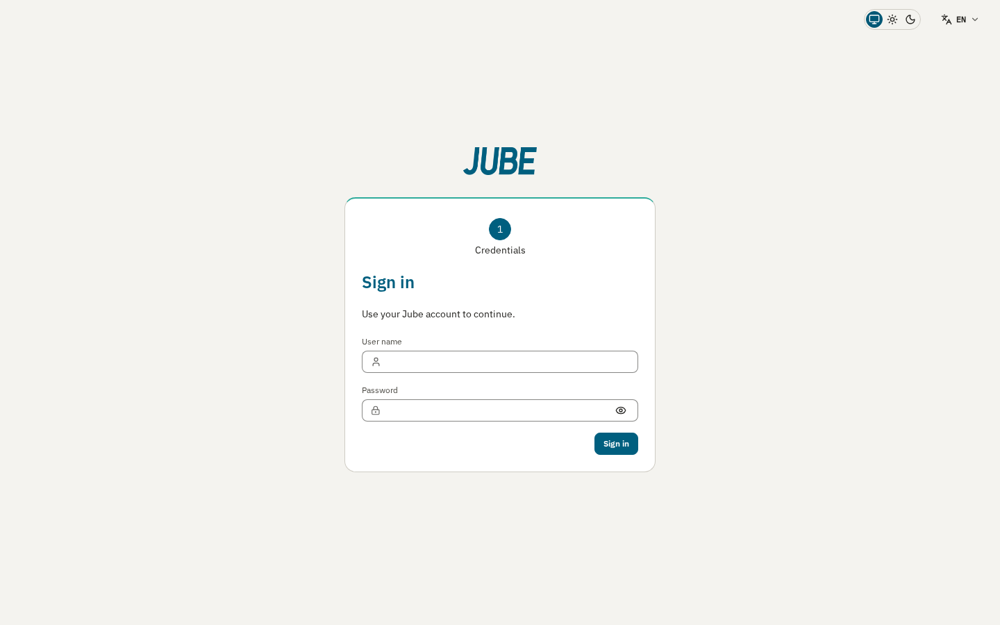
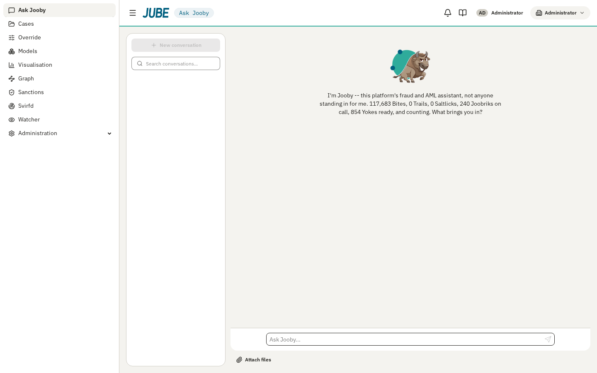

# Deploying with Docker

Docker is the supported way to get Jube running. A `docker-compose.yml` file at the root of the repository orchestrates Jube alongside its dependencies, being Postgres and a cache speaking the Resp protocol, which is Garnet. Jube is not published to Docker Hub, the images instead being built from source as part of bringing the stack up, and it follows that the only prerequisite is Docker itself.

This base install is for evaluation and development only, and it is **not** intended for production use. It runs a single node, connects to Postgres as superuser, and passes secrets as plain shell Environment Variables. Production deployments should instead follow [Deploying with Jube Cluster](../DeployingWithJubeCluster/index.html), which covers a load-balanced, highly available, clustered deployment with robust secret management (`Jube.Cluster/secrets-init.sh`, Docker Swarm secrets, and per-environment generated credentials rather than shared placeholders).

Jube can be up and running in minutes with the following shell script:

```shell
git clone https://github.com/jube-home/aml-fraud-transaction-monitoring
cd aml-fraud-transaction-monitoring
export DockerComposePostgresPassword='IMPORTANT:_ChangeThisKey_SuperSecretPasswordToChangeForPg'
export DockerComposeJWTKey='IMPORTANT:_ChangeThisKey_et8WMyVE3qE0Fxie4dDMGMGLf5nOFaVjQ1UmLQ8L0ouKJoN8ADRaXmcWU1DpeoAu0njC4F4ASCxreCgucaM85dHKV4vIZa3zzDqkkrAzRdAd3sTtXRLhj1U3GPUA9BEL_UsingThisKeyIsDangerous'
export DockerComposeApiHmacKey='IMPORTANT:_ChangeThisKey_et8WMyVE3qE0Fxie4dDMGMGLf5nOFaVjQ1UmLQ8L0ouKJoN8ADRaXmcWU1DpeoAu0njC4F4ASCxreCgucaM85dHKV4vIZa3zzDqkkrAzRdAd3sTtXRLhj1U3GPUA9BEL_UsingThisKeyIsDangerous'
export DockerComposePasswordHashingKey='IMPORTANT:_ChangeThisKey_et8WMyVE3qE0Fxie4dDMGMGLf5nOFaVjQ1UmLQ8L0ouKJoN8ADRaXmcWU1DpeoAu0njC4F4ASCxreCgucaM85dHKV4vIZa3zzDqkkrAzRdAd3sTtXRLhj1U3GPUA9BEL_UsingThisKeyIsDangerous'
export DockerComposeElementSymmetricEncryptionKey='IMPORTANT:_ChangeThisKey_et8WMyVE3qE0Fxie4dDMGMGLf5nOFaVjQ1UmLQ8L0ouKJoN8ADRaXmcWU1DpeoAu0njC4F4ASCxreCgucaM85dHKV4vIZa3zzDqkkrAzRdAd3sTtXRLhj1U3GPUA9BEL_UsingThisKeyIsDangerous'
export DockerComposeCaseSimilarityHashingKey='IMPORTANT:_ChangeThisKey_et8WMyVE3qE0Fxie4dDMGMGLf5nOFaVjQ1UmLQ8L0ouKJoN8ADRaXmcWU1DpeoAu0njC4F4ASCxreCgucaM85dHKV4vIZa3zzDqkkrAzRdAd3sTtXRLhj1U3GPUA9BEL_UsingThisKeyIsDangerous'
export DockerComposeEnableAskJooby=False
export DockerComposeAskJoobyApiKey='OPTIONAL_IMPORTANT:_ChangeThisKey_et8WMyVE3qE0Fxie4dDMGMGLf5nOFaVjQ1UmLQ8L0ouKJoN8ADRaXmcWU1DpeoAu0njC4F4ASCxreCgucaM85dHKV4vIZa3zzDqkkrAzRdAd3sTtXRLhj1U3GPUA9BEL_UsingThisKeyIsDangerous'
docker compose up -d
```

This quickstart leaves the mock HTTP Adaptation endpoints (`EnableMockEndpoints`, default True) mapped so that the seeded example model works, and the mock RSA MFA verifier unmapped (`EnableMockMfaEndpoint`, default False). Both are anonymous test doubles, and for anything beyond evaluation `EnableMockEndpoints=False` should be set, as the Jube Cluster compose files do.

## The values to change

Every value above must be changed from the example shown, as these are placeholders rather than defaults that can be left in place, and each key should be at least as long as the example given.

| Value                                        | Description                                                                                                                                                                                                                                                                         |
|----------------------------------------------|-------------------------------------------------------------------------------------------------------------------------------------------------------------------------------------------------------------------------------------------------------------------------------------|
| `DockerComposePostgresPassword`              | Bootstraps the superuser password of the `postgres` container upon first initialisation (`POSTGRES_PASSWORD`), and is packed by `docker-compose.yml` itself into the otherwise static `ConnectionString` and `ReportConnectionString` values of the `jube` and `jube-monitoring` services. |
| `DockerComposeJWTKey`                        | Maps through to the `JWTKey` Environment Variable. Jube will not start with an empty value.                                                                                                                                                                                         |
| `DockerComposeApiHmacKey`                    | Maps through to the `ApiHmacKey` Environment Variable, which is required only before issuing API keys.                                                                                                                                                                              |
| `DockerComposePasswordHashingKey`            | Maps through to the `PasswordHashingKey` Environment Variable. Jube will not start with an empty value.                                                                                                                                                                             |
| `DockerComposeElementSymmetricEncryptionKey` | Maps through to the `ElementSymmetricEncryptionKey` Environment Variable.                                                                                                                                                                                                           |
| `DockerComposeEnableAskJooby`                | Optional. Maps through to `EnableAskJooby`, and Ask Jooby is off until it is set to `True`.                                                                                                                                                                                         |
| `DockerComposeAskJoobyApiKey`                | Optional. Maps through to `AskJoobyApiKey`, being the key of the inference provider.                                                                                                                                                                                                |

The Postgres password is henceforth the one value set once and used consistently everywhere it is needed, with nothing to keep in sync by hand. The Environment Variables to which the remainder map are described in [Environment Variables](../../Concepts/EnvironmentVariables/index.html).

`ElementSymmetricEncryptionKey` ships with a well-known placeholder default, and leaving it unchanged means that any value encrypted via the Inline Script AES helper (see [Field Level Encryption](../../Concepts/FieldEncryption/index.html)) is trivially reversible by anyone with a copy of this documentation.

For Ask Jooby, `DockerComposeAskJoobyApiKey` is where the key goes, which is to say a DigitalOcean Serverless Inference key, as `AskJoobyApiEndpoint` and `AskJoobyEmbeddingApiEndpoint` default to DigitalOcean Gradient. It is the only key Ask Jooby needs, as the embedding, reranker and AI analysis roles all inherit it, and there are no separate exports for them. A deployment that serves one of those roles from a different provider can add the matching `AskJoobyEmbeddingApiKey`, `AskJoobyRerankerApiKey` or `AskJoobyAiAnalysisApiKey` Environment Variable to the `jube` service.

None of these values are hardcoded anywhere in `docker-compose.yml` itself, and every secret the compose file needs is interpolated by Docker Compose from the shell Environment at `docker compose up` time. One further value is read from the shell where it has been exported and is otherwise left empty, being `DockerComposeSvirfdApiKey` (the `SvirfdApiKey` Environment Variable), which is not needed to start. `DockerComposeCaseSimilarityHashingKey` (the `CaseSimilarityHashingKey` Environment Variable) is exported above so that Similar cases is switched on. Like the other keys it is a placeholder to be changed, and if it is not exported the system still starts but no case is compared.

The pattern of exporting and then running `docker compose up` passes secrets as plain shell Environment Variables, which is fine for local evaluation, yet it is not how a real deployment should hand over credentials. `Jube.Cluster/secrets-init.sh` provides for this in the clustered Docker Swarm deployment, as described in [Creating Secrets](../DeployingWithJubeCluster/DeploymentRunbook/index.html#creating-secrets), by generating random credentials and an RSA keypair and loading them into Swarm's own secret store, to be resolved at container start via the `SecretsPath` and `[@Key@]` Docker Secrets tokenisation documented in [Environment Variables](../../Concepts/EnvironmentVariables/index.html). That script relies on `docker secret create`, which requires Swarm mode, and it follows that it is not usable from this single-node quickstart as it stands. There is not, at present, an equivalent for Docker Compose, and the quickstart keeps the plain shell Environment Variable pattern for that reason.

## What happens

Copy and paste the full block of shell script above into the terminal. The Jube software is first cloned locally:

```text
Cloning into 'aml-fraud-transaction-monitoring'...
remote: Enumerating objects: ..., done.
remote: Counting objects: 100% (...), done.
remote: Compressing objects: 100% (...), done.
Receiving objects: 100% (...), done.
```

The software is built locally after it has been cloned, there being four images: `jube.app`, `jube.monitoring`, `jube.r` and `jube.opentelemetrylistener`. Once the images have been built, Docker Compose ensures that the remaining dependencies, Postgres and Garnet, are available, and then orchestrates the stack. The build output is long and is not reproduced here, although it concludes in the following form, where the timings and the exact wording differ by version of Docker:

```text
 ✔ jube.app                                            Built
 ✔ jube.monitoring                                     Built
 ✔ jube.r                                              Built
 ✔ jube.opentelemetrylistener                          Built
 ✔ Network aml-fraud-transaction-monitoring_default    Created
 ✔ Network aml-fraud-transaction-monitoring_rsandbox   Created
 ✔ Volume "aml-fraud-transaction-monitoring_postgres"  Created
 ✔ Volume "aml-fraud-transaction-monitoring_resp"      Created
 ✔ Volume "aml-fraud-transaction-monitoring_svirfd"    Created
 ✔ Container postgres                                  Started
 ✔ Container resp                                      Started
 ✔ Container jube-r                                    Started
 ✔ Container jube-otel-listener                        Started
 ✔ Container jube-monitoring                           Started
 ✔ Container jube                                      Started
```

The containers are as follows:

| Container            | Description                                                                                                                                                     | Port on the host |
|----------------------|-----------------------------------------------------------------------------------------------------------------------------------------------------------------|------------------|
| `jube`               | The Jube application, being the user interface, the API, the engine and the background jobs in one container.                                                   | 5001             |
| `postgres`           | Postgres 17 with the pgvector extension, and `pg_stat_statements` preloaded.                                                                                    | 5432             |
| `resp`               | Garnet, the cache, persisting to an append only file.                                                                                                           | 6379             |
| `jube-r`             | The sandbox in which R scripts are executed. It is read only, has all capabilities dropped, and sits on an internal network reachable only by `jube`.           | None             |
| `jube-monitoring`    | A sidecar sampling the Docker containers, host and events through a read only mount of the Docker socket.                                                       | None             |
| `jube-otel-listener` | The listener to which OpenTelemetry is exported.                                                                                                                | None             |

Garnet is the cache of the quickstart. For the purposes of running against Redis instead, `docker-compose.redis.yml` at the root of the repository is the alternative compose file, which swaps the `resp` service for a `redis` service on the Redis Stack image and is passed to Docker Compose with `-f docker-compose.redis.yml`.

Navigate to [http://localhost:5001/](http://localhost:5001/), which presents the Sign in page, having a User name and a Password. The default User name and Password are Administrator / Administrator, requiring change on first login.

SHOT id=getting-started-docker-sign-in
     route=/
     steps=sign-out
     frame=viewport
     state=the Sign in page as first presented by a fresh installation, showing the Jube wordmark, the card with the User name and Password boxes and Sign in, and the theme and language switchers
     conveys=a deployment that has come up answers at its address with the Sign in page
     alt=The Sign in page of Jube showing a card with User name and Password boxes and a Sign in button, alongside the theme and language switchers



Upon signing in for the first time the page moves to the step Choose a new password, where a New password and Confirm new password are entered. The requirements of a new password are listed alongside and are marked as Met or Not met as the password is typed. Clicking Change password and sign in completes the login.

Upon change, navigation to Ask Jooby takes place, which is the first item of the main menu and the landing page for every login. Where Ask Jooby has been left off, as it is in the script above, the page states that Jooby is not switched on for this installation, and what Jooby can do can be read about, yet replies are off until an inference backend is configured. The remainder of the main menu is alongside: Cases, Override, Models, Visualisation, Graph, Sanctions, Svirfd, Watcher and Administration.

SHOT id=getting-started-docker-landing-ask-jooby
     route=/ask-jooby
     steps=none
     frame=viewport
     state=the Ask Jooby page as first seen by the Administrator after login on a fresh installation with Ask Jooby off, showing the main menu, the notice that Jooby is not switched on, the list of conversations and the welcome
     conveys=login lands on Ask Jooby, with the main menu giving access to everything else
     alt=The Ask Jooby page after the first login, with the main menu listing Ask Jooby, Cases, Override, Models, Visualisation, Graph, Sanctions, Svirfd, Watcher and Administration, and a notice that Jooby is not switched on for this installation



## Build dependencies

Nothing further needs installing to build the image, and the following are called out only so that it is clear why they are in `Jube.App/Dockerfile` should it be customised:

* The Kerberos libraries `libkrb5-3`, `libgssapi-krb5-2` and `krb5-user`, required for Negotiate (Windows Integrated / Kerberos) authentication. .NET stopped bundling these from .NET 8 onwards, hence they are installed explicitly as root in the base image stage. `libgssapi-krb5-2` is what the Negotiate P/Invoke calls actually need at runtime, and `libkrb5-3` is pulled in as its dependency.
* The `Jube.Cryptography` and `Jube.Preservation` projects are copied and built as part of the image, required at runtime by Inline Script reflection and by Preservation import and export respectively.

## Hardening beyond the quickstart

The quickstart above connects Jube to Postgres as the `postgres` superuser, which is adequate for evaluation but not for a real deployment. `docs/GettingStarted/CreateUsers.sql` creates two restricted Postgres users, `service` (used for the `ConnectionString` of the application) and `reporting` (used for `ReportConnectionString`), scoped to only the grants each actually needs, rather than running as superuser. The grants are made upon the schema rather than table by table, in the manner of `Jube.Cluster/database.sh`: `service` may select, insert and update every table, and delete only from the inbound queue, `reporting` may only select, and default privileges carry the same grants to the tables that a later Migration creates, provided the script and the Migration are run by the same login. Neither restricted user needs DDL rights, since Migration can instead run under a separate, DDL-capable credential via `MigrationConnectionString` (falling back to `ConnectionString` when unset), as described in [Environment Variables](../../Concepts/EnvironmentVariables/index.html).

When `ReportConnectionString` is left at the quickstart value, being the same superuser as `ConnectionString`, Jube writes a warning to the log at startup, because user-supplied reporting SQL then runs with full privileges behind only a read-only transaction and the SQL validator. It should be noted that the quickstart sets `Log4NetLogLevel=ERROR`, at which level the warning is not written, hence its absence from the log is not evidence that the reporting connection is restricted. See [the reporting database role](../../Configuration/Visualisations/SecurityPolicy/index.html#the-reporting-database-role) for the exact `CREATE ROLE` and `GRANT SELECT` statements.

`docker-compose.yml` does not wire these restricted users in by default. Running `CreateUsers.sql` means also updating the connection strings in the compose file, and the setup of the Postgres users, by hand, which is a manual hardening step. The roles of a production deployment are instead created by `Jube.Cluster/database.sh`, and the simple `docker-compose.yml` is not intended for production use, at least without significant hardening.

## Sizing the quickstart's Postgres and cache containers

The root `docker-compose.yml` pins the `postgres` container to fixed memory-related settings (`shared_buffers`, `work_mem`, `maintenance_work_mem`, `effective_cache_size`, `wal_buffers`, `max_wal_size`, `min_wal_size`, `max_connections`, `temp_file_limit`) rather than leaving them at the conservative defaults of Postgres.

These are sized for a development or evaluation host with several GB of RAM to spare, and are not derived from the actual allocation of the container. They should be resized (or the `command:` override removed entirely, letting Postgres pick its own defaults) to match the memory actually available to the host or container before using this compose file as a starting point for anything beyond local evaluation.

The `resp` container, being Garnet, is started with an append only file, recovery from that file upon start, and a minimum of four threads, and no ceiling on memory is set for it. The alternative `docker-compose.redis.yml` does set a ceiling, pinning `redis` through `REDIS_ARGS` to `maxmemory 18gb` with `maxmemory-policy noeviction` alongside `io-threads 4` and `io-threads-do-reads yes`. `maxmemory-policy noeviction` in particular means that Redis will start refusing writes rather than silently evicting data once `maxmemory` is reached, which is the safer failure mode for a cache that also holds TTL Counter and cache payload state, yet it means that an undersized `maxmemory` shows up as write errors rather than degraded performance.

The stack is deployed as a single `jube` service, one image and one container, rather than being split across separate web API and background jobs services. It follows that every feature flag (reprocessing, cache pruning, sanctions loading, `EnablePublicInvokeController`, and so on) is enabled together, and `LocalCache` stays `True` throughout.

## Beyond a single node

This page covers a single-node Docker Compose deployment, which is the right starting point for evaluation and proof of concept, but is **not** intended for production use as it stands. For a load-balanced, highly available, clustered deployment with robust secret management, see [Deploying with Jube Cluster](../DeployingWithJubeCluster/index.html).
