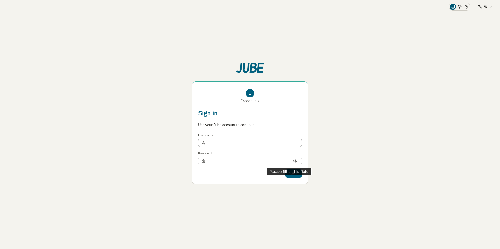
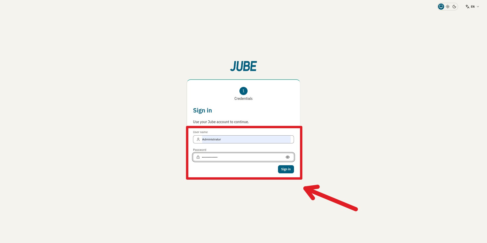
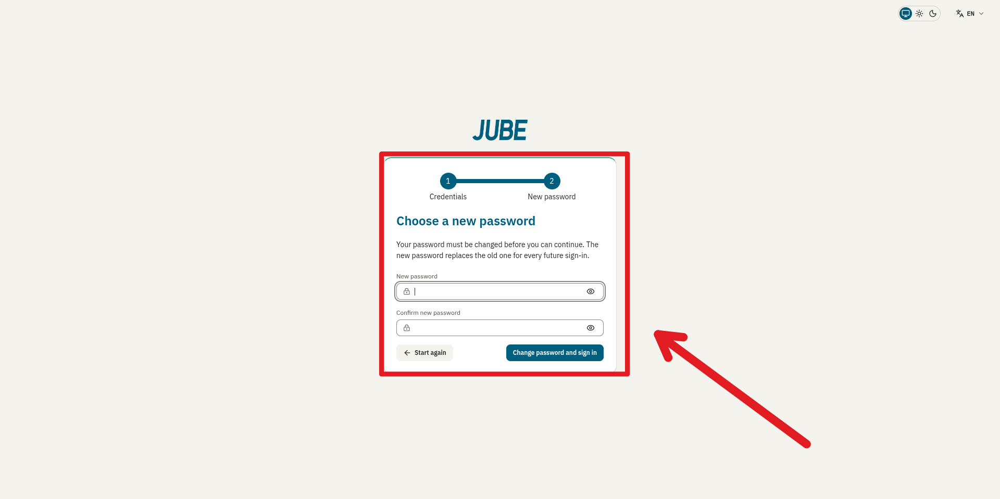
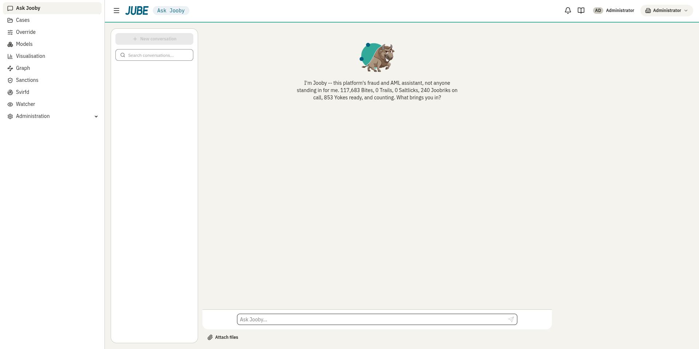
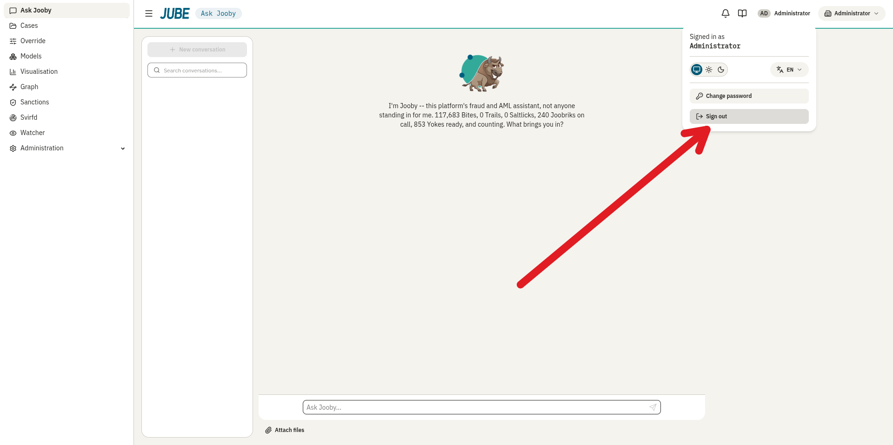
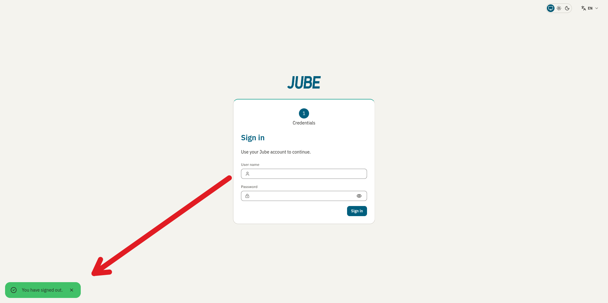
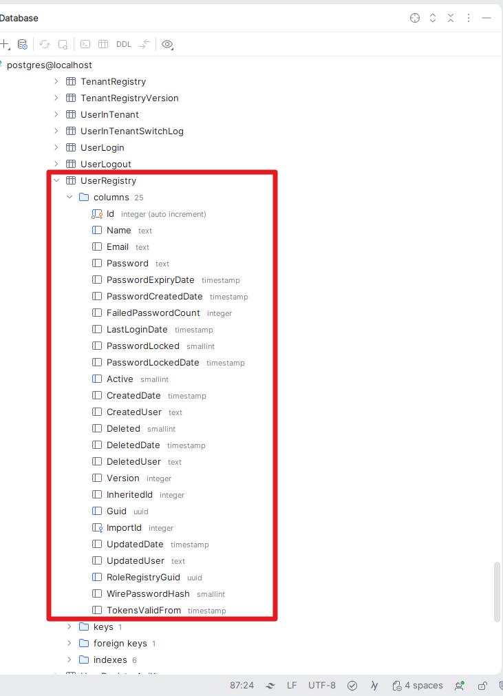
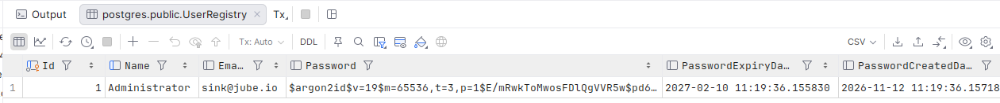

# Authentication

This page walks through signing in to the user interface with a User Name and Password, which is how Jube ships. Where
OAuth or Negotiate has been switched on the sign-in page behaves differently, and where Multi-Factor Authentication has
been switched on a Verification step is added; all of that, with lockout, session lifetime and the audit trails, is
covered in [Authentication Concepts](../../Concepts/Authentication/index.html).

## Signing In for the First Time

The sign-in page asks for a User name and Password:



A new installation has one user:

User: Administrator

Password: Administrator

The default password is weak, however it cannot be used for anything except replacing it: the first sign-in is refused
until a new password is chosen, thus it is only temporary.

Input the user name and password as specified above:



Click the Sign in button. The page moves to its New password step, stating that the password must be changed before
continuing:



The new password must conform to the following complexity rules, which the page lists and ticks off as they are met:

* Length must be at least 12.
* Length must not exceed 128.
* Must contain at least one uppercase letter.
* Must contain at least one lowercase letter.
* Must contain at least one number.
* Must contain at least one special character.
* No character may repeat more than twice consecutively.
* Must not start with a common pattern such as "password", "123456" or "qwerty".

Complete the New password with appropriate complexity, and repeat it in Confirm new password.

Click the Change password and sign in button, which changes the password as part of the authentication process.
Passwords are not stored in plain text and are hashed with the Argon2 algorithm (the computational expense does bring
about a slow experience during authentication however).

Upon successful authentication the user will be navigated to the home page of the user interface:



Consecutive failed attempts lock the account; with the default of three (PasswordAttempts) the third wrong password
locks it.

## The Session

As a consequence of authentication, a JSON Web Token will exist in a cookie named "authentication-jwt". The cookie is
HttpOnly, so it cannot be read by script in the page, and the browser sends it with each request. The instant at which
the session will end is returned to the page in an HTTP response header named "X-Session-Expiry".

The token is valid for 15 minutes. Each request made through the user interface replaces it with a fresh 15 minute
token, so an active session slides forward, but never beyond twelve hours from the original sign-in by default
(SessionAbsoluteLifetimeInterval and SessionAbsoluteLifetimeIntervalValue), after which authentication must be
repeated however active the user has been.

When the session is within five minutes of ending, the user interface shows a warning that the session is about to
expire, with an Extend session button. If the session does end, the user interface says so and returns to the sign-in
page, remembering the page that was open so that signing in again returns to it.

## Signing Out

To sign out, open the Account menu and click Sign out.



Signing out removes the cookie, revokes every token issued to the user so far (so a copied token stops working on every
instance of Jube at once) and returns to the sign-in page with a confirmation that the user has signed out:



The same menu offers Change password for a user who is signed in with a User Name and Password.

## The JSON Web Token

Authentication is a matter of obtaining a JSON Web Token and ensuring that it is available on each HTTP request, in
either the cookie named "authentication-jwt", or in the customary location of an HTTP header named "Authorization" with
the value being the string "Bearer " concatenated with the token. A token sent in the header is not refreshed; only the
cookie slides forward.

The token is signed, not encrypted: its contents can be read by anyone who holds it, but cannot be altered or forged
without the key. It is signed with HMAC-SHA256 using Environment Variables as follows:

```text
JWTValidAudience=http://localhost:5001
JWTValidIssuer=http://localhost:5001
JWTKey=<a long random value, at least 32 characters>
```

| Value            | Description                                                                                                                                                                             |
|------------------|-----------------------------------------------------------------------------------------------------------------------------------------------------------------------------------------|
| JWTValidAudience | The server domain that is allowed the token.                                                                                                                                            |
| JWTValidIssuer   | The server domain that issued the token.                                                                                                                                                |
| JWTKey           | The signing key for the JWT. It has no default and is not generated: it must be supplied as an Environment Variable, and Jube will not start without it. Changing it ends every session. |

The token carries the user name in the Name claim (http://schemas.xmlsoap.org/ws/2005/05/identity/claims/name) and the
NameIdentifier claim (e.g. Administrator), and the instant the session began, from which the twelve hour limit is
counted. It carries no permissions: those are evaluated on the server on every request.

The nature of a JSON Web Token is that it does not have to be issued by the authentication components of Jube, and
upon knowledge of the JWTKey, issuer and audience, a token can be created externally to the application. Such a token
is nonetheless checked against the database on every request: it is refused if the user is not active or is locked, or
if the user's tokens have been revoked since it was issued.

## The User Registry

The User Name must correspond to an entry with the UserRegistry table:



```sql
select * from "UserRegistry"
```



<!-- TODO(screenshot): file=UserRegistryTableDefinition.png state="the UserRegistry table definition, which has gained columns (TokensValidFrom, Totp*, PasswordLockedDate)" -->
<!-- TODO(screenshot): file=UserRegistryTableData.png state="select from UserRegistry showing the hashed password" -->

The UserRegistry table is not intended to be administered directly, except to draw attention to the password not being
stored in clear text. User interface interactions for the purpose of authorisation are explained in a separate section
of this documentation.

Passwords are hashed in an irreversible manner using the Argon2 algorithm, with a random salt for each password and a
secret key known only to the installation, supplied via Environment Variable:

```text
PasswordHashingKey=<a long random value>
```

Like JWTKey, PasswordHashingKey has no default and is not generated; Jube will not start without it. It must not be
changed once users exist, since every stored password was hashed with it and none would verify afterwards.

It is worth noting that the key values set in Environment Variable must be common in each instance of Jube, else
password authentication and session maintenance will only work partially (thus not at all).
