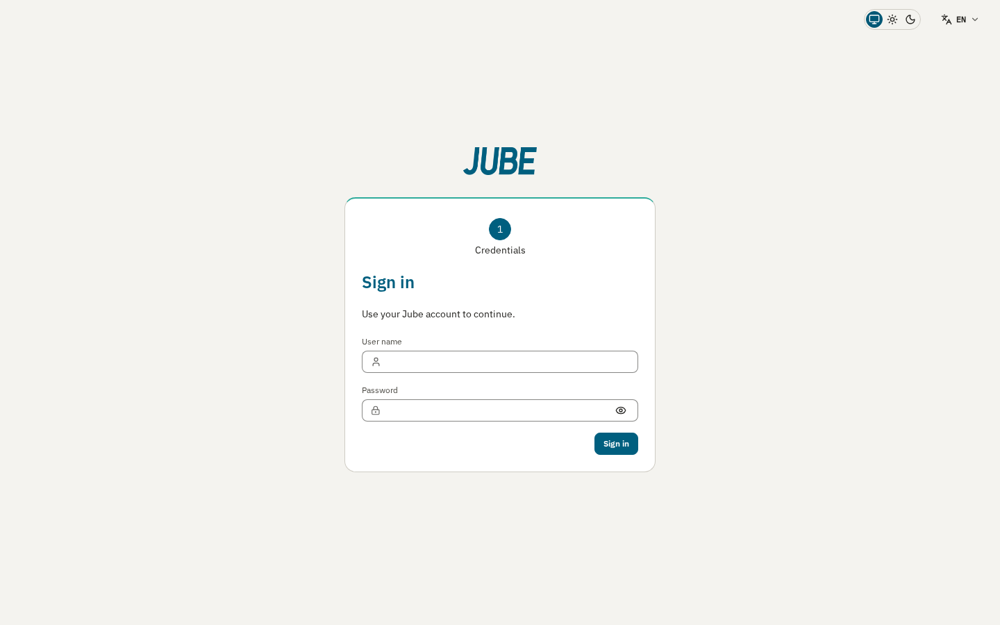

# Authentication

This page describes signing in to the user interface with a User Name and Password, which is how Jube ships. Where OAuth or Negotiate has been switched on the sign-in page behaves differently, and where Multi-Factor Authentication has been switched on a Verification step is added. These are outlined below insofar as they change what is presented, and all of that, with lockout, session lifetime and the audit trails, is covered in [Authentication Concepts](../../Concepts/Authentication/index.html).

## Where it lives

The sign-in page is presented at the root address of the user interface, for example `http://localhost:5001/`, and navigating to any other page without a session will redirect to it, remembering the page asked for such that it is returned to upon signing in. In the absence of a page having been asked for, the page presented upon signing in is Ask Jooby.

The sign-in page presents the theme switcher and the language switcher at its head, as described in [Main Menu Navigation](../MainMenuNavigation/index.html), such that the language can be chosen before authentication, and beneath them a card which proceeds through as many as three steps, the steps taken being shown across the head of the card:

| Step         | Heading               | Presented                                                                                              |
|--------------|-----------------------|--------------------------------------------------------------------------------------------------------|
| Credentials  | Sign in               | Always, except where OAuth or Negotiate has been switched on.                                          |
| Verification | Verify it is you      | Where Multi-Factor Authentication has been switched on.                                                |
| New password | Choose a new password | Where the password must be changed before continuing, as is the case for the first sign-in.            |

Other than at the Credentials step, a Start again button abandons the steps taken and returns to Credentials.

SHOT id=navigation-authentication-sign-in
     route=/
     steps=sign-out
     frame=viewport
     state=the sign-in page before any entry, showing the theme switcher and language switcher at the head, the Jube wordmark, and the card at its Credentials step with the User name and Password fields
     conveys=signing in is a single card that proceeds in steps, with the language and theme available beforehand
     alt=The Jube sign-in page with the User name and Password fields in a card, and the theme and language switchers above



## Fields

| Value                | Step         | Description                                                                                                         | Example       |
|----------------------|--------------|---------------------------------------------------------------------------------------------------------------------|---------------|
| User name            | Credentials  | The name of the user, which must correspond to an active entry in the User Registry.                                | Administrator |
| Password             | Credentials  | The password of the user. Show password reveals what has been typed.                                                |               |
| Verification code    | Verification | The one-time code from the security token or authenticator app, of between four and eight digits.                   | 123456        |
| New password         | New password | The password that replaces the old one for every future sign-in.                                                    |               |
| Confirm new password | New password | The new password, repeated.                                                                                         |               |

## Signing in for the first time

A new installation has one user:

```text
User name: Administrator
Password:  Administrator
```

The default password is weak, however it cannot be used for anything except replacing it: the first sign-in is refused until a new password is chosen, thus it is only temporary.

Upon entering the User name and Password as specified above and clicking Sign in, the card moves to its New password step, stating that the password must be changed before continuing, and that the new password replaces the old one for every future sign-in.

The new password must conform to the following complexity rules:

* Length must be at least 12.
* Length must not exceed 128.
* Must contain at least one uppercase letter.
* Must contain at least one lowercase letter.
* Must contain at least one number.
* Must contain at least one special character.
* No character may repeat more than twice consecutively.
* Must not start with a common pattern such as "password", "123456" or "qwerty".

The rules are ordinarily checked in the server, which returns those that have not been met to be presented at the head of the card. Where wire password hashing is on for the user, as described in [Authentication Concepts](../../Concepts/Authentication/index.html), the server only ever receives a hash of the password, so the rules are instead checked in the browser, the card listing them under the heading Your new password needs and marking each as Met or Not met while the password is typed.

Having completed the New password with appropriate complexity, and repeated it in Confirm new password, clicking Change password and sign in changes the password as part of the authentication process. Passwords are not stored in plain text and are hashed with the Argon2 algorithm (the computational expense does bring about a slow experience during authentication however).

Upon successful authentication the user will be navigated to the Ask Jooby page of the user interface, or to the page that was asked for.

## Refusal

Where the User name or the Password is not correct, the card states only that the details were not accepted, giving no indication as to which was at fault, and the Password is cleared to be entered again. The messages presented are as follows:

| Message                                                    | Meaning                                                                                              |
|------------------------------------------------------------|------------------------------------------------------------------------------------------------------|
| The details were not accepted. Check them and try again.   | The User name, the Password or the Verification code was wrong, or the account is locked or inactive. |
| The two new passwords do not match.                        | New password and Confirm new password differ.                                                        |
| The new password does not meet every requirement.          | A complexity rule has not been met, where the rules are checked in the browser.                      |
| The server did not accept the request.                     | The server refused the request on validation, the reasons being listed beneath.                      |
| Jube could not be reached. Try again in a moment.          | The server did not respond, or responded with a fault.                                               |

Consecutive failed attempts lock the account; with the default of three (PasswordAttempts) the third wrong password locks it.

## Multi-Factor Authentication

Where Multi-Factor Authentication has been switched on, by way of the EnableMultifactorAuthentication Environment Variable, the card moves to its Verification step upon Sign in being clicked, asking for the code from the security token to finish signing in. The Verification code is entered as digits only, exactly as the token shows them, and Verify and continue sends the User name, the Password and the code together, there being no half signed-in state held in between. A wrong code is refused in the same manner as a wrong password, and it counts towards the locking of the account likewise.

Where the second factor is an authenticator app, which is to say that MultifactorAuthenticationProvider is `Totp`, the Verification step also offers Set up an authenticator app, for a user who has not yet done so. Upon it being clicked the card presents a QR code to be scanned with the authenticator app, and beneath it the key as text for an app into which it must be typed. The six digit code that the app then shows is entered as the Verification code, and that first valid code both completes the set up and signs the user in.

Once an authenticator has been set up for an account, Set up an authenticator app no longer works for that account, and it states that an authenticator has already been set up, such that a person having learned the password cannot attach a phone of their own. A user having lost their phone asks an administrator to reset the authenticator, whereupon it is set up again at the next sign-in.

## OAuth and Negotiate

The sign-in page asks the server which methods of signing in have been switched on before presenting anything, stating meanwhile that it is checking how the user signs in. It follows that the Credentials step is presented only where it can be used:

| Method                 | What is presented                                                                                                                                                                                                                                                              |
|------------------------|--------------------------------------------------------------------------------------------------------------------------------------------------------------------------------------------------------------------------------------------------------------------------------|
| User Name and Password | The Credentials step, as described above.                                                                                                                                                                                                                                      |
| OAuth                  | The browser is sent to the identity provider of the organisation, the page stating that it is doing so and offering Continue to sign-in should the browser not have moved. Upon returning from the identity provider the user is signed in, and no step of the card is presented. |
| Negotiate              | The user is signed in automatically by the computer, without anything being entered. Where Multi-Factor Authentication has been switched on, the Verification step alone is presented. Where the computer did not sign the user in, the page says as much, there being no password to fall back upon, and offers Try again. |

In either case the user must already exist and be active in the User Registry, as the identity provider establishes who the person is and does not create an account for them.

## The session

As a consequence of authentication, a JSON Web Token will exist in a cookie named "authentication-jwt". The cookie is HttpOnly, so it cannot be read by script in the page, and the browser sends it with each request. The instant at which the session will end is returned to the page in an HTTP response header named "X-Session-Expiry".

The token is valid for 15 minutes. Each request made through the user interface replaces it with a fresh 15 minute token, so an active session slides forward, but never beyond twelve hours from the original sign-in by default (SessionAbsoluteLifetimeInterval and SessionAbsoluteLifetimeIntervalValue), after which authentication must be repeated however active the user has been.

Working in the page, which is to say clicking, changing a value or submitting a form, extends the session quietly, no more often than every three minutes. When the session is nonetheless within five minutes of ending, the user interface shows a warning beneath the bar at the head of the page that the session is about to expire, with an Extend session button. If the session does end, or is revoked, the user interface says that the session has expired and returns to the sign-in page, remembering the page that was open so that signing in again returns to it.

The wording presented in each event is as follows:

| Event                                             | Wording                                                |
|---------------------------------------------------|--------------------------------------------------------|
| Five minutes or fewer of the session remain       | Your session is about to expire. with Extend session.  |
| The session has ended or been revoked             | Your session has expired. Sign in again to continue.   |
| The user has signed out                           | You have signed out.                                   |

## Signing out

To sign out, open the account menu, being the button showing the name of the user in the bar at the head of the page, and click Sign out.

Signing out removes the cookie, revokes every token issued to the user so far (so a copied token stops working on every instance of Jube at once) and returns to the sign-in page with a confirmation that the user has signed out.

## Changing the password

A password is changed at sign-in, at the New password step, whenever the server demands it, as is the case for the first sign-in and where an administrator has reset the password. The account menu offers no page for the changing of a password by a user who is already signed in, which is done through `POST /api/Authentication/ChangePassword`. Changing a password revokes every token issued to the user so far.

## The JSON Web Token

Authentication is a matter of obtaining a JSON Web Token and ensuring that it is available on each HTTP request, in either the cookie named "authentication-jwt", or in the customary location of an HTTP header named "Authorization" with the value being the string "Bearer " concatenated with the token. A token sent in the header is not refreshed; only the cookie slides forward.

The token is signed, not encrypted: its contents can be read by anyone who holds it, but cannot be altered or forged without the key. It is signed with HMAC-SHA256 using Environment Variables as follows:

```text
JWTValidAudience=http://localhost:5001
JWTValidIssuer=http://localhost:5001
JWTKey=<a long random value, at least 32 characters>
```

| Value            | Description                                                                                                                                                                             |
|------------------|-----------------------------------------------------------------------------------------------------------------------------------------------------------------------------------------|
| JWTValidAudience | The server domain that is allowed the token.                                                                                                                                            |
| JWTValidIssuer   | The server domain that issued the token.                                                                                                                                                |
| JWTKey           | The signing key for the JWT. It has no default and is not generated: it must be supplied as an Environment Variable, and Jube will not start without it. Changing it ends every session. |

The token carries the user name in the Name claim (http://schemas.xmlsoap.org/ws/2005/05/identity/claims/name) and the NameIdentifier claim (e.g. Administrator), and the instant the session began, from which the twelve hour limit is counted. It carries no permissions: those are evaluated on the server on every request.

The nature of a JSON Web Token is that it does not have to be issued by the authentication components of Jube, and upon knowledge of the JWTKey, issuer and audience, a token can be created externally to the application. Such a token is nonetheless checked against the database on every request: it is refused if the user is not active or is locked, or if the user's tokens have been revoked since it was issued.

## The User Registry

The User Name must correspond to an entry with the UserRegistry table:

```sql
select * from "UserRegistry"
```

The columns of the UserRegistry table that bear upon authentication are as follows:

| Column              | Description                                                                                           |
|---------------------|-------------------------------------------------------------------------------------------------------|
| Name                | The User Name.                                                                                        |
| Password            | The hash of the password, never the password itself.                                                  |
| Active              | Whether the user may sign in.                                                                         |
| FailedPasswordCount | The number of consecutive failed attempts.                                                            |
| PasswordLocked      | Whether the account is locked, with PasswordLockedDate being when it was locked.                      |
| PasswordCreatedDate | When the password was last set, with PasswordExpiryDate being when it must next be changed.           |
| LastLoginDate       | When the user last signed in.                                                                         |
| WirePasswordHash    | Whether the browser sends a hash of the password rather than the password.                            |
| TokensValidFrom     | The instant before which every token issued to the user is refused.                                   |
| TotpSecret          | The secret of the authenticator app, encrypted, with TotpEnrolledDate and TotpLastAcceptedStep.       |

The UserRegistry table is not intended to be administered directly, except to draw attention to the password not being stored in clear text. User interface interactions for the purpose of authorisation are explained in a separate section of this documentation.

Passwords are hashed in an irreversible manner using the Argon2 algorithm, with a random salt for each password and a secret key known only to the installation, supplied via Environment Variable:

```text
PasswordHashingKey=<a long random value>
```

Like JWTKey, PasswordHashingKey has no default and is not generated; Jube will not start without it. It must not be changed once users exist, since every stored password was hashed with it and none would verify afterwards.

It is worth noting that the key values set in Environment Variable must be common in each instance of Jube, else password authentication and session maintenance will only work partially (thus not at all).
