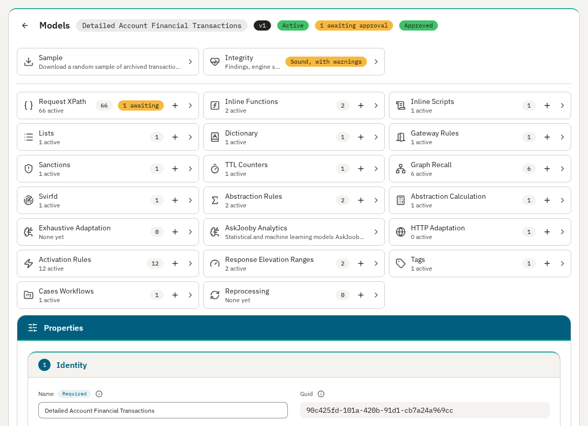
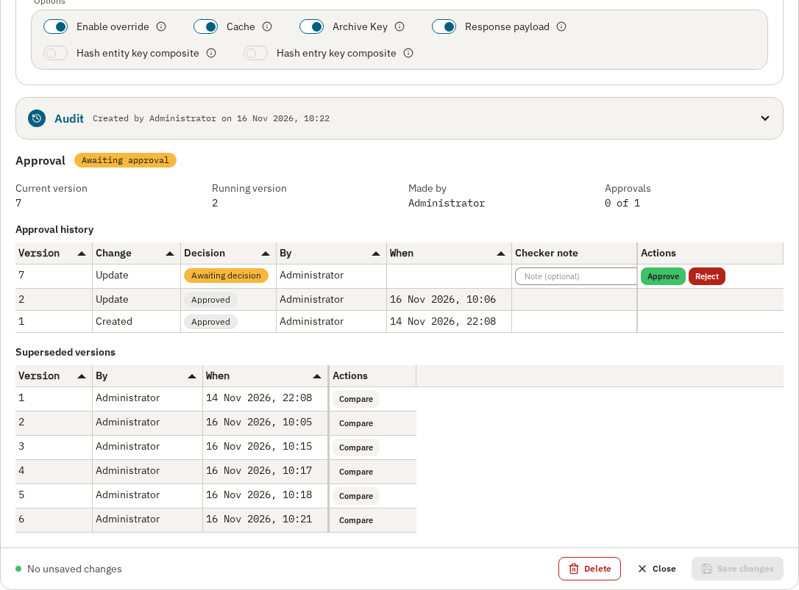

# Child Objects

Child objects roll up to the [Parent Objects](../ParentObjects/index.html) and they are administered via a common user interface, which is to say that a Request XPath, an Activation Rule, a List and a Case Workflow are all created, changed and deleted in the same manner, and, where they are subject to it, approved in the same manner also. This page describes that manner once, and the pages for each child object henceforth describe only what is particular to them: the fields, the behaviour and an example. In this page a Request XPath is taken as the example child, rolling up to a Model as the parent.

## Where it lives

Child objects are reached from the parent. For the children of a Model, navigate through the menu to Models, which presents the table of models, then click Open on the model of interest. The page is arranged as a story, read from top to bottom: each step taken (the table of models, the model, a list of children, a child record) is added beneath the last, and the steps already passed collapse into a single summary line each, which can be clicked to return to that step. The current step carries a back arrow, titled for the step it returns to (for example Back to Models).

Upon opening a model, a hub card is presented for each type of child object available to the model, with the model's own Properties form beneath. Each hub card shows:

| Element            | Description                                                                                                       | Example             |
|--------------------|-------------------------------------------------------------------------------------------------------------------|---------------------|
| Label              | The type of child object.                                                                                         | Request XPath       |
| Summary            | A count of the active and locked children, or None yet where there are no children.                               | 3 active, 1 locked  |
| Total              | A badge with the total number of children.                                                                        | 4                   |
| Awaiting           | A warning badge, shown only where children are awaiting approval.                                                 | 1 awaiting          |
| New (the + button) | Opens a blank form for a new child directly, without passing through the list.                                    |                     |

Clicking the hub card itself opens the list of children. The hub cards are presented in the order in which the engine processes the child objects, and each card fetches its own counts: while the counts are being fetched a placeholder is shown in their place, and should they not be fetched, which is the case where the user is not permitted to read that type of child object, the card states Could not load. The locked count is given in the Summary only where at least one child is locked, and the Awaiting badge takes the form of a count followed by awaiting.

The address in the browser follows the story, such that a record can be linked to directly, taking the form `/models?path=EntityAnalysisModel:12,EntityAnalysisModelRequestXPath:34`. A list with no record open is not held in the address, which stops at the model.

SHOT id=child-objects-model-hub-cards
     route=/models
     steps=open-default-model
     frame=page
     state=the default model opened, showing the collapsed Models step, the hub cards for each child type with their counts, and the top of the Properties form
     conveys=children are reached from hub cards on the parent, and the page is a story of steps
     alt=The default model opened on the Models page, with one hub card for each type of child object, each showing its counts and a New button



## The list

The list of children is titled for the type of child object and has a count badge, a Search box, and a New button. The list shows 25 records per page, with a Name column and an Open action for each record. A row can be expanded for a read only summary of the record without opening it, and an empty list reads No records yet.

The elements of the list behave as follows:

| Element       | Behaviour                                                                                                                                                                                                 |
|---------------|-----------------------------------------------------------------------------------------------------------------------------------------------------------------------------------------------------------|
| Back          | A back arrow, titled for the step it returns to (for example Back to Detailed Account Financial Transactions), which returns to the parent.                                                               |
| Count badge   | The number of records in the list, which falls to the number matching as soon as something is typed into Search.                                                                                          |
| Search        | Filters the list as it is typed, keeping the records whose name contains the text entered, without regard to case. The filtering takes place in the browser upon the records already fetched.            |
| New           | Replaces the list step with the New step, as described below.                                                                                                                                            |
| Open          | Opens the record, the list step being replaced by the record step.                                                                                                                                       |
| Show summary  | The expander at the start of each row, which presents the read only summary and becomes Hide summary. The summary shows the values of the record by group, and any children of its own under the heading Below this record, each of which can be opened directly. Where there is nothing to present it reads Nothing more to show for this record. |
| Pager         | Beneath the rows: a statement of the rows shown (for example 1–25 of 40), Rows per page offering 10, 25, 50 and 100, with 25 as the default, the buttons First page, Previous page, Next page and Last page, and the page position (for example Page 1 of 2). |

The columns of the list are not sortable, and the records are presented in the order returned by the server. Should the records not be fetched, the list is replaced by the message The records could not be loaded.

The state of individual records is not shown row by row. Instead the heading of the list step carries the totals: the number in total (for example 4 in total), then the number active, the number locked where there are any, and the number awaiting approval where there are any. For a list that has no records the heading reads None yet.

## Creating a child object

Click New in the list, or the + button on the hub card. The list step is replaced by a step named New, with a form headed New followed by the type of child object and carrying a New badge, above which sits the back arrow, titled for the list it returns to, and the reminder Fill in the fields below, then save to create it.

TODO(verify): the English labels of forms are at present derived from the names of the properties, such that the heading reads New Entity Analysis Model Request X Path and the XPath field reads X path. Owner to decide whether proper English labels are to be supplied, after which the labels quoted throughout the documentation are to be checked against the user interface.

The form is generated from the definition of the child object in the server, and it follows that all forms behave alike:

* Fields are arranged in numbered groups, some of which start collapsed. For a Request XPath the groups are Identity, Extraction, Search Key (collapsed), Behaviour and Audit (collapsed).
* A field that must be completed carries a Required badge.
* Each field has an information button, which presents the description of the field.
* Labels and descriptions follow the language chosen for the user interface, as described below.

Upon completing the fields, click Create at the base of the form. The Create button is not available until something has been entered, nor while the request is in flight. Confirmation is returned as a notice reading Created., and the step becomes the record just created, ready for further editing, rather than returning to the list. A new record starts at version 1 and, where the child object is subject to approval, in the state Awaiting approval.

The base of the form remains in view as the form is scrolled, and it carries, beside Create, a Close button, which abandons the new record and returns to the list, as does the back arrow. Upon leaving by Close or by the back arrow a form into which something has been entered, confirmation is sought under the heading Discard unsaved changes?, as described under Updating a child object.

If the child object is not valid it is not created. Each problem is written beneath the field it relates to, and a summary at the head of the form gives the number of problems to fix (for example 2 problems to fix), each line of which names the field and the problem and can be clicked to move to the field in question. A collapsed group holding a field with a problem is opened. Validation takes place in the server, keeping in mind that the user interface is a fascia of the API, so the same rules apply to a child object created through the API directly. The one check made in the browser beforehand is that a numeric field holds a number, failing which the head of the form states that the field must be a number and nothing is sent.

Where the server refuses the request for a reason that does not belong to a field, the reason is written at the head of the form, or The request was refused. with the HTTP status where no reason is given. Any other failure is returned as a notice, as follows:

| Circumstance                                  | Notice                                               |
|-----------------------------------------------|------------------------------------------------------|
| The user does not hold the permission (403).  | You are not permitted to do that.                    |
| The record no longer exists (404).            | That record could not be found.                      |
| The server cannot be reached.                 | The server could not be reached. Check your connection. |
| Any other failure in the server.              | The server could not complete the request.           |

## Updating a child object

Click Open on the record in the list. The record step shows the name of the record alongside its version, whether it is Active or Inactive, whether it is Locked, and its approval state. Beneath are hub cards for any children of its own, then the Properties form.

Alter the values as required, then click Save changes, which is not available until a value has been altered. Confirmation is returned as a notice reading Saved., the form remains open, and the version is incremented by one. The base of the form states at all times whether there are Unsaved changes or No unsaved changes, and while there are unsaved changes the step in the story carries an Unsaved badge. Where the child object is subject to approval, the saved change returns the record to the state Awaiting approval, and the engine continues with the version before until the change is approved.

Close, at the base of the form, closes the record and returns to the list, as does the back arrow. The form of a record that has been opened is headed Properties, whereas that of a new record is headed New followed by the type of child object.

The collapsed Audit group shows the version, and the user and date of creation, last update and deletion. Its summary line reads as the user and date of the last update, or of creation where the record has never been updated.

Two safeguards exist against the loss of work:

* **Unsaved changes.** Upon moving to another step, or away from the page, while a form has unsaved changes, confirmation is sought under the heading Discard unsaved changes?, stating which step has changes that are not saved and that going on will discard them, and offering Keep editing or Discard changes. Closing or reloading the browser tab raises the browser's own prompt.
* **Changes made by another user.** If the record is updated by another user while it is open, a notice names that user and the time of the change, offering to reload the record and lose the edits made, or to keep editing. A save over a record that has changed since it was opened is refused.

The notice of a change made by another user is presented at the head of the form, and it takes one of four forms, depending upon what happened and whether the form has unsaved changes at that moment. A change made by the user themselves raises no notice, and where the name of the other user is not known the notice reads Someone in its place.

| Circumstance                                                         | Notice                                                                                                      | Offered                                   |
|----------------------------------------------------------------------|-------------------------------------------------------------------------------------------------------------|-------------------------------------------|
| Another user saved the record, and the form has no unsaved changes.  | The record is reloaded at once, and the notice names the user and the time, the versions (for example Version 3 to 4.) and the number of fields changed. Each field that changed carries a Changed badge. | Dismiss.                                  |
| Another user saved the record, and the form has unsaved changes.     | The named user changed this record while you have unsaved edits. Nothing is reloaded.                       | Reload and lose my edits, or Keep editing. |
| Save changes was clicked over a record that had changed (409).       | This record changed since you opened it, so your save was refused.                                          | Reload and lose my edits, or Keep editing. |
| Another user deleted the record.                                     | The named user deleted this record.                                                                         | Close, which returns to the list.         |

A [Locked](../LockedAndActive/index.html) record is presented with its form disabled, a Locked badge in the heading of the form, and without Save changes or Delete, Close alone remaining at the base of the form.

## Deleting a child object

Open the record and click Delete, which is available only where the record is not locked. Confirmation is sought under the heading Delete this record?, noting that A deletion may need approval before it takes effect, and offering Close, which leaves the record as it was, or Delete. Upon confirmation being given, a notice reading Deleted. is returned and the story returns to the list, from which the record is gone. A user who does not hold the permission to write the child object is refused with the notice You are not permitted to do that., and nothing is deleted.

Where the child object is subject to approval, the deletion is itself a change awaiting a checker: the record leaves the list at once, yet the engine continues to use it until the deletion is approved, and until then it is listed in the section What is waiting for approval of [Model Integrity](../../Configuration/Models/ModelIntegrity/index.html), from where the deletion is approved or rejected.

### Deleting an entity that is in use

The entities of a model use each other: a rule names fields, TTL counters, abstractions, lists and other rules in its text, and settings name entities too, such as an abstraction rule's search key, a TTL counter's data name, or the case workflow and TTL counter an activation rule uses. A delete is refused while anything in the model still uses the entity, and nothing is deleted. The refusal names each entity that uses it and how, either the name in its rule text (such as `List.HighRisk`) or the setting (such as `TtlCounterDataName`), so the entities using it can be changed first.

The refusal is returned by the server as a failure of validation (400) and is presented in the summary of problems to fix at the head of the form, with one line for each entity that uses the record, in the form This cannot be deleted because ActivationRule 'High value from denied IP' depends on it (List.IPDenyList). The record remains open and unchanged.

This applies to Request XPath, Inline Functions, Inline Scripts (through their properties), Abstraction Rules, Abstraction Calculations, Activation Rules, TTL Counters, Sanctions, Lists, Dictionaries, HTTP Adaptations, Exhaustive adaptations and Case Workflows. Entities that have been deleted no longer count as using anything, and an entity that refers to itself does not block its own delete.

Renaming or deactivating an entity is not checked in this way. A rule that names a renamed entity no longer compiles, and an active entity that uses an inactive one may not work as intended. To see what uses an entity before changing it, use the **Dependencies** tab of [Model Integrity](../../Configuration/Models/ModelIntegrity/index.html), which also lists names that no longer resolve and active entities that use inactive ones.

## Approval

A new child object, a change to one and the deletion of one are each subject to approval by a second user before they take effect in the engine, as described in [Maker Checker](../../Concepts/MakerChecker/index.html). The number of approvals needed is set by the ApprovalsRequired Environment Variable, which is 1 by default.

Approval applies to the Model and to the child objects that bear upon the engine, which is to say Request XPath, Inline Functions, Inline Scripts, Gateway Rules, Abstraction Rules, Abstraction Calculations, TTL Counters, Activation Rules, Overrides, Lists, Dictionaries, Tags, Sanctions, HTTP Adaptations, Graph Recall, Svirfd, Response Elevation Ranges and Exhaustive adaptations. A Case Workflow and its own children are not subject to approval, and a change to them takes effect upon being saved.

A record is in one of the following states, shown on the record step and in the Approval section:

| State                      | Description                                                                             |
|----------------------------|-----------------------------------------------------------------------------------------|
| Awaiting approval          | Created or changed, and not yet approved. The engine continues with the version before. |
| Approved                   | The current version has been approved and is taken up by the engine.                    |
| Rejected                   | The checker rejected the change. The maker can resubmit or retract.                     |
| Deletion awaiting approval | Deleted by the maker, and still in use by the engine until the deletion is approved.    |
| Deletion rejected          | The checker rejected the deletion.                                                      |
| Deleted                    | The deletion has been approved.                                                         |

The state is shown as a badge, and its colour can be read at a glance: green for Approved, amber for the two states awaiting a checker, red for the two rejected states, and grey for Deleted.

The Approval section sits beneath the form of the record, and shows the state, the Current version, the Running version (or Not running yet), who the change was Made by (or Unknown), and the Approvals recorded against the number required, in the form 0 of 1. The Current version is the version of the record as saved, and the Running version is the latest version to have been approved, which is to say the version the engine uses: where the two differ, a change is awaiting a checker and the engine has not yet taken it up.

The Approval history beneath lists each decision, with the columns Version, Change (Created, Update, Deletion, Restore, Retracted or Resubmitted), Decision, By, When, Checker note, Return note and Actions, and it reads No approvals or rejections recorded. where there are none:

* For a version awaiting a decision, a row is placed at the head of the history with the Decision shown as Awaiting decision, in which the checker may enter an optional note under Checker note, then click Approve or Reject. Confirmation is returned as a notice reading Approved. or Rejected., and the state, the Running version and the Approvals recorded are brought up to date.
* For a rejected version, the maker may click Resubmit, having corrected the record, or Retract where an earlier version is already running, in which case that running version stands, Retract not being offered where no version is running. A note may be returned with either, entered under Return note, and confirmation is returned as Resubmitted. or Retracted.

Beneath the history, Superseded versions lists each version that came before with the user and time, reading No superseded versions yet. where there are none. Compare, against a version, presents a table headed Changes in version followed by the number, with the columns Field, Earlier version and This version. For version 1 it reads This is the first version, so there is nothing earlier to compare with., and where nothing visible differs it reads No visible field changed.

A maker cannot approve their own change, and Approve and Reject are not offered to them, nor to a checker who has already approved the version where more than one approval is required. The server refuses in the same manner where the request is made through the API directly, and each refusal is returned with status 400, carrying a message and its reasons, of which the reasons are written at the head of the Approval section, as follows, where IP stands for the name of the record:

| Circumstance                                                               | Message in the response                                                           | Reason written in the Approval section                                |
|----------------------------------------------------------------------------|-----------------------------------------------------------------------------------|-----------------------------------------------------------------------|
| The maker attempts to decide their own change.                             | A maker cannot approve their own change. (or reject)                              | IP was changed by you.                                                |
| The checker has already approved the version.                              | You have already approved this version.                                           | IP version 4 already carries your approval.                           |
| The record was changed again while it was being reviewed.                  | This version is no longer current.                                                | IP is at version 5; review that version rather than version 4.        |
| The version has already been rejected.                                     | This version was rejected.                                                        | IP version 4 was rejected; an edit opens a new approval cycle.        |
| The version has already been approved and is running.                      | This version is already in effect.                                                | IP version 4 is approved.                                             |
| A rejection is attempted of a version that is running.                     | This version is in effect, so it cannot be rejected. The live rule is left alone. | IP version 4 is approved and live; a rejection would withdraw it.     |
| The note exceeds 1,000 characters.                                         | The note is too long.                                                             | A note can be at most 1000 characters.                                |
| Approval would leave the model referring to something not itself approved. | The approval would leave the model inconsistent.                                  | One reason for each matter to be put right first.                     |

The last of these deserves explanation. Before an approval is recorded, the server considers what the model would look like with the change in effect, and it refuses where the record depends upon another that is not yet approved, naming each in the form Approve List IPDenyList first: it is not yet approved and the name of the record depends on it. It follows that where several related changes are awaiting, they are approved from the bottom upward: the list before the rule that names it.

Everything awaiting approval in a model can also be reviewed and decided in one place: open the model, then Integrity, then the section What is waiting for approval.

Upon approval the change is taken up by the engine at its next cycle, and no explicit synchronisation is required. Should it be needed, a model can still be synchronised by hand from Integrity, in the section Is the engine running it, using Synchronise this model, or all models can be synchronised using Synchronise all models above the table of models.

SHOT id=child-objects-record-with-approval
     route=/models
     steps=open-default-model, open-hub:Request XPath, open-first-row, scroll-to:Approval
     frame=record
     state=a Request XPath of the default model opened, awaiting approval, showing the record step heading with its badges, the numbered field groups and the Approval section with its history
     conveys=one record page holds the form, the audit and the approval, and this layout is common to every child object
     alt=A Request XPath record opened beneath its model, showing the grouped Properties form and the Approval section with the approval history



## Permissions and security

Each type of child object is guarded by a permission of its own, given in the page for the child object, and the server checks it upon every request. The buttons New, Create, Save changes and Delete are presented to every user who can open the page, and it is upon their use that a user without the permission is refused, with status 403 and the notice You are not permitted to do that., nothing being changed. The exception is Reprocessing, where the buttons a role may not use are withheld and the list states Some actions are hidden because your role does not hold the permission they need.

The Approval section is presented to a user holding permission 44, Allow Approval, or permission 45, View Pending Approvals, and it is absent altogether for a user holding neither. To approve or reject requires permission 44, Allow Approval, and Approve and Reject are offered only to a user who holds it and is not the maker of the change. Records are scoped to the tenant of the user, such that a record of another tenant behaves as one that does not exist.

## Common fields

Each child object has the following fields, in addition to those particular to it:

| Value  | Description                                                                                                                                       | Example |
|--------|---------------------------------------------------------------------------------------------------------------------------------------------------|---------|
| Name   | A text string naming the child object, by which it is listed and, for most child objects, by which rules refer to it.                             | IP      |
| Active | Whether the child object is taken up by the engine. An inactive child object is kept, yet plays no part in processing. For several child objects, Lists and Inline Scripts among them, Active is off for a new record and must be switched on. | True    |
| Locked | Whether the child object is protected from change. It is shown for information and cannot be set from the form of a child object.                 | False   |

A description field appears on a more irregular basis and is a character string also. Locked and Active are described further in [Locked and Active](../LockedAndActive/index.html).

## Languages

The user interface is available in English, Polish, Arabic, Georgian, Indonesian, Swedish, Urdu, Hindi and French, selected from the language switcher. The labels and descriptions of fields follow the language chosen, and anything without a translation is shown in English. For Arabic and Urdu the layout is mirrored to read from right to left.

## Versions and audit

For child objects there is a version system in place. When a record is created it is given version 1, and each update or delete increments the version by one.

All deletes are done on a logical basis, which means that the record is marked as deleted in the database, yet remains there for the purposes of audit.

When a child record is updated, the record is updated in place, such that its Id is immutable and can be relied upon by other data, and a full copy of the record as it stood beforehand is written to a version table, named for the table of the child object with Version appended. For example, on inspection of the version table for Request XPath:

```sql
select *
from "EntityAnalysisModelRequestXpathVersion"
order by "Id" desc
```

It can be seen that a copy of the record is present for each version that came before.

Irrespective of the manner in which the history of the record is maintained, it should be noted that there is a record of each update maintained in the database for the purposes of audit.
