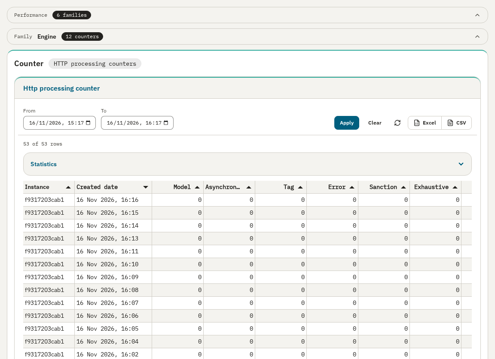
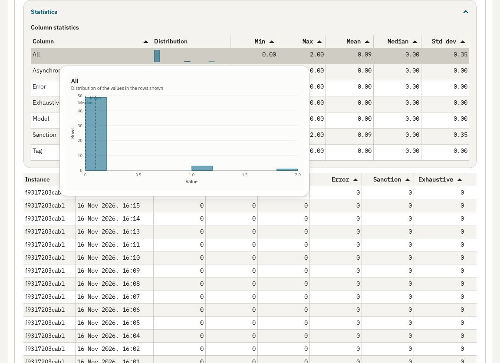

# Data Grids

Most of the pages that present monitoring, performance, audit and payload data are drawn by a single data grid, such that having learned to filter, sort, page and export in one page, the same holds true for all of them. The data grid is described by the server and not by the page, which is to say that the columns, the filters, the search box, the default sort, the cap on the number of rows and the window of time are all a matter of definition in the server, with the browser merely presenting what it has been given.

For each such page the browser requests the definition of the grid from `GET /api/GridModel/{area}`, the area being the name of the data to be presented, and thereafter calls the endpoint of the area itself for the rows. The areas available to the user are returned by `GET /api/GridModel`.

## Where it lives

The data grid is not a page in its own right, rather it is embedded in the pages as follows:

| Page                          | Data presented                                                                                                                   |
|-------------------------------|----------------------------------------------------------------------------------------------------------------------------------|
| Administration >> Performance | The counters, metrics, logs and events of the engine, the database, the cache, telemetry and the infrastructure, one area to a grid. |
| Administration >> Security    | The audit of sign-in and of sign-out, as described in [Login Audit](../../Configuration/Administration/LoginAudit/index.html).  |

The lists of records elsewhere, for example the table of models and the list of children of a model described in [Child Objects](../ChildObjects/index.html), are drawn by the same underlying grid and share its sorting, paging and layout, although they carry no filters and no export.

SHOT id=navigation-data-grid-payload-grid
     route=/administration/performance
     steps=open-hub:Engine, open-hub:HTTP processing
     frame=page
     state=a performance area opened as a data grid, with the From and To window completed, a select filter, the search box, Apply, Clear, Refresh and the Excel and CSV buttons across the head, the count of rows, the collapsed Statistics panel, several rows of data and the pager at the base
     conveys=one grid, with its filters above and its pager beneath, presents every list of monitoring data
     alt=A data grid of performance data with a time window, filters and export buttons above the rows, and a pager beneath



## Filters

The filters are presented across the head of the grid, and those available depend upon the area:

| Filter        | Description                                                                                                                                                                                                                                  |
|---------------|----------------------------------------------------------------------------------------------------------------------------------------------------------------------------------------------------------------------------------------------|
| From and To   | The window of time for which rows are returned, presented only where the area has a date upon which to filter. The window is 60 minutes by default, concluding now. The values are entered in the local time of the browser and sent to the server as UTC. |
| Select filter | A list from which one value is chosen, or All. The choices are either fixed for the area, or looked up from another endpoint, for example the list of models.                                                                                |
| Search        | Free text, labelled for whatever the area searches. Leading and trailing spaces are removed, and an empty search is not sent.                                                                                                                |

The filters are not applied as they are changed, rather upon instruction:

| Button  | Description                                                                                                            |
|---------|------------------------------------------------------------------------------------------------------------------------|
| Apply   | Sends the filters to the server and presents the rows returned. Pressing Enter in any of the filters has the same effect. |
| Clear   | Restores the filters to their defaults, the window of time included.                                                   |
| Refresh | Repeats the last request, without regard to any filter changed but not yet applied.                                    |

The filtering takes place on the server side, henceforth it is efficient.

The grid is in one of the following states:

| State                                    | What is shown                                          |
|------------------------------------------|--------------------------------------------------------|
| The rows are being fetched               | A placeholder, announced as Loading rows.              |
| No row matches the window and filters    | No rows in this window.                                |
| The rows could not be fetched            | The rows could not be loaded. together with Try again. |
| Rows were returned                       | The count, in the form 132 of 132 rows, and the rows.  |

It should be kept in mind that the default window is the last 60 minutes, hence a grid of monitoring data on an installation that has been idle for an hour reads No rows in this window. until the From is moved back and Apply clicked.

## Row cap and statistics

The server returns no more than a given number of rows for a request, being 2000 for every area, and the endpoints constrain any larger value that they receive. The number of rows returned is stated above the grid alongside the total number matching, for example 132 of 132 rows. Where the total is larger than the rows returned the grid says as much, for example:

```text
2,000 of 51,234 rows shown; narrow the window or filters to see the rest
```

A small number of areas present the state of the database as it stands at the moment of the request rather than a history, being Postgres activity, Postgres index statistics, Postgres statement statistics and Postgres table statistics. For these there is no window of time and no cap is sent.

Where the area returns summary statistics, a Statistics panel sits above the rows and starts collapsed. Upon being expanded it presents, for each numeric column, the following:

| Column       | Description                                                                                         |
|--------------|-----------------------------------------------------------------------------------------------------|
| Column       | The name of the column the statistics describe.                                                     |
| Distribution | A small histogram of the values, or No values.                                                      |
| Min          | The smallest value.                                                                                 |
| Max          | The largest value.                                                                                  |
| Mean         | The arithmetic mean.                                                                                |
| Median       | The median.                                                                                         |
| Std dev      | The standard deviation.                                                                             |

Hovering over the small histogram, or clicking it, presents the full chart, which is drawn on the server as SVG. The statistics describe the rows returned, hence they are subject to the same cap.

SHOT id=navigation-data-grid-statistics
     route=/administration/performance
     steps=open-hub:Engine, open-hub:HTTP processing, open-section:Statistics, hover:Distribution of
     frame=page
     state=the Statistics panel expanded above the rows, listing each numeric column with its distribution, min, max, mean, median and standard deviation, with the full histogram for one column presented
     conveys=the grid summarises its numeric columns, and the distribution of each can be opened as a chart
     alt=The Statistics panel of a data grid listing the minimum, maximum, mean, median and standard deviation of each numeric column, with a histogram opened for one of them



## Sorting and paging

Clicking a column heading sorts by that column, and clicking again reverses the direction. The sort is sent to the server, which accepts it only for the columns that the area allows to be sorted, and it is applied to the rows presented also. Where an area has a default sort, it is restored by Clear.

The pager at the base of the grid presents the range of rows shown against the total, and a choice of 10, 25, 50 or 100 rows per page. The data grids of monitoring data present 100 rows per page by default, and the lists of records 25. The pager offers First page, Previous page, Next page and Last page. For the languages that read from right to left, the arrows of the pager are mirrored along with the rest of the layout.

Paging takes place in the browser over the rows already returned, keeping in mind the cap, so moving between pages does not make a request to the server.

## Export

Two buttons export the rows of the grid, and both are unavailable while the grid has no rows:

| Button | File                 | Description                                                                                                                                                                                                 |
|--------|----------------------|-------------------------------------------------------------------------------------------------------------------------------------------------------------------------------------------------------------|
| Excel  | The area name, with the extension `.xlsx`. | A workbook with a single sheet named for the title of the grid. The header row is styled and frozen, and carries a filter. Column widths are fitted to the content, alternate rows are shaded, numbers are stored as numbers, and dates as dates in the format `yyyy-mm-dd hh:mm`. |
| CSV    | The area name, with the extension `.csv`.  | The same rows as plain comma separated values, starting with a byte order mark so that a spreadsheet opens the file as UTF-8 correctly.                                                                     |

The export is done in the browser from the rows already loaded. It follows that an export contains the rows subject to the cap, across every page of the grid, and not the whole of the table in the database. Where more is needed, the window or the filters should be narrowed and the export repeated, or the data taken from the database directly.

A value in the data could be crafted such that a spreadsheet would run it as a formula upon the file being opened. For the purposes of preventing this, a text value in the CSV that begins with `=`, `+`, `-`, `@`, a tab or a carriage return is written with a leading apostrophe, unless it is a plain number such as `-12.5`. In the Excel file such values are stored as text, which a spreadsheet does not evaluate.

## Languages

The title of the grid, the column headings, the labels of the filters and the choices of a select filter are translated on the server, where a translation exists for the language chosen in the language switcher, and are otherwise presented in English. The buttons, the pager and the messages of the grid follow the language chosen in the same manner as the rest of the user interface. For Arabic and Urdu the layout is mirrored to read from right to left.

TODO(verify): confirm in an Arabic and an Urdu session that numbers, dates, IP addresses and identifiers within the rows of a grid read correctly from left to right. The page formerly stated that they are presented as left to right text, and no explicit handling of this was found in DataGrid.vue or dataGridColumns.ts.

## Charts

Charts, the histogram of the Statistics panel among them, are drawn by the server as SVG and presented in light or dark to match the theme chosen in the theme switcher.

TODO(verify): the page formerly stated that the text of a chart, such as its axis titles, is in English in every language. Confirm on a running system, in a language other than English, whether the chart text is now translated, and state the outcome here.

## Value lists

The Values grid of Lists and Dictionaries, which allows a value to be added, edited, deleted, approved, rejected, resubmitted and retracted, each value carrying its own approval state, is a separate widget and is not the data grid described in this page. It is described in [Lists](../../Configuration/Models/Lists/index.html) and [Dictionary](../../Configuration/Models/Dictionaries/index.html).

## Permissions and security

The data grid carries no permission of its own, rather each area carries the permission of the data that it presents. An area is returned by `GET /api/GridModel`, and its definition by `GET /api/GridModel/{area}`, only where the user is permitted the data of that area, and several areas are available to a landlord only, those under Administration >> Performance among them. A user without the permission receives 403 for the definition of the grid as for its rows, and an area that does not exist receives 404. The audit of sign-in and of sign-out is presented in Administration >> Security to a user holding permission 35, Read Write Security User.
