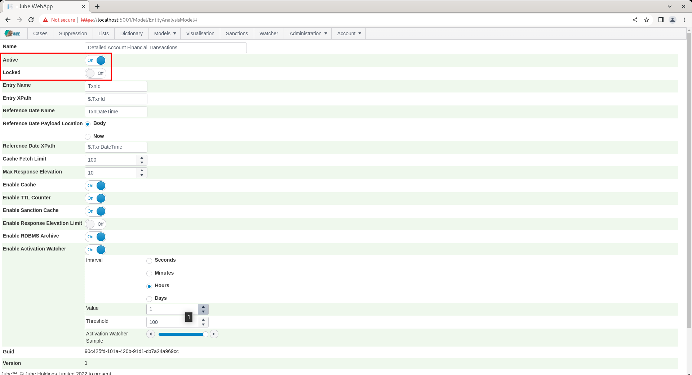
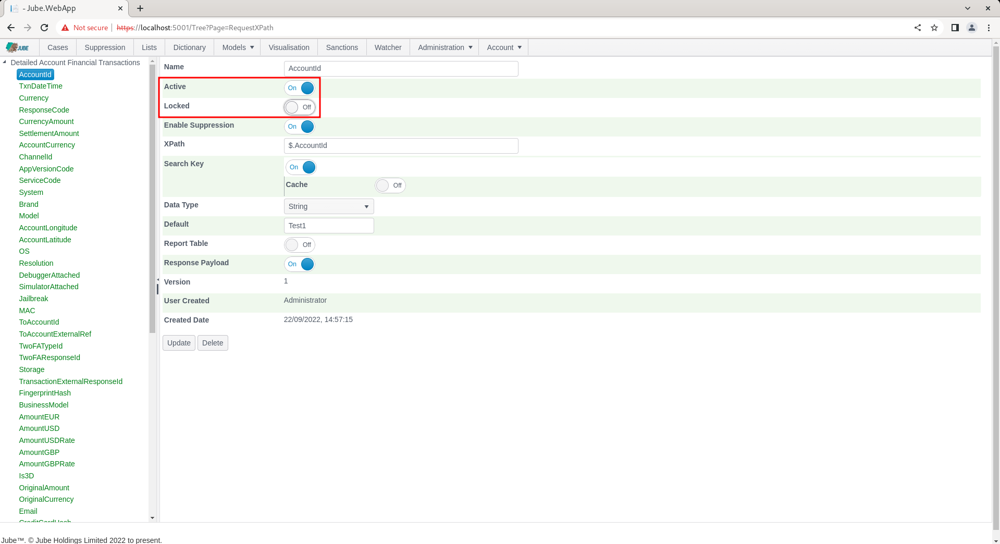
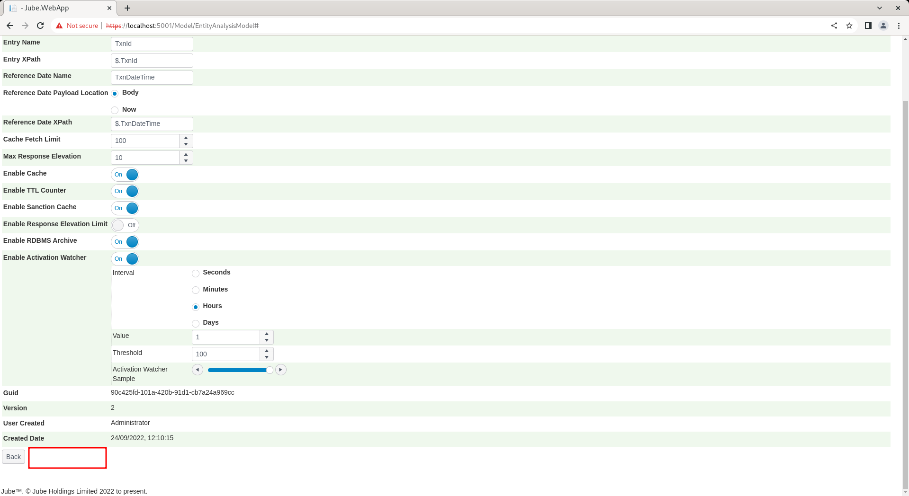
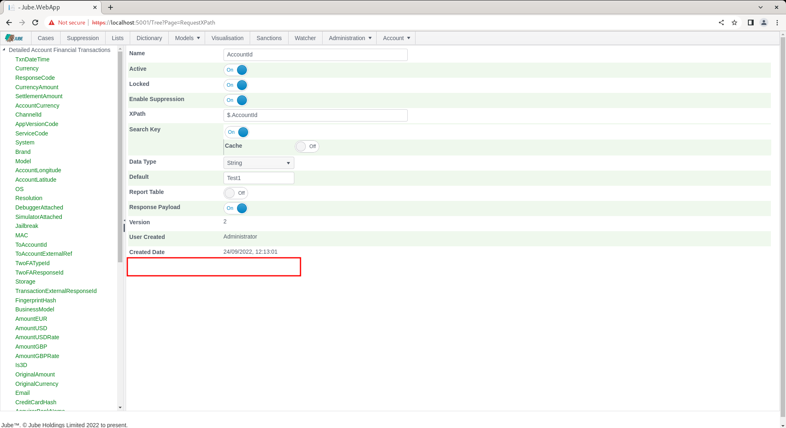

# Locked and Active

<!-- TODO(docs): this page predates the DTO-led Vue form (SchemaForm, CrudPanel, AreaStory); re-read every sentence against the running UI -->
<!-- TODO(docs): describe the field help, group tabs, required markers and validation messages now generated from the DTO attributes and the form model endpoint /api/FormModel/{area} -->
<!-- TODO(docs): describe language behaviour: labels follow the chosen locale (en, pl, ar, ka); descriptions and placeholders without a translation show English; Arabic mirrors the layout -->

For every parent object and child object there exists an Active and Locked switch. In the case of a parent object:

<!-- TODO(screenshot): file=locked-and-active-locked-and-active-in-parent.png route=/models state="replace Razor-era LockedAndActiveInParent.png with the Vue form-model screen showing the same step" -->

In the case of a child object:

<!-- TODO(screenshot): file=locked-and-active-locked-and-active-in-child.png route=/models state="replace Razor-era LockedAndActiveInChild.png with the Vue form-model screen showing the same step" -->

Both the Active and the Locked flags form part of the model object record and are updated in the same manner as the rest
of its properties.

The Active flag provides a means to deactivate an object without having to delete it. In most cases deactivating a child
object has a very similar behaviour to deleting it, insofar as the entry will be unavailable for processing.

The Locked flag may be toggled in just one direction, locking a record. If a record is locked it means that all
subsequent editing of that record is barred, and the records is presented as read only.

Locking records is useful to avoid the inadvertent update or deletion of important objects. An example of objects that
once created should not be deleted are Abstraction Rules which are in use a Machine Learning Adaptation (either HTTP or
Exhaustive), given alteration would render the results of the Adaptation inaccurate.

Another example is ensuring that the Request XPath configuration, once created, remains unchanged such is the importance
of these values in maintaining real time interfaces.

On lock, the effect is that the buttons for updating the record are hidden, however, this has no effect should the
values be deleted by API (this may change in the future).

In the case of a parent object:

<!-- TODO(screenshot): file=locked-and-active-missing-buttons-in-parent.png route=/models state="replace Razor-era MissingButtonsInParent.png with the Vue form-model screen showing the same step" -->

In the case of a child object:

<!-- TODO(screenshot): file=locked-and-active-missing-buttons-in-child.png route=/models state="replace Razor-era MissingButtonsInChild.png with the Vue form-model screen showing the same step" -->

Notice both the absence of Update or Delete buttons.

A small number of child objects — List Values, Dictionary Key Value Pairs, and Override — additionally support a Delete
Expiry Date, rather than an Active flag. Where set, this has exactly the same effect as an explicit delete, but
occurring automatically and unattended at a specified future date and time, without requiring any further manual
intervention or synchronisation. See
the [Lists](../../Configuration/Models/Lists/index.html), [Dictionary](../../Configuration/Models/Dictionaries/index.html)
and [Activation Rules Override](../../Configuration/Models/ActivationRulesOverride/index.html) pages for further detail.