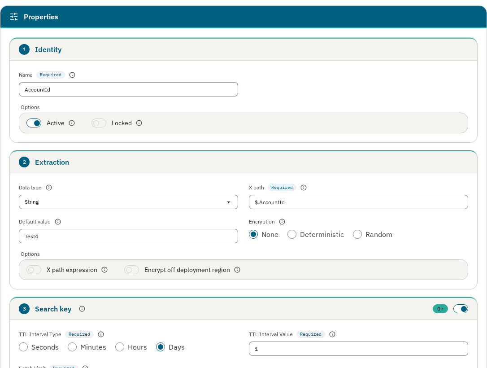
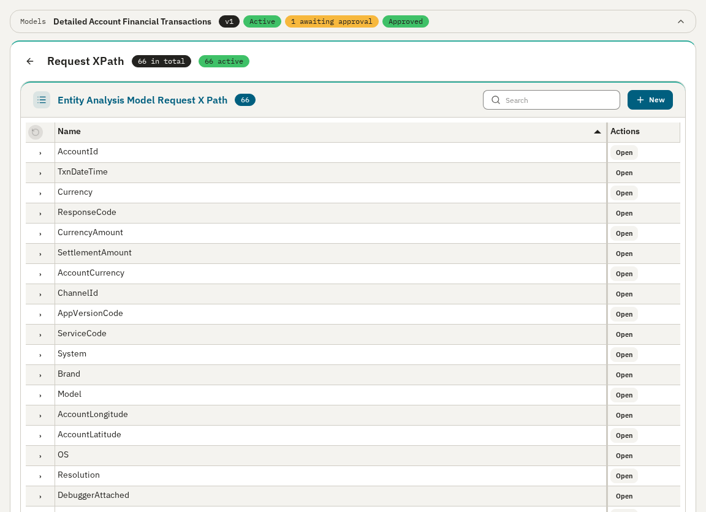

# Locked and Active

For every parent object and child object there exists an Active and a Locked switch. Both the Active and the Locked flags form part of the record of the object, they are stored alongside the rest of its properties, and a change to either increments the version of the record in the manner of any other update.

The Active flag provides a means to deactivate an object without having to delete it, while the Locked flag provides a means to protect an object from change. The two are independent, which is to say that a record may be active and locked, inactive and locked, or neither.

## Where it lives

The Active and Locked switches are presented in the Identity group at the head of the Properties form, in the case of a parent object having navigated through the menu to Models and opened a model, and in the case of a child object having further opened the hub card for the child and a record within it, as described in [Parent Objects](../ParentObjects/index.html) and [Child Objects](../ChildObjects/index.html).

The state of the two flags is also presented without the form being opened:

| Where                        | Active                                    | Locked                                  |
|------------------------------|-------------------------------------------|-----------------------------------------|
| The table of models          | The Status column, as Active or Inactive. | The Lock column, as Locked or Editable. |
| The heading of a record step | Active or Inactive.                       | Locked, where the record is locked.     |
| A hub card                   | A count, for example 3 active.            | A count, for example 1 locked.          |
| The heading of the form      |                                           | A Locked badge.                         |

SHOT id=navigation-locked-and-active-locked-record
     route=/models
     steps=open-default-model, open-hub:Request XPath, open-first-row
     frame=record
     state=a locked Request XPath of the default model opened, the record step heading showing Active and Locked, the form heading carrying the Locked badge, every field of the Identity and Extraction groups disabled, and no Save changes or Delete at the base of the form
     conveys=a locked record is presented read only, and the lock is stated in the heading rather than left to be inferred
     alt=A locked Request XPath record with the Locked badge in its heading, its fields disabled and no buttons to save or delete



## Fields

| Value  | Description                                                                                                                                                                              | Example |
|--------|------------------------------------------------------------------------------------------------------------------------------------------------------------------------------------------|---------|
| Active | Whether the object is taken up by the engine. It is off for a new Model, and for the new record of several child objects, Request XPath, Lists and Inline Scripts among them, and it must be switched on for the object to play a part in processing. | True    |
| Locked | Whether the object is protected from update and deletion. It is shown for information and cannot be switched from the form.                                                              | False   |

## Active

In most cases deactivating a child object has a very similar behaviour to deleting it, insofar as the entry will be unavailable for processing, yet the record is kept and may be made active again at a later time. An inactive Model does not participate in invocation nor in synchronisation.

It follows that only what the engine would actually run is offered elsewhere in the user interface: a child object that has been made inactive does not appear in the completions of the Coder nor in the field lists of the Builder, as described in [Rule and Code Builder](../RuleBuilderAndCoder/index.html), and it appears again as soon as it is made active. The Active switch of the Model itself does not hide its fields, so that rules can be built for a model that is still a draft.

SHOT id=navigation-locked-and-active-list
     route=/models
     steps=open-default-model, open-hub:Request XPath
     frame=page
     state=the default model with the Request XPath hub open, the heading carrying the badges 66 in total and 66 active, and the list beneath showing the Request XPath records of the model by name, one to a row, each with an Open action
     conveys=the heading of a list of child objects counts how many records are kept and how many of them are active, before any one record is opened
     alt=The Request XPath list of the default model, headed by badges reading 66 in total and 66 active, with the records listed by name one to a row



Switching Active is an update as any other, hence it is subject to approval by a second user before it takes effect in the engine, as described in [Maker Checker](../../Concepts/MakerChecker/index.html). It follows that there are two things to distinguish when reading the screen: the Active badge in the heading of the record step, green for Active and grey for Inactive, states what has been saved, whereas the Running version in the Approval section states what the engine is using. A record switched to Inactive and awaiting approval therefore continues to be processed until the checker approves the change.

Deactivating is not checked against the other objects of the model in the manner that a delete is. An active object that uses an inactive one may not work as intended, and the Dependencies tab of [Model Integrity](../../Configuration/Models/ModelIntegrity/index.html) lists the active entities that use inactive ones.

## Locked

If a record is locked it means that all subsequent editing of that record is barred, and the record is presented as read only: the fields of the form are disabled, a Locked badge, in amber, is placed in the heading of the form, and Save changes and Delete are absent, Close alone remaining at the base of the form. The children of a locked record are not locked by it, each child carrying a Locked flag of its own, such that the hub cards of a locked model continue to open and their records continue to be created and changed.

Locking records is useful to avoid the inadvertent update or deletion of important objects. An example of objects that once created should not be deleted are Abstraction Rules which are in use by a Machine Learning Adaptation (either HTTP or Exhaustive), given alteration would render the results of the Adaptation inaccurate.

Another example is ensuring that the Request XPath configuration, once created, remains unchanged such is the importance of these values in maintaining real time interfaces.

The lock is enforced in the server and not merely by the hiding of buttons. Keeping in mind that the user interface is a fascia of the API, an update or a delete of a locked record made directly through the API is refused in the same manner as for a record that does not exist, and nothing is changed.

The Locked flag is toggled in just one direction for the most part, locking a record. The exception is the Model, which a user holding permission 6, Read Write Model, can unlock using the Unlock button presented beside the back arrow of a locked model. Unlocking writes a copy of the record to the version table and increments the version by one, as any update would. For the unlocking of a model through the API, the request is as follows, where 12 is the Id of the model:

```http
POST /api/EntityAnalysisModel/12/Unlock
```

TODO(verify): the Locked switch is presented read only in every form of the Vue user interface, for a new record as well as an existing one (SchemaField.vue treats a lock field as read only), so there is at present no means of locking a record from the user interface; a record can be locked only by an update through the API carrying Locked as true. Unlock exists for the Model alone, there being no means in the user interface or the API of unlocking a child object. Owner to decide whether a Lock action, and an Unlock for child objects, are to be provided; this section then needs the names of the controls.

## Delete Expiry Date

A small number of child objects, being List Values, Dictionary Key Value Pairs and Override, additionally support a Delete Expiry Date, rather than an Active flag. Where set, this has exactly the same effect as an explicit delete, but occurring automatically and unattended at a specified future date and time, without requiring any further manual intervention or synchronisation. See the [Lists](../../Configuration/Models/Lists/index.html), [Dictionary](../../Configuration/Models/Dictionaries/index.html) and [Activation Rules Override](../../Configuration/Models/ActivationRulesOverride/index.html) pages for further detail.

## Permissions and security

Active is switched with the permission that allows the object itself to be written, for example permission 6, Read Write Model, for a Model and permission 7, Read Write Request XPath, for a Request XPath. Unlocking a Model requires permission 6, Read Write Model, and the Unlock button is not presented without it. Should the unlocking fail, The model could not be unlocked. is written beneath the button. A user without the permission receives 403, and a model of another tenant, or one that is not locked, behaves as one that does not exist.
