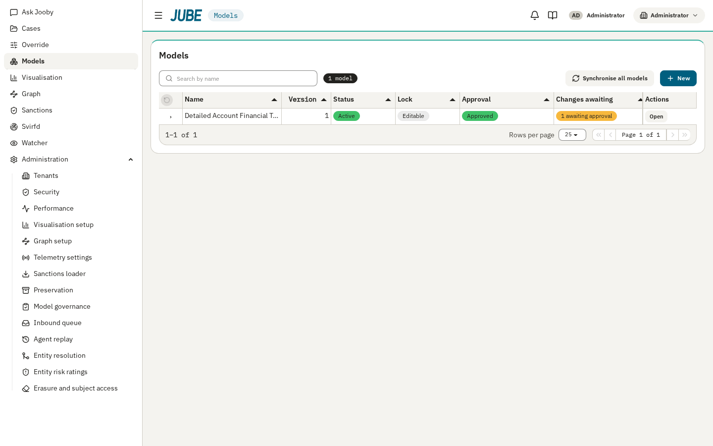
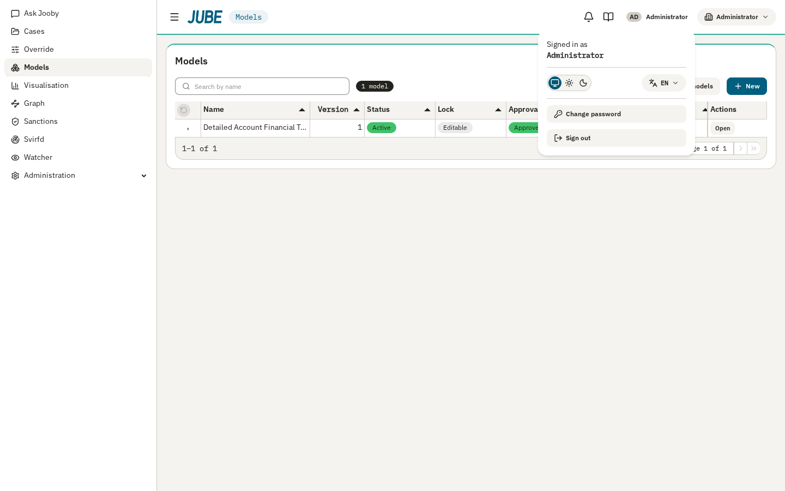

# Main Menu Navigation

Navigation in the Jube platform is centred around a Menu, where each Menu item will redirect the user to a specific page to administer Jube. The Menu is presented down the side of every page once authenticated, and it is accompanied by a bar across the head of the page, henceforth the shell, which carries the functions that are common to all pages: notifications, the theme, the language, the tenant and the account.

Throughout this documentation, navigation is given in words as a path through the Menu. For example, navigating to the page for the administration of users would be referred to as navigate to Administration >> Security, which is to say firstly expanding the Administration menu item, then clicking the Security sub menu item. The functionality of each page is detailed individually in this documentation.

It should be noted that the Menu is far shallower than it once was. The configuration of a model, which is to say Request XPath, Lists, Dictionaries, Activation Rules and the many other child objects, is no longer a matter of sub menu items, rather these are reached from the model itself, having navigated to Models and opened a model, as described in [Parent Objects](../ParentObjects/index.html) and [Child Objects](../ChildObjects/index.html).

SHOT id=navigation-main-menu-shell
     route=/models
     steps=open-menu:Administration
     frame=viewport
     state=the Models page with the Menu down the side, the Administration item expanded to show its sub menu items, and the bar across the head of the page showing the page label, the notification bell, the Resources button, the account button and the tenant switcher
     conveys=every page shares one Menu and one shell, and the Menu is a short list with a single expandable item
     alt=The Jube user interface showing the Menu down the side with Administration expanded, and the bar across the head of the page with the notification bell, account button and tenant switcher

## The Menu

The Menu is presented in the order as follows, with a Menu item being presented only where the user is permitted. An item is revealed where the user holds any one of the permissions given, a permission being granted to a role as described in [Permissions](../../Configuration/Administration/Permissions/index.html):

| Title          | Description                                                                                                                                                                                                                                                                                                             | Address          | Permissions that reveal it                                                    |
|----------------|-------------------------------------------------------------------------------------------------------------------------------------------------------------------------------------------------------------------------------------------------------------------------------------------------------------------------|------------------|-------------------------------------------------------------------------------|
| Ask Jooby      | The conversational assistant, as described in [Ask Jooby](../../AskJooby/index.html). It is the page presented upon signing in.                                                                                                                                                                                         | `/ask-jooby`     | None, it is presented to every user.                                          |
| Cases          | Cases is the case management system that can output work to end users, as the result of Activation Rules having matched.                                                                                                                                                                                                | `/cases`         | 1, Read Write Case.                                                           |
| Override       | Override allows an end user, for example a customer service agent, to stop Activation Rules triggering for a given entity, for example an account number, without necessitating the updating of the underlying Activation Rule. It was formerly titled Suppression, and it is an alternative to Lists.                  | `/override`      | 2, Read Write Suppression.                                                    |
| Models         | The specification of models in Jube. Examples of models might be Fraud Prevention, Advertising Technology, Credit Risk Analysis and Intrusion Detection. One example concept is that data is aggregated around an Entity identifier, such as an Account number. Opening a model reveals a large amount of configuration, documented separately. | `/models`        | Any of 3 to 26, 37, 40, 45 to 48, 60, 73 and 74, as set out below.            |
| Visualisation  | Visualisation allows for the presentation of reports which have been created in Administration >> Visualisation setup, allowing end users to retrieve reports on a self-serve basis under their existing authentication and authorisation.                                                                              | `/visualisation` | 28, View Visualisation Directory.                                             |
| Graph          | The presentation of the graphs of entities and their relationships which have been created in Administration >> Graph setup, as described in [Graph](../../Configuration/Graph/index.html).                                                                                                                                                                                            | `/graph`         | 49, View Graph.                                                               |
| Sanctions      | Sanctions allows the manual lookup of names against multi part strings (e.g. ROBERT MUGABE) stored in Jube. Sanctions are supported on a real-time basis, direct API and manual basis.                                                                                                                                  | `/sanctions`     | 29, View Sanction.                                                            |
| Svirfd         | The manual lookup of an IP address for IP intelligence, as described in [Svirfd](../../Configuration/Svirfd/index.html).                                                                                                                                                                                                | `/svirfd`        | 72, View Svirfd.                                                              |
| Watcher        | The Watcher is a real-time streaming interface showing instances of transactions or events having matched upon an Activation Rule. If a Latitude and Longitude is configured and available in Request XPath, the event will be plotted to the map using the colours specified in the rule.                              | `/watcher`       | 30, View Watcher.                                                             |
| Administration | Access to the administrative functions such as Authentication (Users), Authorisation (Roles and Permissions), Visualisation, Tenants and performance monitoring. It is the only Menu item to expand into sub menu items, as set out below.                                                                              |                  | Any of 6, 18, 31 to 36, 38, 49 to 51, 78, 79 and 80, or the user being landlord. |

Lists and Dictionary are no longer items in the Menu, being child objects of a model, and they are reached by navigating to Models, opening the model, then the Lists or Dictionary hub card. The purpose that positioning served, the delegating of this otherwise administrative function to customer service orientated roles, is retained by permission instead, keeping in mind that permission 3, Read Write List, or permission 4, Read Write Dictionary, is sufficient on its own to reveal the Models menu item.

The Models menu item is revealed by any one of the permissions as follows:

| Permission | Name                                    |
|------------|-----------------------------------------|
| 3          | Read Write List                         |
| 4          | Read Write Dictionary                   |
| 5          | Allow Synchronisation                   |
| 6          | Read Write Model                        |
| 7          | Read Write Request XPath                |
| 8          | Read Write Inline Function              |
| 9          | Read Write Inline Script                |
| 10         | Read Write Gateway Rule                 |
| 11         | Read Write Sanction                     |
| 12         | Read Write TTL Counter                  |
| 13         | Read Write Abstraction Rule             |
| 14         | Read Write Abstraction Calculation      |
| 15         | Read Write HTTP Adaptation              |
| 16         | Read Write Exhaustive                   |
| 17         | Read Write Activation Rule              |
| 18         | Read Write Case Workflow                |
| 19         | Read Write Cases Workflows Status       |
| 20         | Read Write Case Workflow XPath          |
| 21         | Read Write Cases Workflow Form          |
| 22         | Read Write Cases Workflow Action        |
| 23         | Read Write Cases Workflow Display       |
| 24         | Read Write Cases Workflow Macro         |
| 25         | Read Write Cases Workflow Filter        |
| 26         | Read Write Reprocessing Rule            |
| 37         | Read Write Tags                         |
| 45         | View Pending Approvals                  |
| 46         | Advanced Analytics Recall               |
| 47         | Advanced Analytics Promote Model        |
| 48         | Advanced Analytics                      |
| 60         | View Model Integrity                    |
| 73         | Trigger Reprocessing Run                |
| 74         | Stop or Delete Reprocessing Run         |

TODO(verify): the Models menu item is revealed by permissions 5, 45 to 48, 60, 73 and 74, yet the table of models is served only to a user holding one of 1, 3, 4, 6 to 26, 37 or 40 (listPermissions in Jube.Service/EntityAnalysisModel/EntityAnalysisModelService.cs). Confirm on a running system that a role holding only, say, 60 is presented with the Models item and then with "You do not have permission to see models.", and conversely that a role holding only 40, View Entity Analysis Model Sampling, has no Models item at all. Owner to decide which list is to change.

## The Administration sub menu

The Administration menu item is expanded by clicking upon it, and it remains expanded while any of its pages is open. A sub menu item is presented only where the user is permitted, and the Administration menu item itself is not presented where none of its sub menu items would be.

Jube is multi-tenanted, and a user of the tenant that is landlord has charge of the installation as a whole, as described in [Multi Tenancy](../../Concepts/MultiTenancy/index.html). It follows that several of the sub menu items are a matter for the landlord only and cannot be granted by permission:

| Title                      | Description                                                                                                                                                                              | Address                            | Revealed by                                                                               |
|----------------------------|------------------------------------------------------------------------------------------------------------------------------------------------------------------------------------------|------------------------------------|-------------------------------------------------------------------------------------------|
| Tenants                    | The creation and administration of tenants, as described in [Enabling Multi Tenancy and Switching](../../Concepts/MultiTenancy/EnablingMultiTenancyAndSwitching/index.html).             | `/administration/tenants`          | Landlord only.                                                                            |
| Security                   | Users, Roles and Permissions, together with the audit of sign-in and sign-out, as described in [Administration](../../Configuration/Administration/index.html).                          | `/administration/security`         | Landlord, or any of 34, Read Write Security Role, 35, Read Write Security User, and 36, Read Write Security Role User Permission. |
| Performance                | The monitoring of the performance of the engine, the database, the cache and the infrastructure, presented in [Data Grids](../DataGrid/index.html).                                      | `/administration/performance`      | Landlord only.                                                                            |
| Visualisation setup        | The configuration of the reports presented in Visualisation, as described in [Visualisations](../../Configuration/Visualisations/index.html).                                            | `/administration/visualisations`   | Any of 31, Read Write Visualisation Administration, 32, Read Write Visualisation Parameter Administration, and 33, Read Write Visualisation Datasource. |
| Graph setup                | The configuration of the graphs presented in Graph, and of the edges derived from the Archive Keys.                                                                                      | `/administration/graphs`           | 50, Author Graph.                                                                         |
| Telemetry settings         | The configuration of what is sent to OpenTelemetry, as described in [OpenTelemetry Log Counter](../../Concepts/API/OpenTelemetryLogCounter/index.html) and [OpenTelemetry Exclude](../../Concepts/API/OpenTelemetryExclude/index.html). | `/administration/telemetry`        | Landlord only.                                                                            |
| Sanctions loader           | The loading of sanctions lists, as described in [Sanctions Loader](../../Configuration/Sanctions/SanctionsLoader/index.html).                                                            | `/administration/sanctions-loader` | Landlord only.                                                                            |
| Preservation               | Snapshots, and the import and export of configuration, as described in [Preservation](../../Configuration/Preservation/index.html).                                                      | `/administration/preservation`     | 38, Allow Preservation Import and Export.                                                 |
| Model governance           | Every model with its owner, purpose, risk tier and human oversight, as described in [Model Governance](../../Concepts/ModelGovernance/index.html).                                       | `/administration/governance`       | 6, Read Write Model.                                                                      |
| Inbound queue              | The transactions waiting to be processed, and those set aside having failed too often, as described in [Ingestion](../../Concepts/Ingestion/index.html).                                 | `/administration/queue`            | 6, Read Write Model.                                                                      |
| Agent replay               | The running of the case triage agent over closed cases, without the outcome being revealed to it, for the purposes of comparing versions of the agent by how often they agreed with the analyst. | `/administration/replay`           | 18, Read Write Case Workflow.                                                             |
| Entity resolution          | The confirming or rejecting of pairs of graph nodes that may be the same real-world entity, as described in [Entity Resolution](../../Concepts/EntityResolution/index.html).             | `/administration/resolution`       | Either of 49, View Graph, and 51, Resolve Graph Entities and Patterns.                    |
| Entity risk ratings        | The review and approval of the risk ratings of entities, as described in [Entity Risk Rating](../../Concepts/EntityRiskRating/index.html).                                               | `/administration/entity-risk`      | Either of 18, Read Write Case Workflow, and 80, Approve Entity Risk Ratings.              |
| Erasure and subject access | The erasure and the export of the data held for a subject, as described in [Retention](../../Concepts/Retention/index.html).                                                             | `/administration/erasure`          | Either of 78, Request Erasure and Export Subject Data, and 79, Approve Erasure.           |

The Menu is a matter of presentation only, and the hiding of a Menu item is not what protects the page. Permissions are evaluated in the server upon each request, keeping in mind that the user interface is a fascia of the API, so navigating directly to the address of a page whose Menu item is not presented will return a page that is refused its data.

## The shell

The bar across the head of the page is common to every page, and it is presented in the order as follows:

| Element             | Description                                                                                                                                                                                             |
|---------------------|---------------------------------------------------------------------------------------------------------------------------------------------------------------------------------------------------------|
| Toggle navigation   | Hides and restores the Menu. The choice is remembered by the browser. On a narrow screen, such as that of a mobile telephone, the Menu is instead drawn over the page, and it closes upon navigating.    |
| Jube                | The Jube wordmark, which navigates to Ask Jooby.                                                                                                                                                        |
| Page label          | The title of the page that is open, for example Models, which is also the title of the browser tab.                                                                                                      |
| Ask Jooby           | Opens the Ask Jooby assistant alongside the page that is open, such that a question can be asked in the context of that page. It is not presented on the Ask Jooby page itself.                          |
| Notifications       | The notification bell, described below.                                                                                                                                                                 |
| Resources           | A menu offering Documentation, which opens www.jube.io in a new tab.                                                                                                                                    |
| Account             | The account menu, described below, which also holds the theme switcher and the language switcher.                                                                                                       |
| Tenant              | The tenant switcher, described below, presented to a landlord only.                                                                                                                                     |

### Notification bell

The notification bell carries a count of the notifications that have not been read. Clicking the bell presents the Notifications panel, listing each notification with its title, its severity as Info, Warning or Error, the date and time it was raised, and a line of detail. Clicking a notification marks it as read and, where the notification relates to a case, navigates to that case. Mark all read marks every notification as read in one action.

Notifications are pushed to the page as they are raised, and for the avoidance of doubt the list is also fetched afresh each minute and whenever the browser tab regains focus. The notifications raised are as follows:

| Notification                                                         | Relates to                                                                                         |
|----------------------------------------------------------------------|----------------------------------------------------------------------------------------------------|
| A case breached its service level                                    | The case, naming the measure breached: time to first view, time to ownership, time to resolution or time in status. |
| Rescreening found new possible sanction matches                      | The number of new matches found.                                                                   |
| The state of a case workflow                                         | The number of cases open, unheld, past a service level and closed in the last day.                 |
| The score of a model has drifted significantly                       | The model and score, with the PSI, as described in [Model Drift](../../Concepts/ModelDrift/index.html). |
| Entity risk ratings are due a review                                 | The number of ratings due.                                                                         |
| A regulatory report on a case awaits approval                        | The case.                                                                                          |
| A regulatory report on a case was decided                            | The case, and the decision.                                                                        |
| The FIU has answered the report on a case                            | The case, and the answer.                                                                          |

### Theme switcher

The theme switcher is held in the account menu, and it is also presented on the sign-in page. It offers three choices: System, which follows the preference of the operating system for a light or dark appearance, Light and Dark. The choice is remembered by the browser, which is to say that it belongs to the browser and not to the user, and will need to be made again in another browser.

### Language switcher

The language switcher sits beside the theme switcher in the account menu, and on the sign-in page, such that the language can be chosen before authentication. It shows the code of the language in use, and upon being clicked lists the nine languages available, each in its own name:

| Code | Language         | Direction     |
|------|------------------|---------------|
| EN   | English          | Left to right |
| PL   | Polski           | Left to right |
| AR   | العربية          | Right to left |
| KA   | ქართული          | Left to right |
| ID   | Bahasa Indonesia | Left to right |
| SV   | Svenska          | Left to right |
| UR   | اردو             | Right to left |
| HI   | हिन्दी           | Left to right |
| FR   | Français         | Left to right |

Upon a language being chosen the page is translated in place, without being reloaded. For Arabic and Urdu the layout is mirrored to read from right to left, which is to say that the Menu moves to the other side of the page. The language is also passed to the server with each request, such that the labels and descriptions generated in the server, and the validation messages, follow the language chosen, with anything not having a translation being shown in English. As with the theme, the choice is remembered by the browser.

### Tenant switcher

The tenant switcher is presented to a landlord only, and it shows the name of the tenant in which the landlord is presently working. Clicking it presents a box to search the tenants by name, with the matching tenants listed beneath and the present tenant marked. No more than 50 tenants are listed at once, and where there are more the search needs to be narrowed by typing further.

Upon a tenant being chosen, the landlord is moved to that tenant and the page is reloaded, henceforth everything presented, and everything changed, belongs to the tenant chosen. Switching between tenants is described further in [Enabling Multi Tenancy and Switching](../../Concepts/MultiTenancy/EnablingMultiTenancyAndSwitching/index.html).

### Account menu

The account button shows the name of the user signed in. Clicking it presents the account menu, which holds:

* Signed in as, followed by the name of the user.
* The theme switcher and the language switcher, as described above.
* Sign out, which ends the session as described in [Authentication](../Authentication/index.html).

SHOT id=navigation-main-menu-account-menu
     route=/models
     steps=open-menu:Administrator
     frame=viewport
     state=the Models page with the account menu open beneath the account button in the bar at the head of the page, showing Signed in as Administrator, the theme switcher, the language switcher and Sign out
     conveys=the account menu hangs from the account button and holds the theme and language switchers alongside Sign out
     alt=The Models page with the account menu open at the head of the page, showing Signed in as Administrator, the theme and language switchers and Sign out

## Permissions and security

The Menu is assembled in the browser from the permissions of the user, which are returned by `GET /api/Me` alongside the name of the user, the tenant and whether the user is landlord. A Menu item that names no permission, of which Ask Jooby is the only one, is presented to every user. A Menu item naming permissions is presented where the user holds any one of them. A Menu item marked for the landlord only is never presented to any other user, whatever permissions that user holds, while a landlord is presented with Security irrespective of the permissions held. For the remaining sub menu items of Administration a landlord is treated as any other user, and must hold a permission that reveals the item.
