# Parent Objects

<!-- TODO(docs): this page predates the DTO-led Vue form (SchemaForm, CrudPanel, AreaStory); re-read every sentence against the running UI -->
<!-- TODO(docs): describe the field help, group tabs, required markers and validation messages now generated from the DTO attributes and the form model endpoint /api/FormModel/{area} -->
<!-- TODO(docs): describe language behaviour: labels follow the chosen locale (en, pl, ar, ka); descriptions and placeholders without a translation show English; Arabic mirrors the layout -->

To Create, Update and Delete a parent object, in this example a Model, a similar user interface exists to list, expand
upon then edit entries.

For example navigate to Models >> Model:

<!-- TODO(screenshot): file=parent-objects-models-menu-item.png route=/models state="replace Razor-era ModelsMenuItem.png with the Vue form-model screen showing the same step" -->
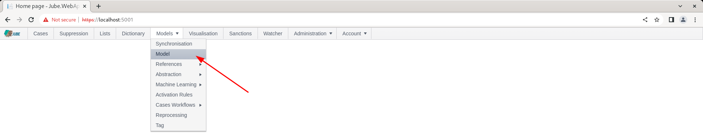

Models will be presented as a list of names:

<!-- TODO(screenshot): file=parent-objects-list-of-models.png route=/models state="replace Razor-era ListOfModels.png with the Vue form-model screen showing the same step" -->
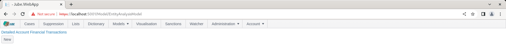

To select into a Model, click on the link by name:

<!-- TODO(screenshot): file=parent-objects-link-to-click-into-menu.png route=/models state="replace Razor-era LinkToClickIntoMenu.png with the Vue form-model screen showing the same step" -->
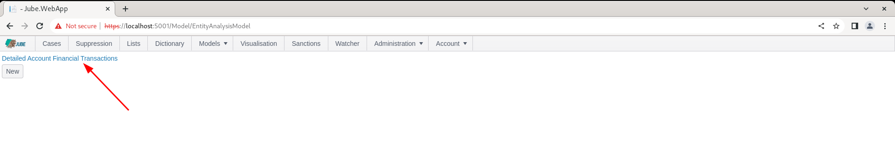

On clicking the link by name, the entry will be expanded upon:

<!-- TODO(screenshot): file=parent-objects-expanded-model.png route=/models state="replace Razor-era ExpandedModel.png with the Vue form-model screen showing the same step" -->
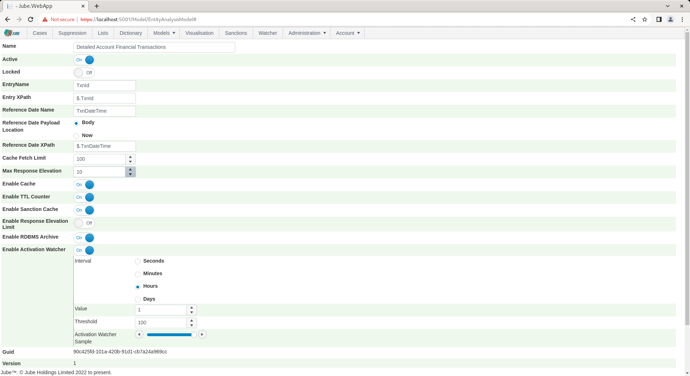

Scrolling down the page and clicking on the back button will restore the view back to the list of models, as start of
this procedure:

<!-- TODO(screenshot): file=parent-objects-clicking-back.png route=/models state="replace Razor-era ClickingBack.png with the Vue form-model screen showing the same step" -->
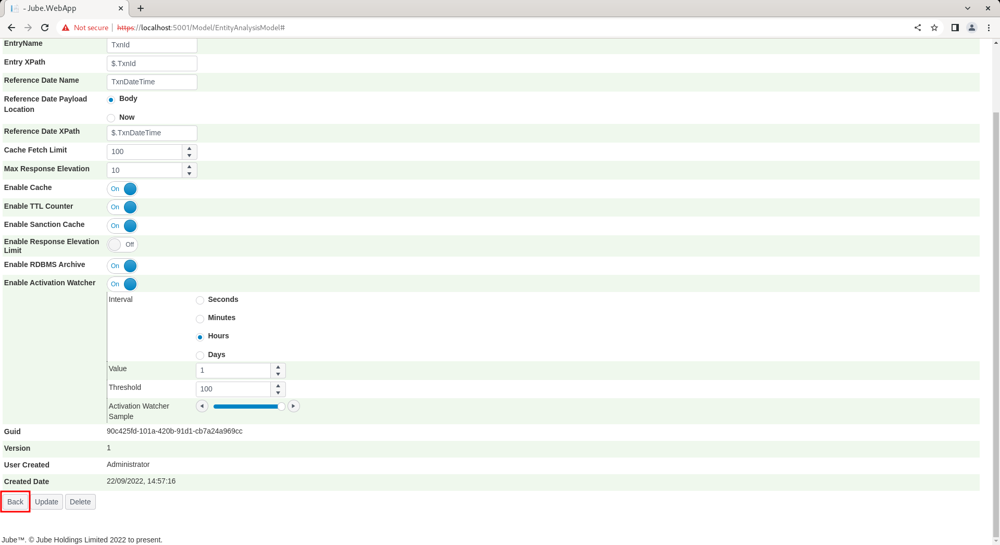

To Add a record to an object, a button titled New is implemented below the list of available models:

<!-- TODO(screenshot): file=parent-objects-new-model-button.png route=/models state="replace Razor-era NewModelButton.png with the Vue form-model screen showing the same step" -->
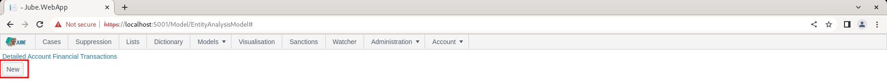

Clicking on this button will expand an empty model record:

<!-- TODO(screenshot): file=parent-objects-empty-model.png route=/models state="replace Razor-era EmptyModel.png with the Vue form-model screen showing the same step" -->
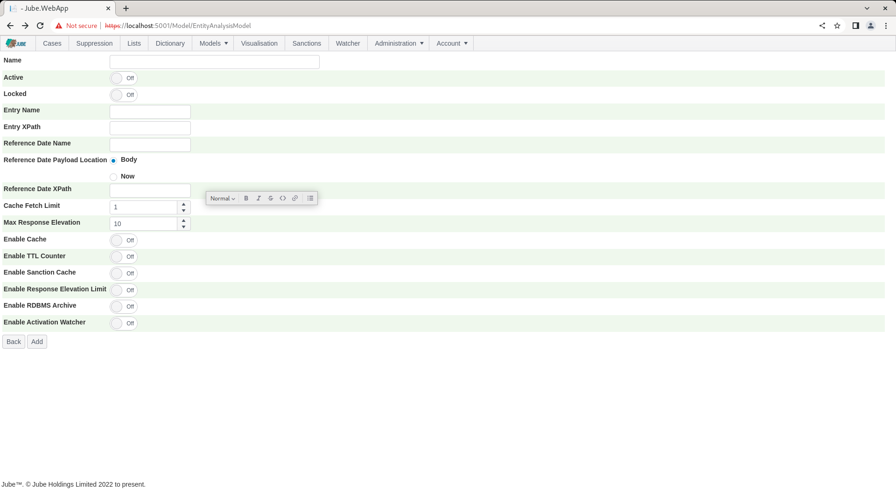

Upon completing the form with valid values for this object (each of these is documented elsewhere), to commit the
record, click the Add button after scrolling down to the base of the page:

<!-- TODO(screenshot): file=parent-objects-add-button-for-model.png route=/models state="replace Razor-era AddButtonForModel.png with the Vue form-model screen showing the same step" -->
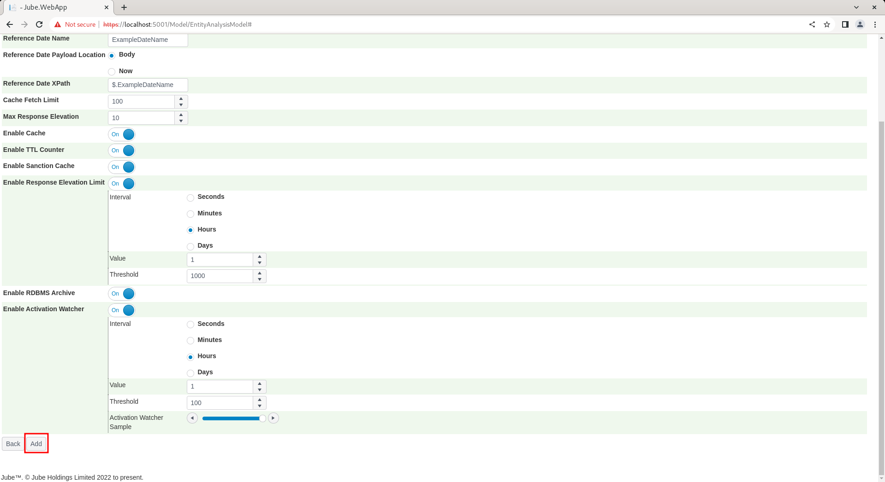

If Add has been clicked, the version, created date and a guid (in some instances) will be returned by way of
confirmation:

<!-- TODO(screenshot): file=parent-objects-model-added.png route=/models state="replace Razor-era ModelAdded.png with the Vue form-model screen showing the same step" -->
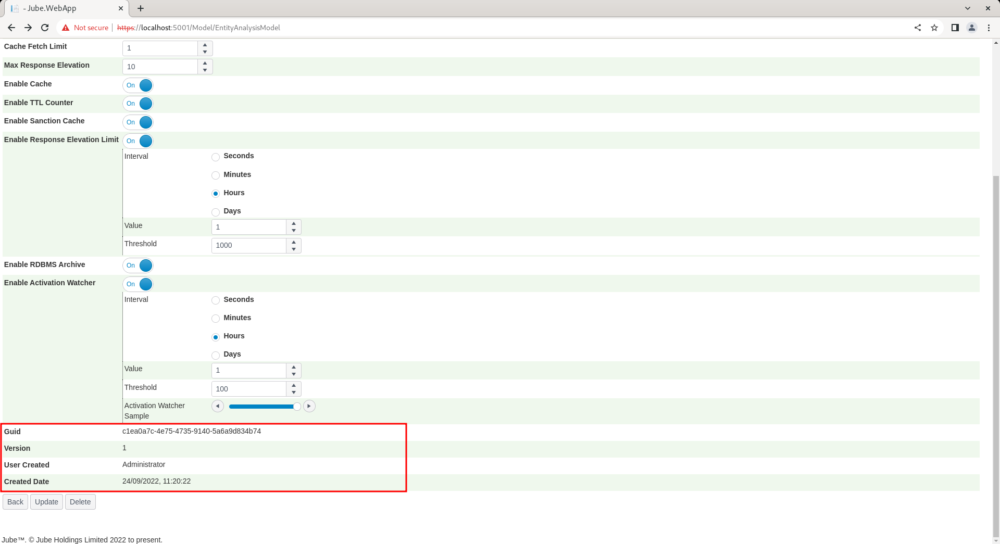

Alternatively, clicking the Back button will roll back the change and return to the list:

<!-- TODO(screenshot): file=parent-objects-back-button-to-rollback.png route=/models state="replace Razor-era BackButtonToRollback.png with the Vue form-model screen showing the same step" -->


To update an entry, select into the entry from the list of names as if to view:

<!-- TODO(screenshot): file=parent-objects-link-to-click-into-menu.png route=/models state="replace Razor-era LinkToClickIntoMenu.png with the Vue form-model screen showing the same step" -->


The fields are available for modification with the current values presented:

<!-- TODO(screenshot): file=parent-objects-updating-model-values.png route=/models state="replace Razor-era UpdatingModelValues.png with the Vue form-model screen showing the same step" -->
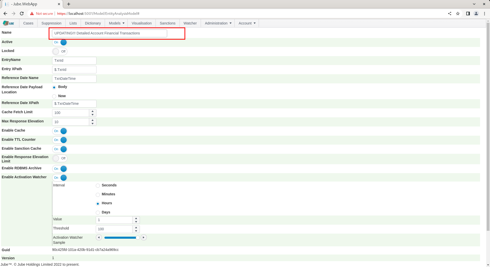

Upon completing the form with valid values for this object to commit the record, click the Update button after scrolling
down to the base of the page. If Update has been clicked, the version and created date will be returned by way of
confirmation, but any Guid will remain static:

<!-- TODO(screenshot): file=parent-objects-model-added.png route=/models state="replace Razor-era ModelAdded.png with the Vue form-model screen showing the same step" -->


The Back button should be used to return to the model list, which will expose the newly created entry:

<!-- TODO(screenshot): file=parent-objects-new-entry-in-model-list.png route=/models state="replace Razor-era NewEntryInModelList.png with the Vue form-model screen showing the same step" -->
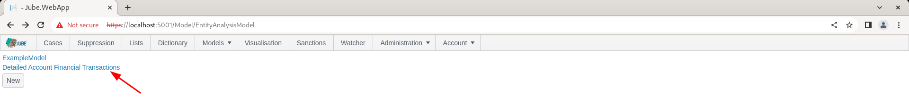

To delete an entry instead of clicking the Update button, click the Delete button instead:

<!-- TODO(screenshot): file=parent-objects-delete-button-for-model.png route=/models state="replace Razor-era DeleteButtonForModel.png with the Vue form-model screen showing the same step" -->
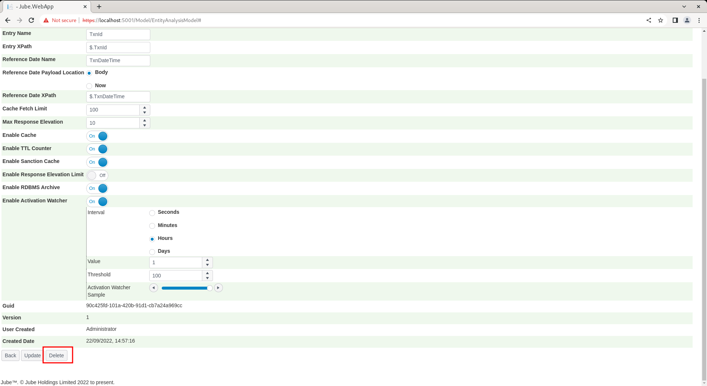

A message for confirmation will be sought:

<!-- TODO(screenshot): file=parent-objects-confirm-delete.png route=/models state="replace Razor-era ConfirmDelete.png with the Vue form-model screen showing the same step" -->
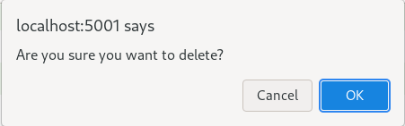

Clicking ok will enact the delete, thereafter returning to the model list, having the same effect as clicking back,
albeit without the entry just deleted available:

<!-- TODO(screenshot): file=parent-objects-models-menu-item.png route=/models state="replace Razor-era ModelsMenuItem.png with the Vue form-model screen showing the same step" -->


Each parent object entry will have a Name field, which is a text string. A description field appears on a more irregular
basis and is a character string.

Upon update a copy of the record before the update is stored in a Version table in the database for the purpose of
audit, thereafter the record is updating in place, incrementing the version number.

For example, on inspection of the versioning for Case Workflow Status Definitions:

```sql
select *
from "EntityAnalysisModelVersion"
Order By "Id" desc
```

It can be seen that a full copy of the record was taken before it was updated. Parent records are versioned in this
manner such is the extent to which complex relationships exist, where Id must be immutable. It should be noted that
there is a record for each update maintained in the database for the purposes of audit.