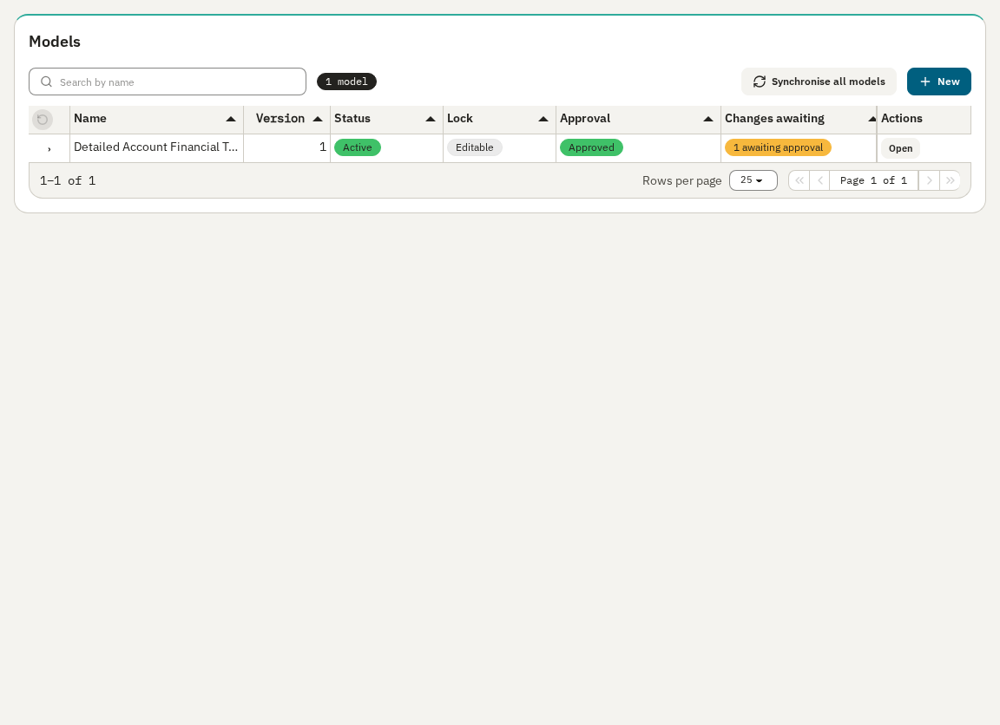
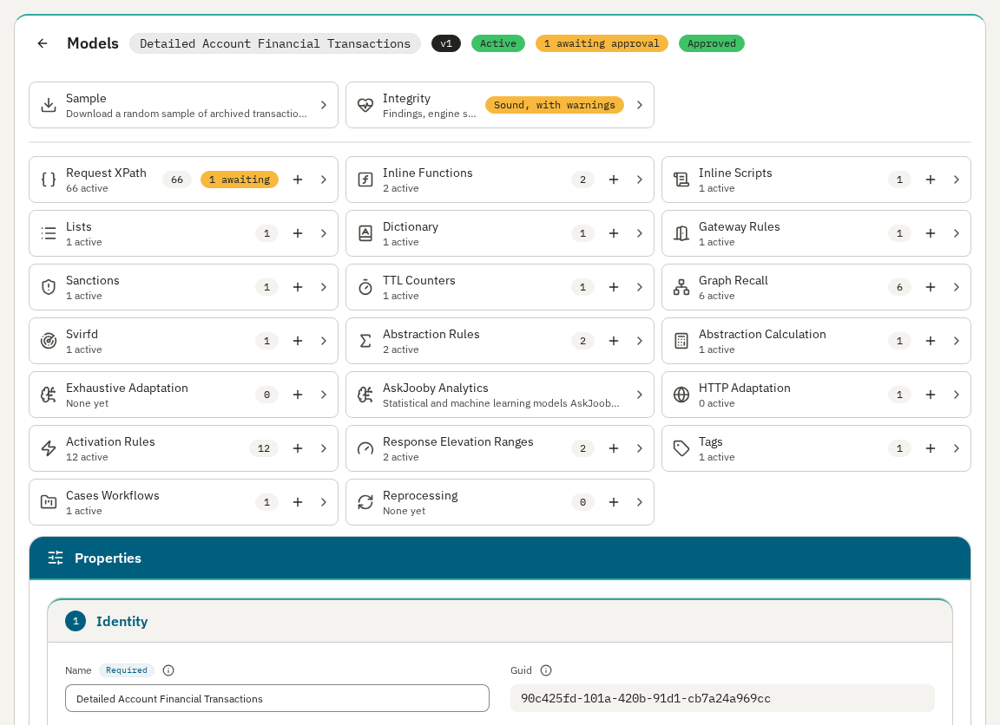

# Parent Objects

A parent object is an object under which other objects roll up, the Model being the most significant example: a Request XPath, an Activation Rule, a List and a Case Workflow are all children of a Model. To Create, Update and Delete a parent object a common user interface exists, which is to list the parent objects in a table, to open one, and thereafter to work upon its properties or descend into its children.

This page takes the Model as the example, and describes the table of models, the opening of a model, and the creation of a new one. The manner in which a record is created, changed, approved and deleted is the same for a parent as it is for a child, and it is described once in [Child Objects](../ChildObjects/index.html), henceforth this page describes only what is particular to the parent.

## Where it lives

Navigate through the menu to Models, which presents the table of models at the address `/models`.

The page is arranged as a story, read from top to bottom, as described in [Child Objects](../ChildObjects/index.html): the table of models is the first step, the model opened is the second, and each step taken thereafter is added beneath the last, the steps already passed collapsing into a single summary line each.

## The table of models

The table of models lists every model of the tenant, 25 to a page, with a box to search the models by name, a badge counting the models shown, and the following columns:

| Column           | Description                                                                                                                              | Example               |
|------------------|------------------------------------------------------------------------------------------------------------------------------------------|-----------------------|
| Name             | The name of the model.                                                                                                                   | Detailed Account Financial Transactions |
| Version          | The version of the model, incremented by one upon each update.                                                                           | 3                     |
| Status           | Whether the model is Active or Inactive.                                                                                                 | Active                |
| Lock             | Whether the model is Locked or Editable, as described in [Locked and Active](../LockedAndActive/index.html).                             | Editable              |
| Approval         | The approval state of the model record itself, as described in [Maker Checker](../../Concepts/MakerChecker/index.html).                  | Approved              |
| Changes awaiting | The number of changes anywhere in the model, its children included, that are awaiting approval, or None awaiting.                        | 2 awaiting approval   |
| Last changed     | The date and time of the last update to the model record.                                                                                |                       |
| Changed by       | The user having made the last update.                                                                                                    | Administrator         |
| Actions          | Open, which opens the model.                                                                                                             |                       |

A row can be expanded for a read only summary of the model without opening it, and where no model matches the search the table reads No models match.

The search box, which carries the prompt Search by name, filters the table as it is typed, keeping the models whose name contains the text entered without regard to case, and the badge beside it follows, reading for example 1 model or 3 models. The columns are not sortable. The pager beneath the table is that of every list, as described in [Child Objects](../ChildObjects/index.html), offering 10, 25, 50 or 100 rows per page.

The badges of the table are coloured so that the exceptional stands out: Active is green and Inactive grey, Locked is amber and Editable grey, a count of changes awaiting is amber and None awaiting grey, and the Approval badge is green for Approved, amber where awaiting and red where rejected. Where the approval state or the count of changes awaiting cannot be fetched, which is the case for a user holding neither permission 44, Allow Approval, nor permission 45, View Pending Approvals, the badge reads Unavailable.

While the models are being fetched a placeholder is presented in place of the table. Should the fetch fail, the table is replaced by the message The models could not be loaded., or by You do not have permission to see models. where the user is refused.

It can be seen that the table answers, for each model, the questions that matter before opening it: is it taken up by the engine, can it be changed, and is anything waiting upon a checker.

Above the table, two further buttons are presented where the user is permitted:

* Synchronise all models, which reveals, between the buttons and the table, the means to synchronise every model with the engine by hand, and conceals it again upon a second click. Approval ordinarily publishes a change to the engine at its next cycle, so this is seldom needed, and it is described in [Model Integrity](../../Configuration/Models/ModelIntegrity/index.html).
* New, which starts a new model, as described below.

SHOT id=navigation-parent-objects-models-table
     route=/models
     steps=none
     frame=page
     state=the table of models with at least two models, one Active and one Inactive, one of them showing changes awaiting approval, with the search box, the count badge, Synchronise all models and New above the table
     conveys=the table of models shows the state, lock, approval and pending changes of each model before it is opened
     alt=The table of models listing each model with its version, status, lock, approval state, changes awaiting, last change and an Open action



## Opening a model

Click Open on the model of interest. The table of models collapses into a summary line, and the model becomes the current step, headed by the name of the model alongside its version, whether it is Active or Inactive, whether it is Locked, the number of changes awaiting approval and its approval state. The step carries a back arrow titled Back to Models.

The model step is presented in three parts, from the top:

| Part            | Description                                                                                                                                                                                                                                        |
|-----------------|----------------------------------------------------------------------------------------------------------------------------------------------------------------------------------------------------------------------------------------------------|
| Operating cards | Sample, which downloads a random sample of archived transactions for the model as described in [Sampling](../../Configuration/Models/Sampling/index.html), and Integrity, which presents the findings, engine state, dependencies and synchronisation of the model as described in [Model Integrity](../../Configuration/Models/ModelIntegrity/index.html). The Integrity card carries the verdict for the model. |
| Hub cards       | One hub card for each type of child object available to the model, in the order in which the engine processes them, starting with Request XPath and concluding with Reprocessing. The hub cards are described in [Child Objects](../ChildObjects/index.html). An AskJooby Analytics card sits among them, opening the statistical and machine learning models trained for the model. |
| Properties      | The form of the model itself.                                                                                                                                                                                                                      |

The Integrity card carries the verdict as a badge, read as follows: Sound, in green, where no check has failed; Sound, with warnings, in amber, where there are warnings yet no errors; and Not sound, in red, where at least one check has returned an error, in which case the model should be opened in Integrity before anything further is approved. Each card carries a line of explanation beneath its title: Download a random sample of archived transactions for this model. for Sample, and Findings, engine state, dependencies and synchronisation. for Integrity.

The address in the browser follows the story, such that a model can be linked to directly, taking the form `/models?path=EntityAnalysisModel:12`, where 12 is the Id of the model. Sample, Integrity and AskJooby Analytics are held in the address also, for example `/models?path=EntityAnalysisModel:12,~integrity`. An address naming a model that does not exist, or that belongs to another tenant, presents the table of models.

SHOT id=navigation-parent-objects-model-story
     route=/models
     steps=open-default-model
     frame=page
     state=the default model opened, showing the collapsed Models step, the model step heading with its version and badges, the Sample and Integrity cards, the hub cards for the child objects, and the first groups of the Properties form
     conveys=a model is one page: its operating cards, its children as hub cards, and its own properties beneath
     alt=A model opened on the Models page, showing the Sample and Integrity cards above the hub cards for each type of child object, with the Properties form of the model beneath



## The Properties form

The Properties form of a model is generated from the definition of the model in the server, in the same manner as the form of any child object, and it follows that the numbered groups, the Required badges, the information button against each field, Save changes, Delete, the safeguards against the loss of work and the Approval section all behave as described in [Child Objects](../ChildObjects/index.html).

The fields of a model are arranged in groups as follows, of which Identity and Entry & Reference Date are open and the remainder start collapsed:

| Group                    | Purpose                                                                                                         |
|--------------------------|-----------------------------------------------------------------------------------------------------------------|
| Identity                 | Name, the Guid by which the model is invoked, Active and Locked.                                                |
| Entry & Reference Date   | Where the entry identifier and the reference date are to be found in the JSON posted to the model.              |
| Cache                    | Whether entry data is stored in the cache, how much is fetched and for how long it is kept.                     |
| Response Elevation Limit | The maximum response elevation, and the limiting of the number of elevations in a rolling period.               |
| Activation Watcher       | Whether activations are streamed to the Watcher, with the sample and the rolling limit.                         |
| Archiving & Counters     | Whether TTL Counters are kept, and whether transactions and activations are archived to the database.           |
| Implicit Async           | Whether a synchronous invocation gives up waiting after a timeout, to be recalled later.                        |
| Logs                     | The capture of the step by step trace of an invocation, sampled or upon a threshold being exceeded.             |
| Response Trace           | Whether the performance breakdown is returned in the response.                                                  |
| Audit                    | The Id and version, and the user and date of creation, last update and deletion.                                |

Each field is described in [Model Configuration](../../Configuration/Models/Models/index.html).

Two matters are particular to the Properties of a model:

* The Guid is assigned by the server upon creation, it cannot be changed, and it remains static across every update. It is the Guid, not the Id nor the Name, that addresses the model for invocation at `/api/invoke/EntityAnalysisModel/{guid}`, such that it can be relied upon by the systems integrating with Jube.
* A locked model is presented with its form disabled and without Save changes or Delete, and an Unlock button is presented beside the back arrow to a user holding permission 6, Read Write Model. Unlocking is itself an update, incrementing the version by one, after which the Lock column of the table reads Editable, the Properties form that is open is read afresh and becomes editable, and the Locked badge leaves its heading. Should the unlocking fail, The model could not be unlocked. is written beneath the button.

Close, at the base of the Properties form, closes the model and returns to the table of models, as does the back arrow. Upon the deletion of a model being confirmed the story likewise returns to the table, from which the model is gone.

## Creating a model

Click New above the table of models. The table collapses and a step named New model is presented, with a blank form to be completed and the reminder to fill in the fields below, then save to create it. The back arrow, titled Back to Models, abandons the new model, seeking confirmation where anything has been entered.

A new model is not Active, and Active must be switched on for the model to participate in invocation and synchronisation. Upon clicking Create, confirmation is returned as Created and the step becomes the model just created, with its Guid assigned and its hub cards presented, ready for its children to be created, rather than returning to the table.

As with any record, a new model, a change to a model and the deletion of a model are each subject to approval by a second user before they take effect in the engine.

## Versions and audit

Each parent object entry has a Name field, which is a text string. A description field appears on a more irregular basis and is a character string.

Upon update a copy of the record before the update is stored in a Version table in the database for the purpose of audit, thereafter the record is updated in place, incrementing the version number. For example, on inspection of the versioning for Models:

```sql
select *
from "EntityAnalysisModelVersion"
order by "Id" desc
```

It can be seen that a full copy of the record was taken before it was updated. Parent records are versioned in this manner such is the extent to which complex relationships exist, where Id must be immutable. It should be noted that there is a record for each update maintained in the database for the purposes of audit. A delete is done on a logical basis, which is to say that the model is marked as deleted and remains in the database.

## Other parent objects

The Model is not the only parent object. Several of the pages under Administration are built in the same manner, as a story that opens with a list of parent objects, each of which is opened to reveal its children as hub cards and its own Properties form beneath:

| Page                                  | Parent object  | Children                    |
|---------------------------------------|----------------|-----------------------------|
| Administration >> Tenants             | Tenant         | None.                       |
| Administration >> Security            | User, and Role | Users, beneath a Role.      |
| Administration >> Visualisation setup | Visualisation  | Parameters and Datasources. |
| Administration >> Graph setup         | Graph          | Edges.                      |

For these pages the address takes the same form, and creating, changing and deleting a record follows the common manner described in [Child Objects](../ChildObjects/index.html). Where a page has something of its own, such as the granting of permissions to a role, it is described in the documentation for that page.

## Permissions and security

The table of models is presented to a user holding any one of the permissions for the children of a model, such that a role granted only permission 3, Read Write List, can open a model for the purposes of maintaining its Lists. To create a model, to change its Properties, to delete it or to unlock it requires permission 6, Read Write Model. New, Create, Save changes, Delete and Unlock are not presented without it, and the server refuses each of them likewise with status 403. Further:

| Element                 | Permission                                                     |
|-------------------------|----------------------------------------------------------------|
| Synchronise all models  | 5, Allow Synchronisation.                                      |
| Sample                  | 40, View Entity Analysis Model Sampling.                       |
| Integrity               | 60, View Model Integrity.                                      |
| AskJooby Analytics      | Any of 45, 46, 47 and 48, the last three being Advanced Analytics Recall, Advanced Analytics Promote Model and Advanced Analytics. |
| Each hub card           | The permission for that type of child object, as given in the page for the child object. A hub card is presented for every type of child object, and one whose children the user is not permitted to read states Could not load in place of its counts. |

A user without permission to see models is told as much in place of the table. Models are scoped to the tenant of the user, and a model of another tenant behaves as one that does not exist.
