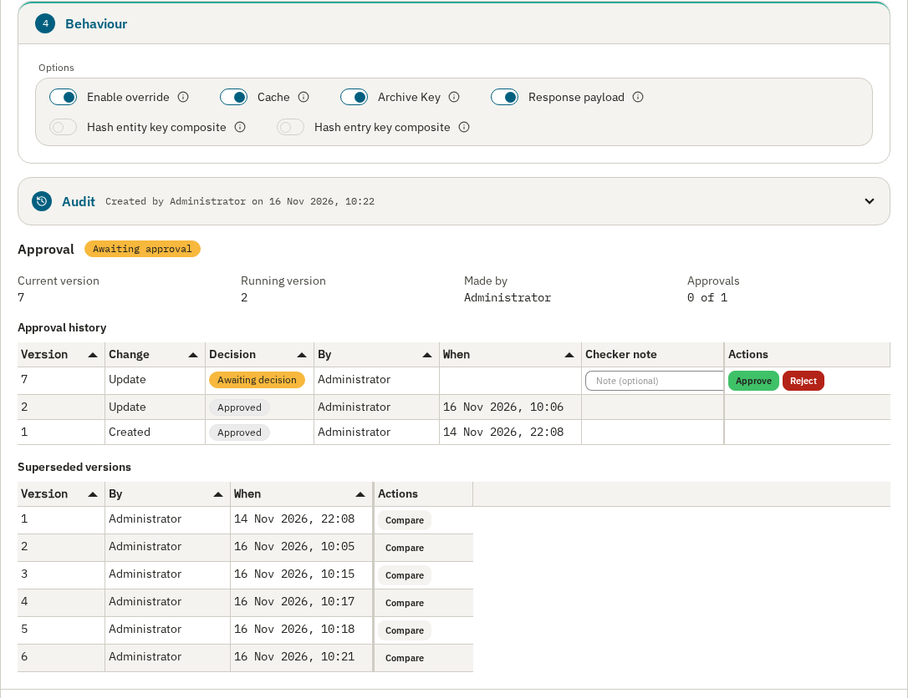

# Archive Key

When request payload data has concluded processing, a comprehensive payload comes to rest as JSONB in a table of name Archive in the database. The format of the data is largely the same as the response payload returned via HTTP response or AMQP, except the [Response Payload](../ResponsePayload/index.html) configuration will be ignored, and it will contain all elements processed:

```sql
select * from "Archive"
```

Each row of the Archive table is a transaction, with the comprehensive payload in the Json column, alongside a small number of columns that identify it:

| Column                               | Description                                                                               |
|--------------------------------------|-------------------------------------------------------------------------------------------|
| Id                                   | The identifier of the row.                                                                |
| Json                                 | The comprehensive payload, as JSONB.                                                      |
| EntityAnalysisModelInstanceEntryGuid | The Guid given to the transaction upon processing, unique to it.                          |
| EntryKeyValue                        | The entry identifier of the transaction, for example the transaction identifier.          |
| ResponseElevation                    | The response elevation returned for the transaction.                                      |
| EntityAnalysisModelActivationRuleId  | The Activation Rule recorded against the transaction, if any.                             |
| EntityAnalysisModelId                | The model that processed the transaction.                                                 |
| ActivationRuleCount                  | The number of Activation Rules that matched.                                              |
| CreatedDate                          | The date and time the row was created.                                                    |
| ReferenceDate                        | The reference date of the transaction.                                                    |

JSONB is a versatile datatype and has a means to expose all of the elements to SQL to support reporting. For example, elements can be extracted via syntax as follows:

```sql
select "Json" -> 'payload' ->> 'Currency' as "Currency"
from "Archive"
```

Elements can be extracted for the purpose of predication, grouping and selection, henceforth it is fantastically powerful, and akin to a traditional table structure. Indexing is somewhat more contrived however.

JSONB is stored with a GIN Index in place, hence, many queries will perform well without any further consideration given to indexing. However, an index may still be required for direct and predictable access, in which case it can be achieved using the JSON predication, as above, in an expression index.

## The Archive Key table

Setting a property to Archive Key has the effect of promoting that value to a heavily indexed key value table, which can be joined to the Archive table. Given the key and value being indexed, the performance of direct access queries can be improved.

```sql
select * from "ArchiveKey"
```

The ArchiveKey table is specified as follows:

| Column                               | Description                                                                                                 |
|--------------------------------------|-------------------------------------------------------------------------------------------------------------|
| Id                                   | The identifier of the row.                                                                                  |
| ProcessingTypeId                     | The stage of processing that created the value, for example 1 for a field of the request payload.           |
| Key                                  | The name of the object promoted, for example Currency.                                                      |
| KeyValueString                       | The value, where it is a string.                                                                            |
| KeyValueInteger                      | The value, where it is an integer.                                                                          |
| KeyValueFloat                        | The value, where it is a float.                                                                             |
| KeyValueBoolean                      | The value, where it is a boolean, as 1 or 0.                                                                |
| KeyValueDate                         | The value, where it is a date.                                                                              |
| KeyValueLong                         | The value, where it is a long integer.                                                                      |
| EntityAnalysisModelInstanceEntryGuid | The Guid of the transaction, by which the row is joined to the Archive table.                               |

It can be observed that the table presents access via a Key (for example Currency) and its KeyValue (e.g. 826). Note however that the key value is stored in an appropriate field for its datatype. Datatype for key values are configured in the Request XPath, otherwise it is of type Float.

An index exists for the Key together with each of the KeyValueString, KeyValueInteger, KeyValueFloat, KeyValueBoolean and KeyValueDate columns, each index including the EntityAnalysisModelInstanceEntryGuid, such that the Guid of the transactions matching a key and value can be returned from the index alone.

## Where it lives

Archive Key is a switch in the Properties form of a child object. Navigate through the menu to Models, open the model, then the hub card for the child object, and open the record, as described in [Child Objects](../ChildObjects/index.html). The switch is available to the child objects as follows:

* Request XPath, in the Behaviour group.
* Inline Functions, in the Behaviour group.
* Sanctions, TTL Counters, Graph Recall, Abstraction Rules, Abstraction Calculation, Exhaustive Adaptation and HTTP Adaptation, in the Output group.
* Activation Rules, in the Output and Sampling group.

SHOT id=navigation-report-table-behaviour-group
     route=/models
     steps=open-default-model, open-hub:Request XPath, open-row:AccountId, scroll-to:Behaviour
     frame=record
     state=the AccountId Request XPath of the default model scrolled to the Behaviour group of its Properties form, showing the switches Enable override, Cache, Archive Key and Response payload switched on, with the Audit and Approval sections of the record beneath
     conveys=Archive Key is one switch among the behaviour switches of the record, not a screen of its own
     alt=The Behaviour group of the AccountId Request XPath record showing its switches, Archive Key among them and switched on, above the Approval section of the record



## Fields

| Value       | Description                                                                                                                                     | Example |
|-------------|-------------------------------------------------------------------------------------------------------------------------------------------------|---------|
| Archive Key | Whether the value created by the child object is written to the ArchiveKey table. It is off for a new Request XPath and must be switched on.   | True    |

## Example

In a new installation where no Archive Key has been set for the purpose of promoting key values, the ArchiveKey table is empty.

In the example of Currency, available in the Request XPath of the default model, there is no promotion of the element for reasons of it not being switched, as is default. Switching on Archive Key for the Currency, followed by the change being approved as described in [Maker Checker](../../Concepts/MakerChecker/index.html) and taken up by the engine at its next cycle, will promote the key value, to be persisted during the same process as the JSONB to the Archive table.

The key values will be promoted on a forward basis only, and there is no functionality to retroactively fill, hence this would need to be done via SQL should it be required. To inspect, select from the ArchiveKey table as above, which upon a transaction having been processed returns data in the manner of the following, abridged to the columns of interest and with the Guid being illustrative:

| Key      | KeyValueString | EntityAnalysisModelInstanceEntryGuid |
|----------|----------------|--------------------------------------|
| Currency | 826            | 3f1c6f0e-8a4b-4f43-9c2e-5d0b7a2e91c4 |

Note the presence of the Key as 'Currency', the KeyValueString as '826' and the availability of the EntityAnalysisModelInstanceEntryGuid to join, thus access, the wider JSONB payload in the Archive table:

```sql
select "Json" from "Archive"
inner join "ArchiveKey"
on "Archive"."EntityAnalysisModelInstanceEntryGuid" = "ArchiveKey"."EntityAnalysisModelInstanceEntryGuid"
where "ArchiveKey"."Key" = 'Currency' and "ArchiveKey"."KeyValueString" = '826'
```

The query returns the Json of each transaction having a Currency of 826, located by way of the index on the ArchiveKey table rather than by inspection of the JSONB.

It is important to use Archive Key and the promotion of keys sparingly as the values are indexed and will affect insert performance, and in many instances values may already have an efficient query path via the availability of the GIN index for the JSONB.

## Permissions and security

Archive Key is switched with the permission that allows the child object itself to be written, for example permission 7, Read Write Request XPath, for a Request XPath. The Archive and ArchiveKey tables are a matter for the database, and access to them by SQL is governed by the roles and grants of the database and not by the permissions of Jube.
