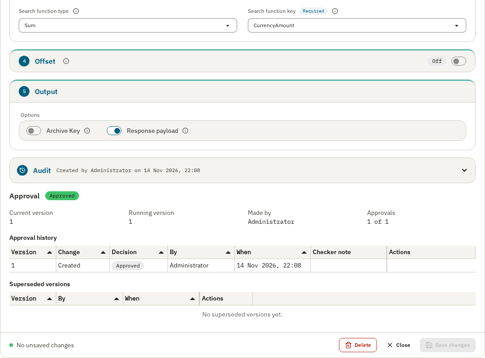

# Response Payload

The child objects of a model that create a value have the option to specify whether that value should be returned in the response payload via HTTP or AMQP. A Response Payload means that the content or value created will be returned to the HTTP response stream or AMQP payload, and is otherwise excluded. It is a means to reduce the amount of bandwidth that is used in extremely large throughput, as some hosting providers charge for outbound bandwidth.

## Where it lives

Response Payload is a switch in the Properties form of the child object. Navigate through the menu to Models, open the model, then the hub card for the child object, and open the record, as described in [Child Objects](../ChildObjects/index.html). For a Request XPath and an Inline Function the switch is in the Behaviour group, for a Gateway Rule in the Gateway group, for an Activation Rule in the Output and Sampling group, and for the remainder in the Output group.

The switch is available to the child objects as follows:

* Request XPath.
* Inline Functions.
* Gateway Rules.
* Sanctions.
* Dictionary.
* TTL Counters.
* Graph Recall.
* Svirfd.
* Abstraction Rules.
* Abstraction Calculation.
* Exhaustive Adaptation.
* HTTP Adaptation.
* Activation Rules.

An Inline Script has no switch of its own, as the values it creates are the properties of the script, each of which declares in the code of the script whether it is to be returned in the response payload, as described in [Inline Scripts](../../Configuration/Models/InlineScripts/index.html).

SHOT id=navigation-response-payload-output-group
     route=/models
     steps=open-default-model, open-hub:Abstraction Rules, open-first-row, scroll-to:Output
     frame=record
     state=an Abstraction Rule of the default model scrolled to the Output group of its Properties form, showing Archive Key switched off and Response payload switched on, with the Audit and Approval sections of the record beneath
     conveys=Response Payload is a switch held with the other output switches of the record that creates the value
     alt=The Output group of an Abstraction Rule record showing Archive Key switched off and Response payload switched on, above the Approval section of the record



## Fields

| Value            | Description                                                                                                                                  | Example |
|------------------|----------------------------------------------------------------------------------------------------------------------------------------------|---------|
| Response Payload | Whether the value created by the child object is included in the response payload. It is off for a new record and must be switched on.      | True    |

## Behaviour

Response Payload is a property of the record in the manner of any other, and it follows that switching it is an update, subject to approval by a second user as described in [Maker Checker](../../Concepts/MakerChecker/index.html), thereafter being taken up by the engine at its next cycle. Until such time, the engine continues to respond as it did before.

Irrespective of the Response Payload being selected, the value will still be compiled into the Archive payload for database insertion, where it remains available for reporting as described in [Archive Key](../ReportTable/index.html). It should be kept in mind therefore that Response Payload governs only what is transported back to the caller, and has no bearing upon what is processed, what is available to rules, nor what is stored.

## Example

Although JSON processing via HTTP or AMQP is outside the scope of this section of the documentation, it may be stated that in the default model the Request XPath named Currency is extracted from the JSON posted. With Response Payload switched on for the Currency, the element appears in the response payload, abridged here to the payload only:

```json
{
  "payload": {
    "AccountId": "Test1",
    "Currency": "826",
    "IP": "8.8.8.8"
  }
}
```

Switching off Response Payload for the Currency will, upon the change having been approved and taken up by the engine, remove the element from the response payload. A like for like request via HTTP will now exclude transport of the Currency element:

```json
{
  "payload": {
    "AccountId": "Test1",
    "IP": "8.8.8.8"
  }
}
```

The Currency is nonetheless present in the Archive payload for the transaction.

TODO(verify): the two JSON listings above replace screenshots of a response and were written from the behaviour of the engine (BuildJsonResponses.cs) rather than captured. Post the sample request in the Http folder to the default model on a running system, with Response Payload on and then off for Currency, and replace the listings with the responses returned, confirming the name and casing of the payload element.

## Permissions and security

Response Payload is switched with the permission that allows the child object itself to be written, for example permission 7, Read Write Request XPath, for a Request XPath, and permission 17, Read Write Activation Rule, for an Activation Rule.
