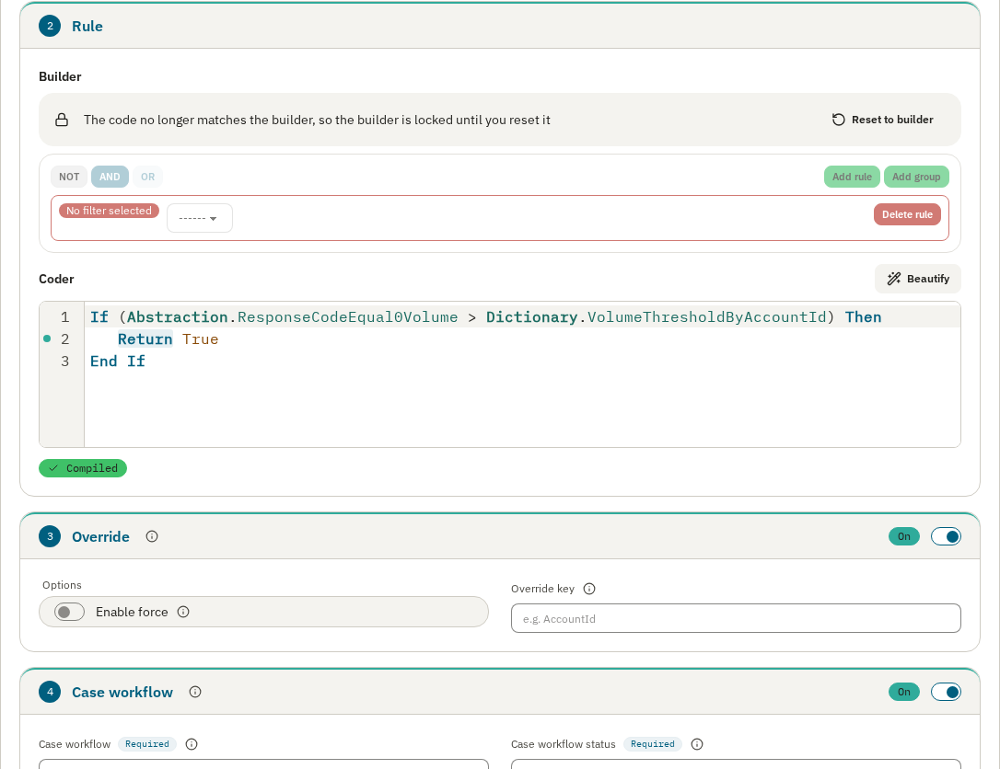
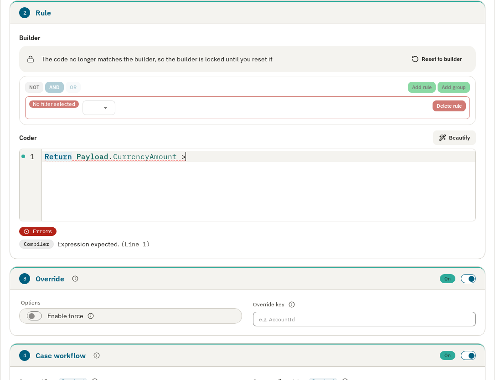
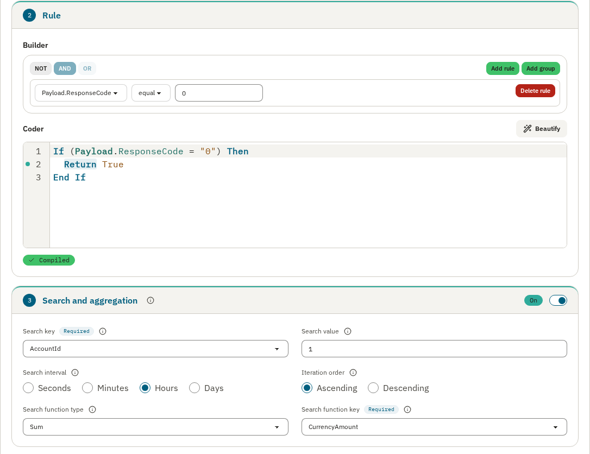

# Rule and Code Builder

Several pages in the platform rely on the construction of code and in most cases this is facilitated by a point and click construction tool. In most cases the code constructed is of vb.net fragment dialect, unless it is used for reporting, case management or Exhaustive training, in which case it is an SQL query fragment.

There are oftentimes two modes to create rules, being Builder (which is point and click) and Coder (which is the handcrafting of the vb.net). The two are presented together, the Builder above and the Coder beneath, and they are kept in step: a rule constructed in the Builder is written to the Coder as its VB.Net fragment equivalent, such that the code that will be compiled can always be seen, and may thereafter be handcrafted.

## Where it lives

The Rule and Code Builder is not a page in its own right, rather it is embedded in the Properties form of the objects that carry a rule. Navigate through the menu to Models, open the model, then the hub card for the object, and open a record or start a new one, as described in [Child Objects](../ChildObjects/index.html). The rule is saved with the rest of the form, by Create or Save changes.

The Builder and Coder is available for the creation of VB.Net fragments in:

* Gateway Rules.
* Activation Rules.
* Abstraction Rules.
* Reprocessing Rules.

Inline Functions can be used in all of these rules, including Reprocessing Rules, and appear in the Builder's field list alongside the Payload fields.

Only the Coder is available for the creation of VB.Net fragments in:

* Inline Functions.
* Abstraction Calculations.

For reasons of creating SQL fragments and not VB.Net fragments, only a Builder is available in:

* Case Workflow Filters, being the Filter hub card of a Cases Workflow.
* Cases Search, in the Cases page.
* Exhaustive Adaptation Class Definition, being the Training Data Filter of an Exhaustive Adaptation.

The Builder for SQL fragments has the same manner of adding rules and groups, yet it has its own, shorter, list of operators, such as is equal to, is like, begins with and is null, and where it is used for Case Workflow Filters and Cases Search it is accompanied by the choice of columns and their order. It has no Coder, and what follows in this page concerns the Builder and Coder for VB.Net fragments.

SHOT id=navigation-rule-builder-and-coder
     route=/models
     steps=open-default-model, open-hub:Activation Rules, open-row:VolumeThresholdByAccountId, scroll-to:Rule
     frame=record
     state=an Activation Rule of the default model with the Builder above the Coder, the Coder showing the rule text with coloured words, and the status beneath reading Compiled
     conveys=the Builder and the Coder are one surface, the Builder above writing the code that is shown in the Coder beneath
     alt=The rule editor of an Activation Rule showing the Builder above the Coder holding the VB.Net rule text, with a Compiled status beneath



## The Builder

The Builder constructs a rule as a group of conditions. A group is joined by AND or by OR, as chosen at the head of the group, and may be negated by selecting NOT. Add rule adds a condition to the group, and Add group adds a group nested within it, such that conditions of any depth can be constructed, with Delete rule and Delete group removing them.

Each condition is a field, an operator and the values of the operator. The field is chosen from a list of everything that is available to the kind of rule, arranged under headings for the source of the data, and in the example of an Activation Rule this is a comprehensive range of data, as set out in the section Fields available to each rule below. The operator list then offers only the operators that suit the type of the field chosen.

Only what the engine would actually run is offered: an item that has been made inactive (a Request XPath, Inline Script, Inline Function, Dictionary, List, TTL Counter, Sanction, Abstraction Rule, Abstraction Calculation, HTTP Adaptation, Exhaustive instance or Tag whose Active switch is off) does not appear in the completions, the field lists of the rule builders, or the fields offered for reporting, and appears again as soon as it is made active. The Active switch of the model itself does not hide its fields, so that rules can be built for a model that is still a draft.

Shortly after each change to the Builder, being a little over a second after the last change such that a burst of changes is taken as one, the Coder is overwritten with the VB.Net fragment equivalent, and the rule is checked. A condition that is not complete, a value being missing or not being a number where a number is needed for example, is stated beneath the editor with the source given as Builder, and the status reads Incomplete until something has been constructed. The statements made of an incomplete condition are as follows, each prefixed by the name of the value concerned, such as Value, From or To:

| Statement                                                    | Raised when                                                        |
|--------------------------------------------------------------|--------------------------------------------------------------------|
| a value is needed.                                           | A value of the operator has been left empty.                       |
| a whole number is needed.                                    | The value must be a whole number and is not.                       |
| a number is needed.                                          | The value must be a number and is not.                             |
| a date and time such as 2026-01-31T00:00:00 is needed.       | The value must be a date and cannot be read as one.                |
| choose a list.                                               | The operator tests against a model list and none has been chosen.  |
| choose a field.                                              | The operator compares with another field and none has been chosen. |
| line breaks and control characters cannot be used.           | The value holds a line break or a control character.               |

Where a rule is opened and one of the fields it used is no longer available, having been deleted or made inactive, the condition is removed from the Builder and a notice names the fields removed, asking that the rule be reviewed, in the form These fields are no longer available and were removed from the rule, followed by the fields and Review this rule. Should the conditions saved for the Builder not be readable at all, the notice reads The saved builder rules could not be restored. Review this rule. Should the editor itself fail to load, it is replaced by The rule editor could not be loaded. Refresh the page to try again.

## The Coder

The Coder is an editor for the VB.Net fragment, with line numbers, colouring and completions. The default Coder value will be taken from the Builder, being the VB.Net fragment equivalent, and it may be left as such, in which case the Builder remains in control of the rule.

As typing, the freehand code will be continually parsed for integrity. Parsing happens upon the conclusion of each typing burst, until such time as the rule compiles, with the outcome stated beneath the editor:

| Status       | Meaning                                                                                                              |
|--------------|----------------------------------------------------------------------------------------------------------------------|
| Checking     | The rule has been sent to the server and the answer is awaited.                                                      |
| Compiled     | The rule parses and compiles.                                                                                        |
| Errors       | The rule does not parse or compile, or a condition of the Builder is incomplete.                                     |
| Incomplete   | The Builder is in control and nothing has yet been constructed.                                                      |
| Return False | The Coder is empty, and a rule without code never matches.                                                           |
| Disconnected | The server could not be reached, so the rule has not been checked.                                                   |

The status is a badge, green for Compiled, red for Errors and Disconnected, and without colour for the remainder. The check is made a little over a second after typing ceases. It is the status that should be consulted before saving: only Compiled states that the engine will accept the rule as it stands, keeping in mind that the rule is checked again by the server upon Create or Save changes whatever the status reads.

Errors are underlined in the code where they occur, with the error being displayed in a tool tip upon hovering, and each is also listed beneath the status with its source, as Compiler or Builder, its message and its line. Clicking a message in the list moves to the place in the Coder, or to the condition in the Builder, that it relates to.

Beautify, above the Coder, lays out the code with consistent indentation, without changing its meaning.

SHOT id=navigation-rule-coder-errors
     route=/models
     steps=open-default-model, open-hub:Activation Rules, open-row:VolumeThresholdByAccountId, scroll-to:Rule, fill:Coder=Return Payload.CurrencyAmount >
     frame=record
     state=the Coder holding a rule with one line that does not compile, underlined where the error occurs, the Builder above dimmed with the notice that the code no longer matches the builder, and beneath the editor the status reading Errors with the compiler message and its line listed
     conveys=freehand code is checked as it is typed, the error is shown both in the code and in a list, and editing the code locks the Builder
     alt=The Coder with an underlined error in the rule text, the Builder above locked, and a list beneath giving the compiler message and line number under an Errors status



### When the Coder diverges from the Builder

If the Coder diverges from what was originally created in the Builder, which is to say that the code has been edited by hand such that it is no longer what the Builder would write, then the Builder is locked: it is dimmed, it cannot be changed, and a notice states that the code no longer matches the builder, so the builder is locked until it is reset. From this point the rule is a Coder rule, and it is the Coder text that is compiled and run by the engine.

Clicking Reset to builder, in the notice, will overwrite the Coder with the parsed contents of the Builder, discarding the handcrafted code, and the Builder becomes enabled once again. A difference of layout alone, such as that made by Beautify, is not a divergence.

## Rule tools

For an Activation Rule that has been saved, a further set of Rule tools is presented beneath the rule, in three sections that start collapsed, a section being presented only where the user is permitted:

| Section      | Description                                                                                                                                             | Permission                    |
|--------------|---------------------------------------------------------------------------------------------------------------------------------------------------------|-------------------------------|
| Backtest     | Runs the rule, as it is in the editor, over archived transactions, as described in [Backtest](../../Configuration/Models/Backtest/index.html).          | 61, Run Backtest.             |
| Dependencies | What the rule uses, and what uses the rule.                                                                                                             | Any of 8, 10, 13, 14, 16, 17, 25 and 26. |
| Integrity    | The findings of [Model Integrity](../../Configuration/Models/ModelIntegrity/index.html) for the rule.                                                   | 60, View Model Integrity.     |

The Rule tools are not presented for a rule that has not yet been created, and the content of a section is fetched only upon the section being opened. A user holding none of the permissions is told You do not have permission to use any of the rule tools.

Dependencies presents two tables. Uses lists what the rule refers to, with the columns Name, Entity, How (whether through the rule text or through a setting) and Line, a name that resolves to nothing being shown as Does not exist and an inactive entity being marked inactive, and it reads Nothing. where the rule refers to nothing. Used by lists what refers to the rule, with the columns Entity, Through and Depth, and it reads Nothing uses this rule. where that is so. Integrity lists the findings for the rule alone, reading No findings for this rule. where every check passes.

SHOT id=navigation-rule-tools-dependencies
     route=/models
     steps=open-default-model, open-hub:Activation Rules, open-row:VolumeThresholdByAccountId, open-section:Dependencies, scroll-to:Dependencies
     frame=record
     state=a saved Activation Rule of the default model scrolled to the Rule tools beneath the rule, with the Dependencies section open and showing its Uses table of five rows, an Abstraction Rule and a Dictionary used through the rule text and a Request XPath and a Case Workflow used through settings, and its Used by table reading Nothing uses this rule, the Backtest and Integrity sections remaining collapsed
     conveys=the Rule tools sit beneath a saved rule as collapsed sections, and Dependencies answers what the rule uses and what uses it
     alt=The Rule tools of an Activation Rule with the Dependencies section open, showing a Uses table of five rows with the columns Name, Entity, How and Line, and a Used by table beneath it reading Nothing uses this rule, between the collapsed Backtest and Integrity sections


## Fields available to each rule

The fields offered depend on the kind of rule, because the invocation pipeline works them out in stages and a rule can only use what has been worked out before it runs:

| Rule                            | Fields it may use                                                                                               |
|---------------------------------|-----------------------------------------------------------------------------------------------------------------|
| Gateway Rule, Reprocessing Rule | Payload fields, inline functions, dictionary values and lists.                                                  |
| Abstraction Rule                | As a Gateway Rule, but only payload fields that are cached.                                                     |
| Activation Rule                 | Everything: also TTL counters, abstractions, sanctions, calculations, adaptations and earlier activation rules. |

The fields offered and the fields the rule compiler accepts differ in one respect: an Abstraction Rule is offered TTL counters and sanctions, and an Abstraction Calculation is offered abstraction calculations, but neither will compile with them. A rule using one is refused when it is saved, in the Builder as in the Coder.

## Validation

A rule is checked again when it is saved. A rule whose text does not parse or compile is refused, with the line and position of each error, and nothing is saved. The check follows the engine: it checks the Builder or Coder text, whichever is in control, and only restricts a Builder Abstraction Rule to cached payload fields, so it never refuses a rule the engine would accept. Reprocessing Rules are checked as Gateway Rules.

The checking that takes place while typing is limited, for the purposes of protecting the server. Each user may make `ParseMaxPerUserPerWindow` checks (120) and a tenant `ParseMaxPerTenantPerWindow` (600) in each `ParseWindowSeconds` (60), these being Environment Variables. Past the limit the server answers HTTP 429 and the Coder quietly checks again ten seconds later.

## Builder operators

Each condition in the Builder is a field, an operator and the operator's values. The operator list only offers the operators that suit the field's type, under headings: Basic first, then the groups below, each in alphabetical order. The same operators are offered in every rule builder, being Gateway, Abstraction, Activation and Reprocessing Rules, and the backtest filters.

### Basic

The Basic operators are the usual comparisons of the builder. Rules saved before the other groups were added keep exactly the rule text they always produced.

| Operator         | Allowed for                   | Values   | Rule text produced                                     |
|------------------|-------------------------------|----------|--------------------------------------------------------|
| equal            | Text, numbers, dates, Boolean | value    | `field = value`                                        |
| not equal        | Text, numbers, dates, Boolean | value    | `field <> value`                                       |
| in               | Text, numbers                 | values   | `field.MatchIn(a, b, …).ToBoolean()`                   |
| not in           | Text, numbers                 | values   | `field.MatchNotIn(a, b, …).ToBoolean()`                |
| less             | Numbers, dates                | value    | `field < value`                                        |
| less or equal    | Numbers, dates                | value    | `field <= value`                                       |
| greater          | Numbers, dates                | value    | `field > value`                                        |
| greater or equal | Numbers, dates                | value    | `field >= value`                                       |
| between          | Numbers, dates                | from, to | `field.MatchInRange(from, to).ToBoolean()` (inclusive) |
| not between      | Numbers, dates                | from, to | `field.MatchInRange(from, to).ToBoolean() = False`     |
| begins with      | Text                          | value    | `field.StartsWith(value)`                              |
| not begins with  | Text                          | value    | `field.StartsWith(value) = False`                      |
| contains         | Text                          | value    | `field.Contains(value)`                                |
| not contains     | Text                          | value    | `field.MatchContainsNone(value).ToBoolean()`           |
| ends with        | Text                          | value    | `field.EndsWith(value)`                                |
| not ends with    | Text                          | value    | `field.EndsWith(value) = False`                        |
| is empty         | Text                          | none     | `field.MatchIsNullOrEmpty().ToBoolean()`               |
| is not empty     | Text                          | none     | `field.MatchIsNotNullOrEmpty().ToBoolean()`            |
| is null          | Text                          | none     | `field.MatchIsNull().ToBoolean()`                      |
| is not null      | Text                          | none     | `field.IsNotNull()`                                    |

### Lists

A model list has one operator, has, which tests whether the list contains the value of a text field chosen from a list, for example `List.HighRisk.contains(Payload.Country)`.

### Compare to another field

Equal, not equal, greater, greater or equal, less and less or equal can also compare a field with another field of the same type, chosen from a list, for example `Payload.BillingCountry <> Payload.IpCountry`. Equal and not equal work for text, numbers and dates, and the others for numbers and dates. In the operator list these are labelled Equals another field, Does not equal another field, Greater than another field, Greater than or equal to another field, Less than another field and Less than or equal to another field.

### Every pipeline test

Every test in the [Rule Pipeline Reference](../../RuleTaxonomy/RulePipelineReference.html) that can be called on a plain text, whole number, number, date or Boolean value is an operator, written as its `Match` step followed by `.ToBoolean()`, for example `Payload.Iban.MatchIsValidIban().ToBoolean()` or `Payload.Amount.MatchIsJustBelowAnyThreshold(10, 1000, 10000).ToBoolean()`. The list is read from the extension library when Jube starts, so a new pipeline test becomes an operator with no other change. Its label is the step's name in words (`MatchIsJustBelowAnyThreshold` is Is just below any threshold, and `RatioOfAbove` is Ratio of: above).

A test that a Basic operator already covers is not offered twice. The pipeline's `Between` is offered as Between exclusive, because unlike between it excludes its ends, and `IsEmpty` as Is empty string.

| Group                                      | For     | Examples                                                                                                                              |
|--------------------------------------------|---------|---------------------------------------------------------------------------------------------------------------------------------------|
| Text: comparison                           | Text    | Equals, ignoring case; In, ignoring case                                                                                              |
| Text: contains and patterns                | Text    | Contains any, Contains all, Contains ignoring case, Matches (a regular expression), Is JSON with the path                             |
| Text: model lists                          | Text    | In list, Not in list, Starts with any in list, Ends with any in list, Contains any in list, Contains none in list                     |
| Text: shape and length                     | Text    | Is numeric, Is alpha, Is all same character, Length in range, Has sequential digits, Shannon entropy above                            |
| Text: validation                           | Text    | Is valid IBAN, BIC, card number (Luhn), card expiry, email; ABA, country and currency codes, CUSIP, ISIN, LEI, SEDOL, UUID, JSON, XML |
| Text: email                                | Text    | Email domain equal, Email domain in, Email domain in list, Email alias normalised equal                                               |
| Text: network                              | Text    | Is valid IP, Is a private, public, loopback or reserved IP address, Is an IP address in the CIDR range                                |
| Text: fuzzy similarity                     | Text    | Soundex, Jaro-Winkler, Levenshtein, Damerau, Dice, token set and token sort, somehow like; each with its threshold                    |
| Number: comparison and value               | Numbers | Is zero, positive, negative, whole number, even, odd, prime; Is multiple of; Has value                                                |
| Number: thresholds and limits              | Numbers | Is just below or above a threshold or any of several, Is round amount, Headroom to, Shortfall below, Excess over                      |
| Number: change and growth                  | Numbers | Increased or decreased by more than a percentage, Deviates from by percent, Relative change, Growth factor, Slope                     |
| Number: ratios and shares                  | Numbers | Ratio of, Inverse ratio, Log ratio, Percent of, Share of sum, Complement, Imbalance with                                              |
| Number: statistics                         | Numbers | Z score, Modified z score, Coefficient of variation, Min–max normalise, Mean, sum, spread, Herfindahl and entropy with others         |
| Number: geography                          | Numbers | Distance, Within or outside a radius (km or miles), Implied speed                                                                     |
| Date: comparison and windows               | Dates   | Before, After, Same day as, Within minutes, hours or days of, More than days after                                                    |
| Date: calendar                             | Dates   | Is weekday, Is weekend, Is start of month, Is end of month, Day of week in                                                            |
| Date: time of day and business hours (UTC) | Dates   | Is morning, Is afternoon, Within or outside (weekday) business hours, in UTC                                                          |
| Date: time zones                           | Dates   | The same weekday, weekend and business hours tests in a named time zone                                                               |
| Date: relative to when the rule runs       | Dates   | Is past, Is future, Is today, Older than days, Younger than days                                                                      |
| Boolean                                    | Boolean | Is true, Is false                                                                                                                     |

The groups for time of day, time zones, the clock and fuzzy matching are labelled plainly because their answer depends on the time zone, on when the rule runs, or on a threshold rather than an exact match. It follows that their answer for a transaction can change when it is reprocessed or backtested later.

A few validation checks have no pipeline test and are written as the plain extension call, for example `Payload.Isin.IsValidIsin()`: ABA routing number, country code, currency code, CUSIP, domain name, ISIN, JSON, LEI, SEDOL, UUID and XML validity, Is JSON with the path, Is an IP address in the CIDR range, and the private, public, loopback and reserved IP address checks.

Every operator is written with `.ToBoolean()` because Visual Basic will not combine a plain comparison written before a pipeline with `AND` or `OR` (`Payload.Amount > 1 AND Payload.Amount.MatchInRange(1, 5)` does not compile, while the reverse order does). `.ToBoolean()` makes every operator an ordinary Boolean, so conditions combine in any order and under NOT.

### Values

Once an operator is chosen, the Builder shows one box per value it takes, with the value's name as its placeholder: a text box, or a list to choose from for a model list or another field. Where a value takes several items, such as the values of in or the thresholds of Is just below any threshold, they are separated with commas, for example `GB, FR`, and the placeholder says as much, reading for example Values, separated by commas. The placeholder of a date gives the form expected, as 2026-01-31T00:00:00, and that of a value which may name a field ends or a field.

A value that is a number, a whole number or a date may also name a field of that type, and the rule then compares against the field, for example `TTLCounter.PerAccount` as the first value of Ratio of: above is written `Payload.Amount.MatchRatioOfAbove(TTLCounter.PerAccount, 2)`. Text values are always taken literally.

Text is written as a VB.NET string: it is wrapped in double quotes and a double quote inside it is doubled, so `say "hi"` becomes `"say ""hi"""`. A date is written as ISO text, such as `2026-01-31T00:00:00Z` (a date without a time zone is read as UTC), and becomes `"2026-01-31T00:00:00Z".ToIsoDateTime()` in the rule text, because Visual Basic date literals are not allowed in rules. Line breaks and control characters cannot be used in a value.

TODO(verify): confirm with the owner, and in an Arabic session, that numbers in the values of the Builder and in the rule text are written with Western digits and a decimal point whatever the language chosen, and state it here.

### How the Builder becomes rule text

The Builder writes the Coder text from the same templates the server uses, so the rule text is the same wherever the rule was built:

* The conditions of a group are joined with ` AND ` or ` OR `, as chosen for the group.
* A nested group is written in parentheses, `( … )`.
* A group with NOT selected is written as `NOT ( … )`.
* The whole expression is wrapped as `If (expression) Then`, `Return True`, `End If`.

For example, a group with NOT selected, holding Payload.Amount greater 1 and an OR group of Payload.Country equal GB and Payload.Country equal FR, becomes:

```vb
If (NOT ( Payload.Amount > 1 AND ( Payload.Country = "GB" OR Payload.Country = "FR" )  )) Then
  Return True
End If
```

## Help while writing in the Coder

The Coder knows the rule dialect, the fields of the model and the words the rule type allows, and uses them to help as the rule is written. None of it changes what a rule means or which rules compile: the server remains the only judge, and a rule saved before this help existed reads, compiles and runs exactly as it did.

SHOT id=navigation-rule-coder-cursor-rule
     route=/models
     steps=open-default-model, open-hub:Abstraction Rules, open-first-row, scroll-to:Rule
     frame=record
     state=the Coder of an Abstraction Rule holding a cursor rule of a dozen lines, with the words coloured by the part they play, the three kinds of gutter mark beside the lines that set the answer, skip to the next record and end the scan, and one amber warning underline
     conveys=the Coder colours the code by the part each word plays and marks in the gutter what each line does to the flow of the rule
     alt=The Coder showing an Abstraction Rule with coloured keywords, data and literals, gutter marks beside the line numbers and an amber underline beneath one word



### Colours

Each word is coloured by the part it plays, the same in the light and the dark theme:

| Part         | Examples                                   | Shown as                                    |
|--------------|--------------------------------------------|---------------------------------------------|
| Language     | `If`, `Then`, `And`, `Not`, `Static`, `As` | Navy, bold                                  |
| The answer   | `Matched`, `Return`                        | Navy, bold, on a pale tint                  |
| Scan control | `Exit For`, `Continue For`                 | Navy, bold, with a dotted underline         |
| Data         | `Payload.Amount`, `Cursor.Position`        | Teal; the object (`Payload`, `Cursor`) bold |
| Method       | `.StartsWith(…)`, `.Round(…)`              | Purple                                      |
| Literal      | `1000`, `"GB"`, `True`                     | Brown                                       |
| Comment      | `' why this rule exists`                   | Grey, italic                                |

Colour is never the only signal: the answer has its tint, the scan words their underline, and the gutter repeats both.

### Gutter marks

To the left of the line numbers, a small mark shows what a line does to the flow of the rule. Hovering a mark names it.

| Mark     | Named as                  | Meaning                                                 |
|----------|---------------------------|---------------------------------------------------------|
| Circle   | Sets the answer           | The line sets the answer (`Matched = …` or `Return …`). |
| Triangle | Skips to the next record  | The line skips to the next record (`Continue For`).     |
| Square   | Ends the scan             | The line ends the scan (`Exit For`).                    |

### Completions

To facilitate the development of Coder rules, completions are populated on each keypress, returning model configurations. Completions are grouped under headings: Fields, Members, Methods, Keywords, Snippets and, in an Abstraction Rule, Variables and Patterns.

After an object and a dot, only what that object has is offered. `Cursor.` lists the cursor's properties and methods, each with its type and a sentence saying what it means. A field lists the methods that suit its type, and a method lists the methods that suit what it returns, so a chain such as `Payload.Name.Trim().StartsWith(` is guided at every step. Every method is offered with the sentence that describes it, lifted from the method itself, so `IsMatch` says that it checks the text against a regular expression and `MatchGreater` says what is true and what it decides.

In an Abstraction Rule, the [variables the rule declares](../../Configuration/Models/AbstractionRules/index.html#rule-variables) are offered under Variables with their type and how long they live, being kept for the transaction being tested or kept for the whole scan, and a variable followed by a dot lists the methods that suit its type. At the start of a line, Snippets also offers the `Dim` and `Static` declarations.

At the start of a line in an Abstraction Rule, the Patterns group offers whole cursor rules to fill in, as follows:

| Pattern                              | Description                                                         |
|--------------------------------------|---------------------------------------------------------------------|
| The Nth record                       | Takes the record at a given position in the scan.                   |
| The first N matching records         | Takes the first of the records that match, up to a number.          |
| Running total until a limit          | Keeps a running total in a `Static` variable until a limit.         |
| Skip the transaction being processed | Passes over the transaction being processed.                        |
| Return a value the rule computes     | Returns a value that the rule computes itself.                      |

The words offered are the words the rule type allows. `Cursor`, `Exit For`, `Continue For`, `Dim` and `Static` are offered in an Abstraction Rule only.

Hovering a word shows what it is: a field shows its type and group, a method each way it can be called and the sentence that describes that call, a cursor member or a scan word the sentence that describes it, and a declared variable its type and whether it is kept for the transaction being tested or for the whole scan. While the arguments of a call are being typed, the signature help above the line shows the matching signatures with the current parameter in bold, the sentence that describes the call, and what the current parameter is for when that is recorded.

### Warnings before the compiler answers

The Coder marks three kinds of slip with an amber underline as soon as they are typed, without waiting for the server:

| Warning                                 | Raised when                                                                           | Quick fix                                                |
|-----------------------------------------|---------------------------------------------------------------------------------------|----------------------------------------------------------|
| X is not a field of this model.         | An object that has known fields is given a field it does not have.                    | Use, followed by the nearest field name, where one is near. |
| X is not allowed in this kind of rule.  | A word is not among the words the rule type allows, nor a variable the rule declares. | None.                                                    |
| Cursor has no member called X.          | A member is asked of an object that does not have it.                                 | None.                                                    |

Hovering the underline presents the warning and its quick fix. A warning is advice: it never blocks saving, and where the compiler reports the same place its message is shown instead. Objects whose fields the Coder has not been told about are left alone, so a warning is only raised where the Coder can be sure.

One compiler error also carries a quick fix. Where a rule works out a value and does nothing with it, such as a line reading `Payload.Amount > 1000`, the error offers Assign to Matched, which makes the line `Matched = Payload.Amount > 1000`.

### Closing a block

Pressing Enter at the end of an `If … Then` line or a `Select Case` line that has not yet been closed adds the matching `End If` or `End Select` below and leaves the caret, indented, on the line between. A block that is already closed, and a single-line `If … Then …`, are left as they are.

## Languages

The Coder is always left to right, in an Arabic or Urdu page as in an English one, because code (`Payload.Amount > 100`) reads from left to right. Its gutter is on the left and the line starts on the left. Messages from the compiler are shown with their own direction, so an English compiler message is not scrambled inside an Arabic page. The Builder around it follows the direction of the page.

TODO(verify): confirm in an Arabic and an Urdu session that the Coder, the completion list and the tool tips of the underlines read correctly, as this could not be settled from code.

The operator, group and value names shown in the Builder are translated for the operators written by hand (Basic, Lists, Compare to another field, validation and network checks) and for every group. The operators generated from the extension library are shown in English in every language until a translation is added.

TODO(verify): owner to decide whether the operators generated from the extension library are to remain in English, or are to be translated.

## Permissions and security

The Rule and Code Builder carries no permission of its own, rather it is available to a user holding the permission that allows the object carrying the rule to be written, for example permission 10, Read Write Gateway Rule, permission 13, Read Write Abstraction Rule, and permission 17, Read Write Activation Rule. The checking of a rule while typing, the fields and the completions are requested for a model, and are returned only for a model of the tenant of the user.

The rule text is compiled in the server, and only the dialect of the rule is accepted: a rule may use the words that its kind of rule allows and nothing else of the VB.Net language, with the compiler refusing anything further, as described in [Rule Compilation Algorithm](../../Configuration/Models/RuleCompilationAlgorithm/index.html).
